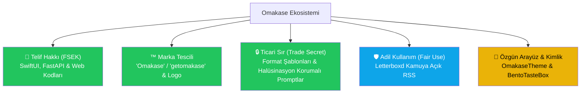

# ⚖️ Omakase — Fikri Mülkiyet, Marka & Hukuki Uyum Raporu

> **Son Güncelleme:** 12 Kasım 2026  
> **Uyarı:** Bu rapor genel bilgilendirme ve teknik-hukuki risk değerlendirmesi amacıyla hazırlanmıştır; resmi hukuki mütalaa yerine geçmez. Somut adımlardan önce bir fikri mülkiyet ve bilişim avukatına danışılması önerilir.

---

## İçindekiler

1. [Özet Değerlendirme](#1-özet-değerlendirme)
2. [Fikri Mülkiyet Koruma Türleri Haritası](#2-fikri-mülkiyet-koruma-türleri-haritası)
3. [Letterboxd & Üçüncü Taraf Platform Entegrasyonları](#3-letterboxd--üçüncü-taraf-platform-entegrasyonları)
4. [Apple Marka Kuralları ve Web Varlıkları (`web/`)](#4-apple-marka-kuralları-ve-web-varlıkları-web)
5. [Prompt Mühendisliği & Ticari Sır (Trade Secret)](#5-prompt-mühendisliği--ticari-sır)
6. [Kaynak Kodu Telif Hakları (iOS, Backend & Web)](#6-kaynak-kodu-telif-hakları-ios-backend--web)
7. [Marka Tescili — "Omakase" & `getomakase`](#7-marka-tescili--omakase--getomakase)
8. [AI Tarafından Üretilen İçeriğin ve Topluluk (UGC) Verilerinin Hukuki Durumu](#8-ai-tarafından-üretilen-içeriğin-ve-topluluk-ugc-verilerinin-hukuki-durumu)
9. [Uluslararası Koruma & Aksiyon Planı](#9-uluslararası-koruma--aksiyon-planı)

---

## 1. Özet Değerlendirme

Omakase ekosisteminin temel fikri mülkiyet değerleri dört ayaktan oluşur:
1. **İçerik Üretim Motoru (`backend/main.py`):** Kullanıcının 12 kültür kategorisindeki tercihlerini, özel konu başlıklarını ve Letterboxd izleme günlüğünü doğrulanmış mikro-hikayelere dönüştüren sunucu taraflı prompt mimarisi.
2. **Kullanıcı Deneyimi (`omakase/`):** Reels tarzı dikey sayfalama, monokrom kağıt/mürekkep estetiği (`OmakaseTheme`), 12 kategorili & 6'lı alt konulu `BentoTasteBox`, Deep Dive bottom sheet modalı ve 3 adımlı `@username` kayıt akışı.
3. **Web Platformu & İnteraktif Simülatör (`web/`):** `getomakase.app` üzerinde çalışan çift dilli (`TR`/`EN`) canlı tadım simülatörü ve marka kimliği.
4. **Akıllı İletim & Tempo:** Server-Sent Events (SSE) ile gerçek zamanlı akış ve kelime bazlı okuma süresi (reading cooldown) algoritması.

| Varlık | Koruma Türü | Durum & Uygulama |
|--------|-------------|------------------|
| **"Omakase" / "getomakase" İsmi & Logosu** | Marka Tescili | TÜRKPATENT Sınıf 9 & Sınıf 42 başvurusu + alan adı koruması |
| **SwiftUI, FastAPI & Web Kaynak Kodları** | Telif Hakkı (FSEK) | Kod yazıldığı anda otomatik doğar (Git zaman damgalı) |
| **Prompt Mimarisi & Format Şablonları** | Ticari Sır (Trade Secret) | Cloud Run sunucu ortamında gizli tutularak korunur |
| **Monokrom Bento & Okuma Arayüzü** | Tasarım / Telif | Özgün UI bileşenleri (`OmakaseTheme`, `BentoTasteBox`) |
| **Letterboxd Entegrasyonu** | Adil Kullanım (Fair Use) | Kamuya açık RSS tabanlı, logo taklit etmeyen dönüştürücü model |

---

## 2. Fikri Mülkiyet Koruma Türleri Haritası

---

## 3. Letterboxd & Üçüncü Taraf Platform Entegrasyonları

Omakase, kullanıcının son izlediği filmleri Letterboxd günlüğünden çekerek doğrulanmış kamera arkası anekdotları üretir (`LetterboxdService.swift` ve `backend/main.py`). Bu entegrasyonun fikri mülkiyet ve App Store Kural 5.2.1–5.2.3 (`third-party-content-licensing`) analizi şu şekildedir:

### A. Marka ve Görsel Kimlik Ayrımı
* Arayüzde Letterboxd Limited şirketine ait tescilli üç renkli daire logosu kullanılmamaktadır.
* Yalnızca hizmetin kaynağını dürüstçe belirtmek üzere *"Belirtici Adil Kullanım"* (Nominative Fair Use) çerçevesinde kullanıcı profilinde (`MyProfileSheet`) ve rozetlerde metin olarak "Letterboxd" ibaresine yer verilmiştir.

### B. Kamuya Açık RSS Feed Kullanımının Hukuki Niteliği
1. **Şifresiz ve Kamuya Açık Veri:** Omakase, özel API anahtarlarını kırmaz veya kullanıcı parolası istemez; kullanıcının kamuya açık web RSS beslemesini (`letterboxd.com/{username}/rss/`) kullanıcının kendi talebiyle okur.
2. **Yeniden Dağıtım Yapılmaması (No Reselling):** Çekilen film adları ve izleme tarihleri satılmaz veya üçüncü şahıslara dağıtılmaz; yalnızca anlık içerik üretimi için Gemini modeline bağlam olarak verilir.
3. **Dönüştürücü Kullanım (Transformative Use):** Omakase, Letterboxd üzerindeki kullanıcı incelemelerini kopyalamaz; film başlığından yola çıkarak tamamen özgün bir sinema tarihi/prodüksiyon anekdotu sentezler.

---

## 4. Apple Marka Kuralları ve Web Varlıkları (`web/`)

* **Dayanak:** `knowledge.app-store-review-guidelines.apple-trademarks-and-product-confusion` (Guideline 5.2.4 & 5.2.5)
* Apple ürün adları ("iOS 17+", "iPhone", "TestFlight", "App Store") ve Apple logosu (`web/assets/apple-logo.png`) kullanılırken Apple'ın resmi oranları korunan, deforme edilmemiş ikon varlığı kullanılmıştır (`fix(web): replace deformed inline SVG Apple icon with crisp PNG asset`).
* Uygulama veya web sitesi Apple tarafından üretilmiş veya onaylanmış izlenimi vermemekte, yalnızca platform uyumluluğunu belirtmektedir.

---

## 5. Prompt Mühendisliği & Ticari Sır (Trade Secret)

Omakase'nin ürettiği içeriklerin kalitesi, [`backend/main.py`](file:///Users/kuzey/projects/omakase/backend/main.py) içerisindeki sistem yönergelerine ve format şablonlarına dayanır:
- **Özel Formatlar:** `DEBATE`, `TIMELINE`, `VERSUS`, `LETTERBOXD DIARY`, `MYTHBUSTER`, `IF YOU LIKE X TRY Y`, `ANECDOTE`.
- **Halüsinasyon Önleyici Çerçeve:** Doğrulanmamış anekdot uydurulmasını yasaklayan ve birincil kaynaklara/sinematografi zanaatına odaklanan kurallar.

### Koruma Yöntemi
Prompt metinleri **Ticari Sır (Trade Secret)** kapsamında korunur:
1. Backend kodu Google Cloud Run üzerinde sunucu tarafında çalışır; sistem promptları iOS istemcisine (`omakase.ipa`) veya web istemcisine (`web/app.js`) gönderilmez.
2. Tersine mühendislikle (reverse engineering) uygulama paketi çözülse dahi prompt mimarisi ve `GEMINI_API_KEY` ele geçirilemez.

---

## 6. Kaynak Kodu Telif Hakları (iOS, Backend & Web)

* 5846 sayılı Fikir ve Sanat Eserleri Kanunu (FSEK) ve uluslararası Bern Sözleşmesi uyarınca; `omakase/` (SwiftUI), `backend/` (Python FastAPI) ve `web/` (HTML/CSS/JS) kaynak kodları yazıldığı andan itibaren eser sahibi lehine otomatik telif koruması altındadır.
* GitHub özel deposundaki commit geçmişi ve zaman damgaları sahiplik ispatı için kesin delil niteliği taşır.

---

## 7. Marka Tescili — "Omakase" & `getomakase`

"Omakase", Japonca *"şefe bırakmak / şefin seçimi"* anlamına gelen bir mutfak terimi olmakla birlikte, yapay zeka destekli kültür ve bilgi akışı yazılımı alanında **ayırt edici / metaforik marka** niteliği taşır.

* **Tescil Edilecek Sınıflar (Nice Sınıflandırması):**
  - **Sınıf 09:** İndirilebilir mobil uygulamalar, yapay zeka tabanlı bilgi ve sosyal ağ yazılımları.
  - **Sınıf 42:** Bulut tabanlı yazılım hizmetleri (SaaS), yapay zeka içerik üretim ve kürasyon platformu hizmetleri.

---

## 8. AI Tarafından Üretilen İçeriğin ve Topluluk (UGC) Verilerinin Hukuki Durumu

1. **AI İçerikleri ve Sorumluluk Sınırı:**
   Kullanım Koşulları (EULA) metninde; *"Omakase'de yapay zeka tarafından üretilen mikro-hikayeler genel kültür, eğitim ve ilham amaçlıdır; tıbbi, hukuki veya finansal tavsiye niteliği taşımaz"* ibaresi yer almalıdır.
2. **Topluluk (UGC) ve `@username` Moderasyonu (Guideline 1.2 & 5651 Sayılı Kanun):**
   Kullanıcılar kendi `@kullanıcı_adı` profilleriyle gönderi paylaşabildiği ve yorum yazabildiği için, Kullanım Koşulları (EULA) içinde **sakıncalı içeriklere ve kötüye kullanıma sıfır tolerans politikası** açıkça belirtilmeli; şikayet edilen içeriklerin kaldırılması ve kural ihlali yapan hesapların engellenmesi/silinmesi hakkı saklı tutulmalıdır.
3. **Kişisel Verilerin Korunması (KVKK & GDPR & Apple Guideline 5.1.1):**
   Toplanan e-posta adresi, görünür isim, `@kullanıcı_adı` ve kullanıcı tercihlerinin yalnızca uygulama işlevselliği (`App Functionality`) amacıyla işlendiği, reklam takibi yapılmadığı ve kullanıcının uygulama içinden hesabını kalıcı olarak silebileceği Gizlilik Politikasında beyan edilmelidir.

---

## 9. Uluslararası Koruma & Aksiyon Planı

1. **Yasal Web Sayfaları (`getomakase.app/privacy` & `/terms`):** App Store incelemesine göndermeden önce Gizlilik Politikası ve Kullanım Koşulları (EULA) web üzerinde yayına alınmalı ve uygulama içi `MyProfileSheet` ekranına bağlanmalıdır.
2. **Marka Başvurusu:** TÜRKPATENT nezdinde "Omakase" ibaresi ve özel uygulama logosu (`assets/logo.svg`) ile Sınıf 09 ve 42 başvurusu tamamlanmalıdır.
