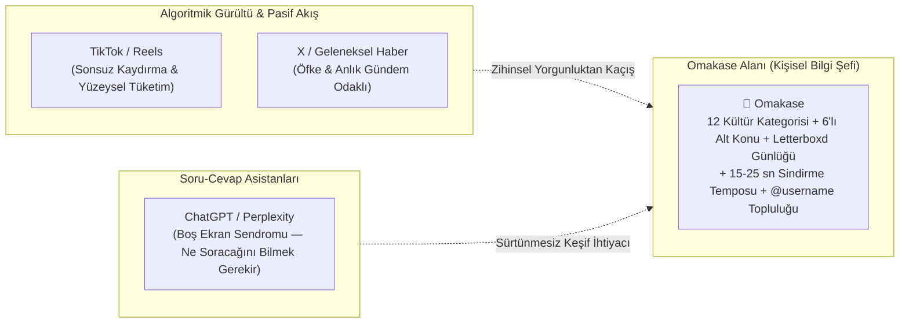

# 🔮 Omakase — Gelecek Stratejisi, Büyüme & Vizyon Raporu

> **Son Güncelleme:** 12 Kasım 2026  
> **Kapsam:** Pazar konumlandırması, rekabet analizi, kültürel veri savunma hattı (Moat), topluluk ağ etkisi, web edinim hunisi (`getomakase.app`) ve uzun vadeli ürün vizyonu.

---

## İçindekiler

1. [Pazar Haritası & Konumlandırma](#1-pazar-haritası--konumlandırma)
2. [Omakase'nin Savunma Hattı (Moat Analizi)](#2-omakasenin-savunma-hattı-moat-analizi)
3. [Doyum Psikolojisi & Okuma Süresi (Doomscrolling Karşıtı Model)](#3-doyum-psikolojisi--okuma-süresi)
4. [Kültürel Entegrasyonlar Yol Haritası (Letterboxd, Spotify, Goodreads)](#4-kültürel-entegrasyonlar-yol-haritası)
5. [Kullanıcı Büyüme (Growth) & Web Edinim Hunisi](#5-kullanıcı-büyüme-growth--web-edinim-hunisi)
6. [Teknik Mimari & Vendor Risk Yönetimi](#6-teknik-mimari--vendor-risk-yönetimi)
7. [Uzun Vadeli Vizyon (2026 - 2028)](#7-uzun-vadeli-vizyon-2026---2028)

---

## 1. Pazar Haritası & Konumlandırma



### Özgün Değer Önerisi (Unique Value Proposition)
> **"Algoritmaların gürültüsünden uzak, zihinsel damak tadınıza özel derinlikli kültür akışı."**

Omakase kendini bir *"AI haber özetleyici"* veya *"sohbet botu"* olarak değil, kullanıcının entelektüel merakını besleyen bir **"Kişisel Bilgi Şefi"** olarak konumlandırır:
* **Haber değil, zamansız merak ve kültür:** Gündemin yıpratıcı hızından uzak; Sinema, Bilim, Felsefe, Sanat, Teknoloji, Tarih, Müzik, Edebiyat, Psikoloji, Mimari, Gastronomi ve Uzay odaklı 12 temel disiplin.
* **Algoritma tahmini değil, bilinçli irade:** Kullanıcı ne tüketmek istediğini 12 kategori, anlık üretilen 6'lı alt konu karosu veya kendi yazdığı özel konu başlığıyla doğrudan seçer.
* **Mürekkep ve kağıt sadeliği (`OmakaseTheme`):** Reklamsız, dikkat dağıtmayan monokrom tipografi ve editoryal okuma deneyimi.

---

## 2. Omakase'nin Savunma Hattı (Moat Analizi)

Basit bir LLM arayüzü kolayca kopyalanabilir. Omakase'yi taklit edilemez kılan beşli koruma hattı:

| Savunma Katmanı | Nasıl Çalışır? | Rakiplerin Taklit Zorluğu |
|-----------------|----------------|---------------------------|
| **1. Kültürel Veri Bağlantısı (Diary Moat)** | Kullanıcının Letterboxd günlüğündeki son 50 filmi canlı girdi olarak kullanılır ve doğrulanmış kamera arkası anekdotlarına dönüştürülür. | Kullanıcı her açtığında kendi izleme geçmişine özel post görür; bu veri Omakase dışında hiçbir sosyal mecrada bu formatta işlenmez. |
| **2. Sürtünmesiz Bento Keşif Motoru (`BentoTasteBox`)** | 12 kategori kapsülü, her kategoride korunan 6'lı kompakt alt konu ızgarası, isteğe bağlı yenileme ve özel konu girişi. | Sohbet botlarındaki "ne soracağım?" sürtünmesini sıfırlar; tek dokunuşla derinlikli mikro-hikaye başlatır. |
| **3. Doyum & Cooldown Motoru** | Metin uzunluğuna göre 15–25 saniye akıllı okuma süresi ve canlı kum saati sayacı uygular. | Hızlı kaydırma (doomscrolling) alışkanlığını kırar, metni gerçekten okutup sindirten bir ritüel yaratır. |
| **4. Deep Dive Bottom Sheet Mimarisi** | Okurun ilgisini çeken bir gönderide tek dokunuşla açılan modal pencerede konunun birincil kaynaklarına ve teknik detaylarına inilir. | Yüzeysel özet ile akademik derinlik arasındaki geçişi tek ekranda pürüzsüzce çözer. |
| **5. `@username` Tabanlı Entelektüel Topluluk** | 3 adımlı kayıtla alınan `@kullanıcı_adı`, gönderi/kişi arama barı, 5'li reaksiyon sistemi (`🔥, 🧠, ❤️, 👏, 🤯`) ve yorumlar. | Kullanıcıların kendi kürasyonlarını paylaştığı yüksek sinyal-gürültü oranına sahip bir kültür ağı oluşturur. |

---

## 3. Doyum Psikolojisi & Okuma Süresi

Sosyal medya uygulamalarının en büyük problemi **"Doomscrolling" (tüketim yorgunluğu)** döngüsüdür. Kullanıcılar metinleri okumadan saniyede bir kaydırır ve birkaç dakika sonra zihinsel yorgunlukla uygulamadan çıkar.

Omakase bu döngüyü bilinçli olarak tersine çevirir:
1. Bir post tamamlandığında kelime sayısına göre **15–25 saniyelik okuma süresi (reading cooldown)** başlar.
2. Bu süre boyunca yeni post üretimi ve kategori seçimleri kilitlenir; ekranın altında animasyonlu bir kum saati geri sayım yapar.
3. Kullanıcı bilgiyi gerçekten okur, dilerse **Deep Dive** ile derinleşir veya **Topluluk** sekmesinde paylaşır.
4. **Sonuç:** Oturum kalitesi yükselir, sunucu/token maliyeti doğal bir hız sınırlayıcıyla (rate-limiter) korunur ve kullanıcıda *"zamanımı değerli bir şey öğrenerek geçirdim"* doyumu oluşur.

---

## 4. Kültürel Entegrasyonlar Yol Haritası

Letterboxd entegrasyonunun kanıtladığı model, kullanıcının diğer kültürel izleriyle genişletilecektir:

```
┌─────────────────────────────────────────────────────────────┐
│                    Kültürel Veri Entegrasyonları            │
├───────────────────┬───────────────────┬─────────────────────┤
│ 🎬 LETTERBOXD     │ 🎵 SPOTIFY        │ 📚 GOODREADS        │
│ (Tamamlandı ✅)    │ (v2.0 Hedefi)     │ (v2.5 Hedefi)       │
│ - Son 50 film     │ - Son çalınan     │ - Son okunan kitap  │
│ - Kamera arkası   │ - Albüm yapım     │ - Felsefi analiz &  │
│   doğrulanmış     │   anekdotları     │   yazarın arka plan │
│   anekdotlar      │ - Sample hikayesi │   hikayesi          │
└───────────────────┴───────────────────┴─────────────────────┘
```

---

## 5. Kullanıcı Büyüme (Growth) & Web Edinim Hunisi

### A. İnteraktif Web Deneyimi (`web/` — `getomakase.app`)
* Statik ekran görüntüleri yerine, ziyaretçilerin web tarayıcısında doğrudan **Canlı Tadım (Interactive Demo)** yapabildiği, kategori seçip SSE daktilo akışını ve Deep Dive modalını deneyimleyebildiği bir web vitrini ([`web/index.html`](file:///Users/kuzey/projects/omakase/web/index.html)) yayındadır.
* Web sitesi hem Türkçe hem İngilizce (`TR`/`EN`) ve Açık/Koyu tema desteğiyle küresel kullanıcı edinimine ve TestFlight bekleme listesi dönüşümüne hazırdır.

### B. Mikro-Viralite & Topluluk Kürasyonu
* Omakase'nin monokrom kağıt/mürekkep kart tasarımı ve çarpıcı başlıkları doğrudan ekran görüntüsü alınıp Instagram Story veya X'te paylaşılmaya uygundur.
* Uygulama içi **Topluluk** sekmesindeki `@kullanıcı_adı` profilleri ve arama çubuğu, kullanıcıların birbirlerinin "zihinsel damak tadını" takip etmesini sağlar.

---

## 6. Teknik Mimari & Vendor Risk Yönetimi

* **Google Cloud Run + Firebase + Cloudflare:**
  - Arka uç (`backend/main.py`) Google Cloud Run üzerinde sunucusuz (serverless) olarak ölçeklenir.
  - Kimlik doğrulama ve gerçek zamanlı topluluk veritabanı Firebase Auth & Cloud Firestore üzerinde çalışır.
  - Web ön yüzü (`web/`) Cloudflare (`wrangler.json`) ve Firebase Hosting (`firebase.json`) ile çift yedekli dağıtılır.
* **Model Çeşitliliği:** Ana içerik üretiminde `gemini-3.5-flash`, hızlı alt konu türetiminde `gemini-3.1-flash-lite` kullanılmaktadır. `google-genai` katmanı sayesinde model güncellemeleri istemciye yeni sürüm çıkmadan sunucu tarafında anında yapılabilir.

---

## 7. Uzun Vadeli Vizyon (2026 - 2028)

Omakase'nin nihai hedefi; kullanıcının tüm kültürel tüketimini (izlediği filmler, dinlediği albümler, okuduğu kitaplar ve merak ettiği disiplinler) tek bir zarif arayüzde birleştiren, algoritmik gürültü yerine entelektüel berraklık sunan birincil günlük okuma ritüeli olmaktır.
