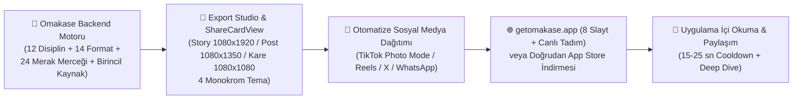
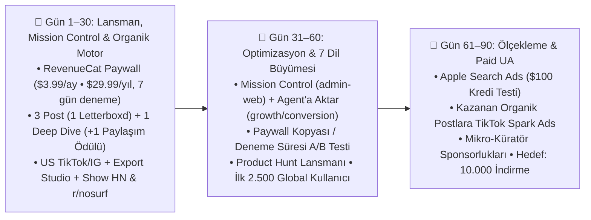

# 🚀 Omakase — Küresel Pazarlama (Global Marketing), Viral Otomasyon & Dağıtım (Distribution) Stratejisi

> **Son Güncelleme:** 26 Kasım 2026  
> **Odak:** LLM Sonrası Dönemde Dağıtım (Distribution), Tier-1 Küresel Pazarlara (ABD/İngiltere/Avrupa + 7 Dil Havuzu) Açılım, Otomatize TikTok/Reels/Shorts Büyüme Motoru, Export Studio Viral Döngüsü, Ücretli Reklam (Paid UA) Matematiği ve Mission Control Ölçüm Altyapısı  
> **Ürün Konumlandırması Notu:** Bu stratejide Omakase'nin ana omurgası **12 kültür disiplini, 14 editoryal mikro-hikaye formatı, 24 merak merceğiyle çalışan Bento keşif matrisi, zorunlu birincil kaynakça (`PostSourceView`) ve 15–25 saniyelik anti-doomscrolling okuma ritüelidir.** Letterboxd entegrasyonu ana ürün kimliği değil, sinema kategorisini zenginleştiren yüksek dönüşümlü bir yan özellik (ücretsiz günde 1 post, Pro'da sınırsız) olarak konumlandırılmıştır.

---

## İçindekiler

1. [2026 Gerçeği: "Kod Ucuzladı, Asıl Savaş Distribution" & Omakase'nin Avantajı](#1-2026-gerçeği-kod-ucuzladı-asıl-savaş-distribution--omakasenin-avantajı)
2. [Küresel Konumlandırma: Tier-1 Pazarlar & 7 Dil Avantajı](#2-küresel-konumlandırma-tier-1-pazarlar--7-dil-avantajı)
3. [Otomatize TikTok, Reels & Shorts Viral İçerik Motoru (Adım Adım Mimari)](#3-otomatize-tiktok-reels--shorts-viral-içerik-motoru-adım-adım-mimari)
4. [Reklam Vermeli Miyim? Paid UA Matematiği, Paywall Kurgusu ve Bütçe Stratejisi](#4-reklam-vermeli-miyim-paid-ua-matematiği-paywall-kurgusu-ve-bütçe-stratejisi)
5. [Sıfır Bütçeli Küresel Kanallar & Export Studio Viral Döngüsü](#5-sıfır-bütçeli-küresel-kanallar--export-studio-viral-döngüsü)
6. [App Store Küresel Vitrin (ASO) & 8 Slaytlı × 7 Dilli Kurgusu](#6-app-store-küresel-vitrin-aso--8-slaytlı--7-dilli-kurgusu)
7. [90 Günlük İcra Takvimi, Mission Control & KPI Tablosu](#7-90-günlük-icra-takvimi-mission-control--kpi-tablosu)
8. [Apple Agent Kit İzlenebilirlik Özeti](#8-apple-agent-kit-izlenebilirlik-özeti)

---

## 1. 2026 Gerçeği: "Kod Ucuzladı, Asıl Savaş Distribution" & Omakase'nin Avantajı

LLM'ler sayesinde bir iOS uygulamasını ve ölçeklenebilir backend'ini geliştirmek artık aylar değil günler sürüyor. Bu durum App Store'da binlerce birbirine benzeyen "AI Wrapper" (sohbet kutusu veya sıkıcı makale özetleyici) doğurdu. Ancak bu bolluk içinde **dağıtım (distribution)** ve **ürün zevki (taste)** en kıt kaynak haline geldi.

### Omakase Neden Orijinal ve Viral Olmaya Çok Müsait?
Çoğu uygulamanın pazarlama yapmak için ürünün dışına çıkıp yapay reklam videoları üretmesi gerekir. Omakase'nin en büyük stratejik üstünlüğü şudur: **Ürünün ürettiği çıktının kendisi, halihazırda sosyal medyada en çok viral olan içerik formatıdır.**

[`backend/app/prompts.py`](file:///Users/kuzey/projects/omakase/backend/app/prompts.py#L203-L295) içindeki **14 dönüşümlü editoryal format** (`CURSED TRIVIA`, `UNLIKELY CONNECTION`, `MYTHBUSTER`, `BUTTERFLY EFFECT`, `THE THING NOBODY TALKS ABOUT`, `DEBATE`, `TIMELINE`, `SCALE & NUMBERS` vb.), **24 dikey merak merceği** ve zorunlu **birincil kaynakça (`Source:` / `Kaynak:`)**, TikTok, Instagram ve X'te milyonlarca görüntülenme alan "yüksek yoğunluklu merak" formatlarının birebir karşılığıdır:

**Temel Pazarlama Tezi:** Omakase'yi bir *"sohbet botu"* olarak değil; **"Evet chatbotlar öğretici ama senin yazmanı bekliyorlar — Omakase beklemez"** kontrastıyla **"Anti-Brainrot"**, **"Entelektüel Espresso"** ve **"Tek Dokunuşta Kaynaklı Kültür Akışı"** olarak konumlandırmalısın.

---

## 2. Küresel Konumlandırma: Tier-1 Pazarlar & 7 Dil Avantajı

Türkiye pazarı erken test için güçlü bir başlangıç olsa da, iOS abonelik ekonomisinde ARPU açısından asıl ölçek **Tier-1 pazarlardadır** (ABD, İngiltere, Kanada, Avustralya ve Batı Avrupa). Üstelik Omakase artık yalnızca TR/EN değil **7 dilde (`en, tr, ja, de, fr, es, ko`)** tam yerel UI, AI üretimi, push bildirimi ve 8 slaytlı App Store ekran görüntüsü sunmaktadır.

### 2.1. Neden Doğrudan Küresel Pazar?
1. **Aynı Maliyet, Çok Daha Yüksek LTV:** Bir kullanıcının `gemini-3.5-flash` + `gemini-3.1-flash-lite` + Cloud Run maliyeti her ülkede ayda **~\$0.10 – \$0.14** seviyesindedir. ABD/İngiltere/Almanya/Japonya pazarlarında \$3.99/ay veya \$29.99/yıl (*ayda ~\$2.49*) fiyat etiketi yüksek ödeme eğilimine denk gelir.
2. **7 Dilli Küresel Havuz:** İngilizce ana motor olmaya devam ederken, Japonca (`ja`), Korece (`ko`), Almanca (`de`), Fransızca (`fr`) ve İspanyolca (`es`) destekleri ASO arama hacmini ek kod yazmadan katlar; Mission Control (`admin-web/`) içindeki **Dil Dağılımı (7 Dil)** kartı hangi dilin en yüksek organik çekişi getirdiğini canlı gösterir.
3. **Kültürel Trend Uyumu:** Z ve Y kuşağı arasında **"Digital Minimalism"**, **"Anti-Doomscrolling"**, **"Stop Brainrot"** ve **"Micro-Learning"** akımları zirvededir. 15–25 saniyelik okuma molası (`Reading Cooldown`) ve monokrom tasarım bu akımın tam kalbine oturur.

### 2.2. Küresel Hedef Kitle Segmentleri

| Segment | Kimdir? | En Çok Tükettiği Kategoriler | Pazarlama Kancası (Global Hook) |
|---------|---------|------------------------------|---------------------------------|
| **1. "The Anti-Doomscroller" (%50)** | 22–38 yaş; sabah yatakta veya metroda TikTok/X kaydırıp suçluluk duyan ama 30 dakikalık makaleye enerjisi olmayan beyaz yakalı, yazılımcı, tasarımcı. | Psikoloji, Bilim, Felsefe, Tarih, Teknoloji | *"Feed your mind, not the algorithm. 3 sourced micro-stories a day."* |
| **2. "The Polymath / Rabbit-Hole Explorer" (%35)** | Wikipedia'da bir konudan girip 2 saat sonra bambaşka bir konuda çıkan, spesifik anomaliler ve birincil kaynaklar peşindeki meraklılar. | Bilim, Sanat, Yemek, Doğa, Müzik | *"Yes, chatbots teach well — but they wait for you to ask. Omakase does not."* |
| **3. "The Cultural Curator" (%15)** | Okuduğu çarpıcı anekdotu Export Studio kartıyla Instagram Story, WhatsApp veya X'te paylaşmayı seven ve Letterboxd günlüğünü takip eden kitle. | Sinema (Letterboxd), Sanat, Müzik, Seyahat | *"Export any post as a monochrome card. Ready for Instagram, WhatsApp & X."* |

---

## 3. Otomatize TikTok, Reels & Shorts Viral İçerik Motoru (Adım Adım Mimari)

### 3.1. Format Seçimi: %70 TikTok Photo Mode (Carousel) + %30 Daktilo B-Roll
Okuma ve kültür uygulamaları için **TikTok Photo Mode (Carousel)** ve **Instagram Carousel**, klasik AI seslendirmeli videolardan **2.9x daha fazla yorum** ve **2.6x daha fazla paylaşım** alır:
1. **%70 — 3 Karelik "Photo Mode / Carousel":**
   - **Slayt 1 (Hook + Merak Boşluğu):** Monokrom zeminde sarsıcı soru/başlık.
   - **Slayt 2 (Omakase Mikro-Hikayesi + Kaynak):** [`ShareCardView.swift`](file:///Users/kuzey/projects/omakase/omakase/omakase/Feed/ShareCardView.swift) `Post (1080×1350)` formatında 40–90 kelimelik içerik + altında gerçek birincil kaynak satırı (`Source: ...`).
   - **Slayt 3 (Deep Dive Cliffhanger & CTA):** Derin İnceleme'nin ilk cümleleri + *"Caught your interest? Read the full Deep Dive on Omakase (getomakase.app)."*
2. **%30 — 8–12 Saniyelik "Aesthetic B-Roll + Canlı Daktilo":**
   - Minimalist video üzerinde metnin SSE ile akışı, kaynak kapsülüne dokunuş ve 15–25 sn okuma sayacının işleyişi.

### 3.2. Türkiye'den ABD / İngiltere Kitlesine Geo-Targeting
TikTok dağıtımı dil seçimine değil **SIM kart ve ağ ülkesine göre** yapar. İkinci bir iPhone'da Türk SIM kartı çıkarılıp **US eSIM (Tello/Airalo US)** ve `United States` bölge ayarıyla hesap açılmalı; ilk 3 gün ABD merkezli kültür/bilim/tasarım hesaplarıyla etkileşim kurularak hesap ısıtılmalıdır.

### 3.3. Otomasyon Boru Hattı (%95 Otomasyon + %5 Manuel Yayın)
* Python betiği her sabah `prompts.py` içindeki `CURSED TRIVIA`, `MYTHBUSTER`, `UNLIKELY CONNECTION`, `BUTTERFLY EFFECT` formatlarıyla İngilizce (ve diğer dillerde) kaynakçalı post üretip `1080×1350` / `1080×1920` monokrom kartlara basar.
* Paylaşım ise trend ambient/lo-fi ses ekleyebilmek ve API erişim kısıtına takılmamak için telefondan TikTok Taslakları (Drafts) üzerinden günde 2 dakikada elle yayınlanır.

### 3.4. Çoklu Niş Hesap Stratejisi
* `@dailyomakase`: Tüm 12 disiplinden günün en vurucu 3 kaynaklı postu.
* `@cursed.archives`: `CURSED TRIVIA` & `MYTHBUSTER` odaklı tarihsel/bilimsel anomaliler.
* `@antibrainrot.club`: Nörobilim/psikoloji + 20 sn okuma ritüeli konsepti.

---

## 4. Reklam Vermeli Miyim? Paid UA Matematiği, Paywall Kurgusu ve Bütçe Stratejisi

### 4.1. Kısa Cevap: İlk 6 Hafta Soğuk Kitleye Reklam Yok
ABD/İngiltere'de Eğitim/Kültür kategorisinde CPI ortalama **\$2.50 – \$5.00** arasındadır. Önce organik içerikle hangi kancanın ve kategorinin 50.000+ izlendiği kanıtlanmalıdır.

### 4.2. Lansman (v1.0) İle Aktif Paywall Matematiği
Uygulama ilk günden tam abonelik ve cihaz-bazlı anti-abuse korumasıyla çıkar:
1. **Tek Ekranlı ASCII Suşi Paywall & 5 Tetikleyici:**
   - `firstPlateSoft` (ilk okuma sonrası tek seferlik yumuşak teklif), `plateLimit` (**günde 3 post** sınırı), `letterboxdLimit` (**günde 1 Letterboxd** sınırı), `deepDiveLimit` (**günde 1 Derin İnceleme** + paylaşımda `+1` ödül) ve `profile`.
   - Hesap değiştirme/silme ile 3 post sınırının aşılmasını önleyen Keychain + SHA-256 `device_usage` koruması sayesinde her ücretsiz kullanıcı gerçekçi dönüşüm hunisine girer.
2. **Fiyat Çapası (Pricing Anchor):**
   - Aylık: **\$3.99 / ay**
   - Yıllık: **\$29.99 / yıl** (*"7 Gün Ücretsiz Dene — Ayda sadece ~\$2.49, %37 avantaj"* — 100 müşteri simülasyonunda `IPP: $2.53` ile tam örtüşen nokta).

### 4.3. Aşamalı Reklam Planı

| Aşama | Bütçe | Kanal | Nasıl Uygulanır? |
|-------|-------|-------|------------------|
| **Faz 1: Organik Kanıt (Hafta 1–6)** | **\$0** | TikTok Photo Mode, IG Reels, Reddit, `getomakase.app` | 30–40 organik post yayınla; Mission Control `Gelir & AI` ve `Agent'a Aktar (growth)` ile hangi dil/konu/paywall kaynağının trial getirdiğini izle. |
| **Faz 2: Apple Search Ads (Hafta 6+)** | **\$10–\$15 / gün** | **Apple Search Ads (US / UK)** | Apple'ın \$100 başlangıç kredisiyle yüksek niyetli kelimelere (`anti doomscrolling`, `daily knowledge`, `micro learning`, `deepstash`, `readwise`, `letterboxd trivia`) çık. |
| **Faz 3: TikTok Spark Ads** | **\$15–\$25 / gün** | **TikTok Spark Ads (US/UK iOS)** | Organik olarak 50.000+ izlenmiş ve yüksek kaydetme/yorum almış TikTok postlarını ABD iOS kullanıcılarına boost et. |
| **Faz 4: Mikro-Küratör Sponsorlukları** | **\$50–\$150 / içerik** | Substack & Mikro-TikToker'lar | 15k–50k takipçili felsefe, mimari, sinema ve dijital minimalizm üreticileriyle çalış. |

---

## 5. Sıfır Bütçeli Küresel Kanallar & Export Studio Viral Döngüsü

### 5.1. Reddit, Hacker News (`Show HN`) ve Product Hunt
* **Reddit:** `r/nosurf`, `r/digitalminimalism`, `r/InternetIsBeautiful`, `r/Letterboxd`, `r/TrueFilm`, `r/SideProject`.
* **Hacker News (`Show HN`):** Yenilenmiş [`web/index.html`](file:///Users/kuzey/projects/omakase/web/index.html) üzerindeki **Canlı Tadım** simülatörü ve 8 slaytlı vitrin sayesinde HN okurları indirmeden önce 15 sn içinde ürünü dener.
* **Product Hunt:** *"The anti-brainrot culture feed. Fun-facts in one tap, always with a primary source."*

### 5.2. Ürün İçi Viral Döngü: Export Studio (`ExportPostSheet.swift`)
Önceki stratejide hedeflenen paylaşım kartı altyapısı artık **tam kapsamlı Export Studio** olarak kodda canlıdır ([`ExportPostSheet.swift`](file:///Users/kuzey/projects/omakase/omakase/omakase/Feed/ExportPostSheet.swift), [`ShareCardView.swift`](file:///Users/kuzey/projects/omakase/omakase/omakase/Feed/ShareCardView.swift)):
1. **Hazır 3 Oran × 4 Tema + `getomakase.app`:** Kullanıcı 3D önizleme sahnesinde `Story` (`1080×1920`), `Post` (`1080×1350`) veya `Kare` (`1080×1080`) seçip doğrudan **Instagram Stories**, **WhatsApp**, **X**'e gönderir veya `getomakase.app` linkini kopyalar.
2. **Paylaşımda `+1` Derin İnceleme Ödülü (`POST /feed/reward-share`):** Ücretsiz kullanıcı her gün ilk paylaşımında o gün için **+1 ekstra Derin İnceleme** hakkı kazanır (maliyeti sadece ~\$0.0004).
3. *v1.1 İyileştirmesi:* Kart altbilgisine opsiyonel `curated by @username` imzası eklenerek sosyal kanıt daha da güçlendirilebilir.

---

## 6. App Store Küresel Vitrin (ASO) & 8 Slaytlı × 7 Dilli Kurgusu

[`skill.app-store-product-page.foundations`](file:///Users/kuzey/projects/omakase/.agents/skills/app-store-product-page/SKILL.md) kurallarına göre üretilen güncel **8 slayt × 7 dil** (`en, tr, ja, de, fr, es, ko`) vitrini ([`app-store-screenshots.json`](file:///Users/kuzey/projects/omakase/app-store-screenshots/app-store-screenshots.json)):

* **İlk 3 Slayt (Arama Sonuçları Vitrini — Letterboxd Bağımsız):**
  1. `01`: *feed your mind, not the algorithm.* (Hero + Monokrom Akış)
  2. `02`: *fun-facts in one tap. written live by ai. always with its source.* (12 Disiplin Bento)
  3. `03`: *yes, ai chatbots teach well, but they wait for you to ask. omakase does not.* (Alt Konular)
* **4–8. Slaytlar (Derinlik, Ritüel, Topluluk & Araçlar):**
  4. `04`: *caught your interest? dive deeper.* (Derin İnceleme)
  5. `05`: *a brief pause to read. so every bite sinks in.* (Okuma Molası + Büyüteç)
  6. `06`: *share the cultural bites you loved with friends. taste what others discovered too.* (Topluluk)
  7. `07`: *connect your letterboxd. fun-facts from your last 50 watched films.* (Letterboxd)
  8. `08`: *export any post as a monochrome card. ready for instagram, whatsapp & x.* (Export Studio)

### Küresel ASO Anahtar Kelime Hedeflemesi (US / UK)
* **Başlık (30 krk):** `Omakase: Daily Culture & Facts`
* **Alt Başlık (30 krk):** `Sourced Micro-Stories & Essays`
* **Anahtar Kelimeler:** `microlearning,daily facts,philosophy,history,science,architecture,anti doomscrolling,brainrot,readwise,deepstash,curiosity,trivia,letterboxd,essays`

---

## 7. 90 Günlük İcra Takvimi, Mission Control & KPI Tablosu

| Dönem | Temel Aksiyonlar | Başarı Metriği (KPI) | Bütçe |
|-------|------------------|----------------------|-------|
| **Ay 1 (Lansman & Organik Motor)** | v1.0 App Store lansmanı (7 dil, 8 slayt); **3 post/gün (1 Letterboxd)** + `+1` Deep Dive paylaşım ödülü; `device_usage` koruması; Mission Control + `ADMIN_ALERT_WEBHOOK_URL` ile günlük geri bildirim & dönüşüm takibi; US TikTok/IG, `r/nosurf`, `Show HN`. | 50.000+ organik gösterim, `getomakase.app` üzerinde 2.000+ Canlı Tadım, ilk 500–1.000 iOS kullanıcısı, `source_tap_rate` ≥ %10, Trial Başlatma ≥ %6. | **\$0** (Sadece ~\$10 US eSIM) |
| **Ay 2 (Dönüşüm & Viral Döngü)** | Mission Control `Agent'a Aktar (conversion & growth)` brifingleriyle 7 dilde en yüksek dönüşen kanallara odaklanma; Export Studio kartlarına `@username` imzası (v1.1); Product Hunt lansmanı. | D7 Retention ≥ %25, Trial → Ücretli Dönüşüm ≥ %35, 2.500–4.000 toplam kullanıcı. | **\$0** |
| **Ay 3 (Kaldıraçlı Reklam & Ölçek)** | Apple Search Ads US/UK testi; 50k+ izlenen organik TikTok postlarına \$15/gün Spark Ads; 3 mikro-küratör sponsorluğu. | CAC < \$18, Yıllık Net LTV ≈ \$25.50, 10.000+ kullanıcı ve pozitif nakit akışı. | **\$300 – \$600** |

---

## 8. Apple Agent Kit İzlenebilirlik Özeti

`.agents/AGENTS.md` kuralları gereğince bu raporun App Store küresel vitrin (Bölüm 6) kurgusunda kullanılan yönlendirme zinciri:

1. **Seçilen Workflow:** Yok (Görev tek bir ürün sayfası yetenek alanına eşleşti).
2. **Seçilen Skill:** [`skill.app-store-product-page.foundations`](file:///Users/kuzey/projects/omakase/.agents/skills/app-store-product-page/SKILL.md)
3. **Yüklenen Knowledge Contracts:** [`header-and-search-result-messaging.md`](file:///Users/kuzey/projects/omakase/.agents/knowledge/app-store-product-page/header-and-search-result-messaging.md) ve [`asset-sequencing-and-story.md`](file:///Users/kuzey/projects/omakase/.agents/knowledge/app-store-product-page/asset-sequencing-and-story.md).
