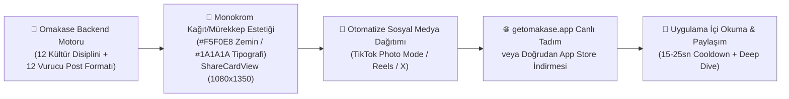
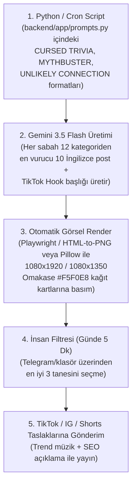
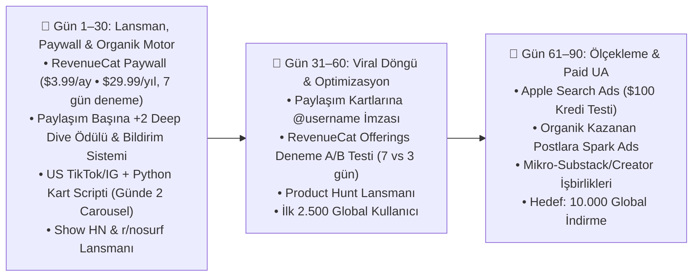

# 🚀 Omakase — Küresel Pazarlama (Global Marketing), Viral Otomasyon & Dağıtım (Distribution) Stratejisi

> **Son Güncelleme:** 15 Kasım 2026  
> **Odak:** LLM Sonrası Dönemde Dağıtım (Distribution), Tier-1 Küresel Pazarlara (ABD/İngiltere/Avrupa) Açılım, Otomatize TikTok/Reels/Shorts Büyüme Motoru, Ücretli Reklam (Paid UA) Matematiği ve Ürün İçi Viral Döngüler  
> **Ürün Konumlandırması Notu:** Bu stratejide Omakase'nin ana omurgası **12 kültür disiplini, 12 editoryal mikro-hikaye formatı, boş ekran sendromunu çözen Bento keşif matrisi ve 15–25 saniyelik anti-doomscrolling okuma ritüelidir.** Letterboxd entegrasyonu ana ürün kimliği değil, sinema kategorisini zenginleştiren opsiyonel bir yan özellik (side-feature / Easter egg) olarak konumlandırılmıştır.

---

## İçindekiler

1. [2026 Gerçeği: "Kod Ucuzladı, Asıl Savaş Distribution" & Omakase'nin Avantajı](#1-2026-gerçeği-kod-ucuzladı-asıl-savaş-distribution--omakasenin-avantajı)
2. [Küresel Konumlandırma: Türkiye'den Tier-1 Pazarlara (US / UK / EU) Açılım](#2-küresel-konumlandırma-türkiyeden-tier-1-pazarlara-us--uk--eu-açılım)
3. [Otomatize TikTok, Reels & Shorts Viral İçerik Motoru (Adım Adım Mimari)](#3-otomatize-tiktok-reels--shorts-viral-içerik-motoru-adım-adım-mimari)
4. [Reklam Vermeli Miyim? Paid UA Matematiği, Paywall Kurgusu ve Bütçe Stratejisi](#4-reklam-vermeli-miyim-paid-ua-matematiği-paywall-kurgusu-ve-bütçe-stratejisi)
5. [Sıfır Bütçeli Küresel Topluluk & Lansman Kanalları (Reddit, HN, X, Product Hunt)](#5-sıfır-bütçeli-küresel-topluluk--lansman-kanalları-reddit-hn-x-product-hunt)
6. [App Store Küresel Vitrin (ASO) & İlk 3 Kare Kurgusu (Letterboxd Bağımsız)](#6-app-store-küresel-vitrin-aso--ilk-3-kare-kurgusu-letterboxd-bağımsız)
7. [90 Günlük İcra Takvimi & KPI Tablosu](#7-90-günlük-icra-takvimi--kpi-tablosu)
8. [Apple Agent Kit İzlenebilirlik Özeti](#8-apple-agent-kit-izlenebilirlik-özeti)

---

## 1. 2026 Gerçeği: "Kod Ucuzladı, Asıl Savaş Distribution" & Omakase'nin Avantajı

LLM'ler sayesinde bir iOS uygulamasını ve ölçeklenebilir backend'ini geliştirmek artık aylar değil günler sürüyor. Bu durum App Store'da binlerce birbirine benzeyen "AI Wrapper" (sohbet kutusu veya sıkıcı makale özetleyici) doğurdu. Ancak bu bolluk içinde **dağıtım (distribution)** ve **ürün zevki (taste)** en kıt kaynak haline geldi.

### Omakase Neden Orijinal ve Viral Olmaya Çok Müsait?
Çoğu uygulamanın pazarlama yapmak için ürünün dışına çıkıp yapay reklam videoları üretmesi gerekir. Omakase'nin en büyük stratejik üstünlüğü şudur: **Ürünün ürettiği çıktının kendisi, halihazırda sosyal medyada en çok viral olan içerik formatıdır.**

[`backend/app/prompts.py`](file:///Users/kuzey/projects/omakase/backend/app/prompts.py#L97-L170) içindeki **12 dönüşümlü editoryal format** (`CURSED TRIVIA`, `UNLIKELY CONNECTION`, `MYTHBUSTER`, `REFRAME`, `THE THING NOBODY TALKS ABOUT`, `VERSUS`, `TIMELINE` vb.), TikTok, Instagram ve X'te milyonlarca görüntülenme alan "yüksek yoğunluklu merak" formatlarının birebir karşılığıdır:

**Temel Pazarlama Tezi:** Omakase'yi bir *"yapay zeka uygulaması"* olarak **pazarlamamalısın**. İnsanlar "AI" kelimesinden yoruldu. Omakase'yi **"Anti-Brainrot" (Zihin Çürümesi Karşıtı)** bir hareket, **"Entelektüel Espresso"** ve **"Meraklı Zihinler İçin Algoritmasız Kültür Ritüeli"** olarak pazarlamalısın.

---

## 2. Küresel Konumlandırma: Türkiye'den Tier-1 Pazarlara (US / UK / EU) Açılım

Türkiye pazarı erken test için harika olsa da, iOS abonelik ekonomisinde gelir (ARPU) ve ödeme alışkanlığı açısından asıl ölçek **Tier-1 İngilizce konuşan pazarlardadır** (ABD, İngiltere, Kanada, Avustralya ve Kuzey/Batı Avrupa).

### 2.1. Neden Doğrudan Küresel Pazar?
1. **Aynı Maliyet, 8x Gelir Potansiyeli:** Bir kullanıcının Gemini 3.5 Flash + Cloud Run maliyeti Türkiye'de de ABD'de de ayda **~\$0.10 – \$0.14** seviyesindedir. Ancak ABD/İngiltere'de \$3.99/ay veya \$29.99/yıl fiyat etiketi "bir kahveden ucuz" (impulse buy) kategorisindedir ve ücretli dönüşüm oranı (Free-to-Paid CVR) Türkiye'ye kıyasla **4 ila 7 kat** daha yüksektir.
2. **İngilizce İçerikte Küresel Ölçek:** Türkçe ürettiğin bir TikTok içeriğinin tavanı birkaç milyon kişiyken, İngilizce ürettiğin "Bauhaus mimarisi ile synth müziğin gizli bağlantısı" (`UNLIKELY CONNECTION`) içeriğinin potansiyel kitlesi ABD'den Japonya'ya kadar **1.5 milyar İngilizce tüketen entelektüel kullanıcıdır**.
3. **Kültürel Trend Uyumu:** Şu an ABD ve Avrupa'da Z ve Y kuşağı arasında **"Digital Minimalism"**, **"Anti-Doomscrolling"**, **"Stop Brainrot"** ve **"Micro-Learning"** akımları zirvededir. Omakase'nin 15–25 saniyelik okuma kilidi (`Reading Cooldown`) ve kağıt/mürekkep teması bu akımın tam kalbine oturur.

### 2.2. Küresel Hedef Kitle Segmentleri (Letterboxd Bağımsız Ana Kitle)

| Segment | Kimdir? | En Çok Tükettiği Kategoriler | Pazarlama Kancası (Global Hook) |
|---------|---------|------------------------------|---------------------------------|
| **1. "The Anti-Doomscroller" (Ana Pazar - %50)** | 22–38 yaş; sabah yatakta veya metroda TikTok/X kaydırıp beyninin uyuşmasından suçluluk duyan ama 30 dakikalık makale okuyacak enerjisi olmayan beyaz yakalı, yazılımcı, tasarımcı. | Psikoloji, Bilim, Felsefe, Tarih, Teknoloji | *"Replace 10 minutes of brainrot with 3 verified micro-stories."* |
| **2. "The Polymath / Rabbit-Hole Explorer" (%35)** | Wikipedia'da bir konudan girip 2 saat sonra bambaşka bir konuda çıkan, genel kültür ve derin detay (`NICHES & NUANCE`, `CURSED TRIVIA`) bağımlısı meraklılar. | Mimari, Uzay, Sanat, Gastronomi, Müzik, Edebiyat | *"For people who read Wikipedia at 2 AM, without the endless walls of text."* |
| **3. "The Cultural Curator" (%15)** | Okuduğu çarpıcı anekdotu arkadaş grubunda anlatmayı veya Instagram Story/X'te paylaşarak entelektüel kimliğini yansıtmayı seven kitle (Letterboxd gibi yan özellikler bu kitleye ekstra sürpriz olur). | Sinema, Sanat, Müzik, Edebiyat | *"Your personal culture chef. Curated by your taste, not an engagement algorithm."* |

---

## 3. Otomatize TikTok, Reels & Shorts Viral İçerik Motoru (Adım Adım Mimari)

Sorduğun en kritik soru: *"Otomatize kurup bir TikTok hesabından viral olmaya çalışabilir miyim?"*
**Cevap: Kesinlikle evet — hatta Omakase için en yüksek kaldıraçlı (high-leverage) büyüme kanalı budur.** Ancak 2026 TikTok/Reels algoritmasında "ucuz AI videosu" filtresine takılmamak için doğru formatı ve doğru teknik altyapıyı kurman gerekir.

### 3.1. Kritik Stratejik Seçim: Video mu, "TikTok Photo Mode" (Kaydırmalı Slayt) mı?

Okuma ve kültür uygulamaları için **TikTok Photo Mode (Carousel / Kaydırmalı Görsel)** ve **Instagram Carousel**, klasik AI seslendirmeli videolardan çok daha iyi performans gösterir:
* TikTok verilerine göre Photo Mode gönderileri **2.9x daha fazla yorum** ve **2.6x daha fazla paylaşım** alır; çünkü izleyici metni okumak için ekranda durur (dwell time artar) ve kendi hızında kaydırır.
* Üstelik Omakase'nin estetiği zaten **kağıt üzerine mürekkep (monokrom kart)** olduğu için, kullanıcı TikTok'ta gördüğü slaytın birebir uygulama içinden çıktığını hisseder.

**Önerilen Format Dağılımı:**
1. **%70 — 3 Karelik "Photo Mode / Carousel" (Tam Otomatize Edilebilir):**
   - **Slayt 1 (Hook + Merak Boşluğu):** Monokrom kağıt zeminde büyük, sarsıcı bir başlık veya soru.  
     *Örn:* `"Why medieval architects intentionally built 'whispering galleries' into cathedrals — and how it accidentally birthed modern acoustics."`
   - **Slayt 2 (Omakase Mikro-Hikayesi):** Doğrudan Omakase'nin [`ShareCardView.swift`](file:///Users/kuzey/projects/omakase/omakase/omakase/Feed/ShareCardView.swift) tasarımındaki 40–90 kelimelik net, doğrulanmış içerik.
   - **Slayt 3 (Deep Dive Cliffhanger & Subtle CTA):** Konunun en ilginç ikinci katmanının ilk 2 cümlesi bulanık/kesik görünür; altında: *"Read the 60-second Deep Dive on Omakase (Link in bio — no algorithm, just pure curiosity)."*
2. **%30 — 8–12 Saniyelik "Aesthetic B-Roll + Canlı Daktilo" Videosu:**
   - Arka planda 3 saniyelik karanlık/minimalist bir estetik video (kahve, yağmurlu pencere, kütüphane, müze) -> Üzerinde Omakase ekranında metnin SSE ile harf harf akışı ve alttaki `18s` kum saatinin çalışması.

### 3.2. Türkiye'den ABD / İngiltere Kitlesine TikTok'ta Ulaşmanın Altın Kuralı (Geo-Targeting)
TikTok algoritması içeriği hangi ülkeye göstereceğini **dil seçimine göre değil, SIM kart ve ağ sinyallerine göre** belirler. Türkiye SIM kartı takılı bir telefondan İngilizce içerik yüklersen, TikTok bunu yine %85 Türkiye'deki kullanıcılara gösterir!

**ABD/UK Kitlesine Düşmek İçin Yapman Gereken Kurulum:**
1. Eski/ikinci bir iPhone'u sıfırla, içinden Türk SIM kartını **tamamen çıkar** (veya fiziksel/eSIM olarak ucuz bir **US Tello / US Roaming eSIM** profili yükle).
2. Cihaz dilini `English (US)` ve bölgeyi `United States` yap, konum servislerini kapat.
3. Hesabı açtıktan sonra ilk 3 gün hiç post atmadan ABD merkezli kültür/bilim/tasarım hesaplarını (*Veritasium, Vsauce, Criterion, Architectural Digest, A24, felsefe/tarih carousel hesapları*) izle, yorum yap ve kaydet (Hesap ısıtma / Account Warm-up).

### 3.3. Otomasyon Boru Hattı (Automation Pipeline) Nasıl Kurulur?

Omakase'nin kendi backend'ini kullanarak günde 10 dakikada 5–6 yüksek kaliteli post üreten yarı-otomatik bir sistem kurabilirsin:

**Neden %100 API'den Otomatik Post Atmamalısın?**
* TikTok ve Instagram, üçüncü parti otomasyon API'lerinden (Make/Zapier direct publish) atılan gönderilerde **ticari ses/trend müzik kullanmana izin vermez** ve erişimi (reach) ciddi oranda kısar.
* En yüksek viraliteyi yakalayan yöntem: **Üretimi ve görsel tasarımını %100 otomatize et** (Python scripti her sabah sana hazır 3'lü PNG slayt setlerini ve kopyalanacak açıklamayı üretsin), ama paylaşımı **telefondan TikTok taslaklarına (Drafts) atıp o günün yükselen ambient/lo-fi sesini ekleyerek elle (günde 2 dakika) yayınla.**

### 3.4. Çoklu Hesap (Multi-Account / Faceless Network) Stratejisi
Tek bir "Omakase Resmi Hesabı" yerine **konsept/niş hesaplar** açmak viral olma ihtimalini 3'e katlar:
* **Hesap 1 (`@omakase.app` veya `@dailyomakase`):** Tüm 12 disiplinden "Günün 3 Entelektüel Tabağı" (Genel kültür, bilim, felsefe, mimari).
* **Hesap 2 (`@cursed.archives` veya `@obscure.history`):** Sadece Omakase'nin `CURSED TRIVIA` ve `MYTHBUSTER` formatlarıyla üretilen tuhaf tarihsel/bilimsel gerçekler.
* **Hesap 3 (`@antibrainrot.club`):** Doomscrolling karşıtı psikoloji/nörobilim gerçekleri ve "Telefonunu kapatmadan önce bugün gerçekten bir şey öğren" konsepti.

---

## 4. Reklam Vermeli Miyim? Paid UA Matematiği, Paywall Kurgusu ve Bütçe Stratejisi

Sorduğun ikinci kritik soru: *"Reklam vermeli miyim, nasıl bir strateji izlemeliyim?"*

### 4.1. Kısa Cevap: Hemen Değil, Önce 2 Şartı Sağlamalısın!
Şu an App Store'a çıktığın ilk gün Meta (Instagram) veya TikTok'ta soğuk kitleye ücretli reklam verirsen **paranı yakarsın.** Neden?
* ABD/İngiltere'de iOS Eğitim/Kültür kategorisinde bir uygulama indirme maliyeti (**CPI - Cost Per Install**) ortalama **\$2.50 – \$5.00** arasındadır.
* Eğer indiren 100 kişiden en az 8–10 tanesi ilk 3 gün içinde yıllık/aylık aboneliğe geçmiyorsa, reklama harcadığın her \$100 sana \$20 olarak döner.

### 4.2. Lansman (v1.0) İle Birlikte Devreye Alınacak "Paywall Matematiği"
Uygulama **ilk günden (v1.0)** ödeme sistemiyle çıkacağı için hem sunucu/AI maliyetleri kontrol altında tutulur hem de ilk günden **Cost Per Trial** verisi birikir:
1. **İlk Değer Anı + "Günün Menüsü" Limiti (7 Gün Ücretsiz Deneme):**
   - Kullanıcı **ilk mikro-hikayesini okuyup cooldown bittikten hemen sonra** kapatılabilir yumuşak bir **Omakase Pro** ekranı görür; ana tetikleyici ise ücretsiz katmandaki **"Günün Menüsü" (günde 5 tabak + 1 Deep Dive)** limiti dolduğunda çıkan satır içi limit kartıdır.
   - **Fiyat Çapası (Pricing Anchor):**
     - Aylık: **\$3.99 / ay** (deneme yok)
     - Yıllık: **\$29.99 / yıl** (*"7 Gün Ücretsiz Dene — Ayda sadece \$2.49"*).
   - Küresel iOS uygulamalarında gelirlerin **%75'i yıllık abonelik + ücretsiz deneme (free trial)** paketinden gelir; çünkü bu sayede reklam verdiğin gün (Day 0) kullanıcının deneme başlatıp başlatmadığını ölçebilirsin (**Cost Per Trial**). (7 günün seçilme sebebi: uygulamanın günlük okuma ritmine alışmak için bir haftalık döngü sunmasıdır; Ay 2'de 3 gün vs 7 gün A/B testi yapılabilir.)

### 4.3. Hangi Aşamada, Nereye ve Ne Kadar Reklam Verilmeli?

| Aşama | Bütçe | Kanal | Nasıl Uygulanır? |
|-------|-------|-------|------------------|
| **Faz 1: Organik Kanıt (Hafta 1–6)** | **\$0** | TikTok Photo Mode, IG Reels, Reddit, `getomakase.app` | Hiç reklam verme. 30–40 organik TikTok/Reels içeriği paylaş. Hangi kancanın (Hook) ve hangi kategorinin (örn. Psikoloji mi, Mimari mi, Tarih mi?) organik olarak 50.000+ izlendiğini ve bio'daki linke tıklattığını bul. |
| **Faz 2: Apple Search Ads (ASA) Testi (Hafta 6+)** | **\$10–\$15 / gün** | **Apple Search Ads (US / UK)** | App Store'da zaten çözüm arayan yüksek niyetli kullanıcılara reklam ver. Hedef anahtar kelimeler: `anti doomscrolling`, `daily knowledge`, `micro learning`, `deepstash`, `blinkist`, `curiosity app`, `wikipedia reader`. Apple yeni hesaplara genellikle **\$100 ücretsiz reklam kredisi** verir; ilk testi bu krediyle yap. |
| **Faz 3: TikTok Spark Ads (Yalnızca Kazanan İçeriğe)** | **\$15–\$25 / gün** | **TikTok Spark Ads (US/UK iOS 17+)** | Sıfırdan reklam videosu çekme! Faz 1'de organik olarak paylaştığın ve **zaten kendi kendine yüksek izlenme/yorum almış** bir TikTok postunu "Spark Ad" olarak günde \$15 ile ABD'deki iOS kullanıcılarına boost et. Organik kanıtı olan içeriğin tıklama maliyeti (CPC) soğuk reklamlardan 3 kat daha düşüktür. |
| **Faz 4: Mikro-Küratör Sponsorlukları** | **\$50–\$150 / içerik** | Substack Bültenleri & Mikro-TikToker'lar | Büyük influencer'lara binlerce dolar verme. ABD/Avrupa'da 15.000–50.000 takipçisi olan felsefe, mimari, edebiyat, tasarım veya "digital minimalism" içerik üreticilerine (veya Substack yazarlarına) ulaş. \$75–\$100 karşılığında kendi Omakase ekranlarını paylaşmalarını sağla. |

---

## 5. Sıfır Bütçeli Küresel Topluluk & Lansman Kanalları (Reddit, HN, X, Product Hunt)

Ürünün geliştirme maliyeti düşük olduğu için, ilk **1.000 – 5.000 küresel kullanıcıyı tamamen \$0 bütçeyle** getirecek 4 ana kanal vardır. Burada kural **"reklam yapmamak, hikayeyi ve interaktif demoyu (`getomakase.app`) konuşturmaktır."**

### 5.1. Reddit "Anti-Ads" Stratejisi (En Yüksek Dönüşümlü Kanal)
Reddit kullanıcıları açık reklamlardan nefret eder ama **bağımsız bir geliştiricinin çözdüğü gerçek bir probleme** bayılırlar.
* **Hedef Subreddit'ler:**
  - Anti-Doomscrolling & Dijital Minimalizm: `r/nosurf` (300k+ üye — *Omakase'nin 15-25 sn Reading Cooldown özelliği bu topluluk için biçilmiş kaftandır!*), `r/digitalminimalism`, `r/productivity`.
  - Merak & Genel Kültür: `r/InternetIsBeautiful` (doğrudan `getomakase.app` üzerindeki **Canlı Tadım / Interactive Web Demo** için), `r/todayilearned` (yorumlarda derin bağlam), `r/Philosophy`, `r/HistoryAnecdotes`.
  - Indie Geliştirici & Tasarım: `r/SideProject`, `r/iOSProgramming`, `r/indiehackers`.
* **Örnek `r/nosurf` / `r/digitalminimalism` Post Kurgusu:**
  > *"I was tired of waking up and scrolling TikTok/X for 30 minutes feeling like my brain rotted, but I also couldn't force myself to read a 400-page book at 8 AM. So I built an ink-on-paper iOS app with a mandatory 20-second 'reading cooldown' that physically stops you from doomscrolling, serving verified 60-word micro-stories across 12 disciplines (Philosophy, Architecture, Science, History). No ads, no engagement algorithm."*

### 5.2. Hacker News (`Show HN`) & `getomakase.app` Kaldıracı
Hacker News kitlesi (yazılımcılar, kurucular, araştırmacılar) Omakase'nin **en yüksek ödeme potansiyeline sahip (High-LTV)** kitlesidir.
* HN kullanıcıları hemen uygulama indirmek istemez; önce tarayıcıda denemek ister.
* Senin halihazırda [`web/index.html`](file:///Users/kuzey/projects/omakase/web/index.html) üzerinde çalışan **Canlı Tadım (Interactive Demo)** simülatörün bu noktada devasa bir avantajdır.
* **Başlık Önerisi:** `Show HN: Omakase – An ink-on-paper, anti-doomscrolling culture feed with a 20s reading cooldown` -> Kullanıcılar `getomakase.app` üzerinde demoyu dener, SSE akışını ve 12 editoryal formatın kalitesini görür, ardından iOS uygulamasını indirir.

### 5.3. Product Hunt Küresel Lansmanı
* **Konumlandırma (Tagline):** *"The anti-brainrot culture feed. 12 disciplines, zero algorithms."*
* İlk yorumda (Maker Comment) LLM çağında neden "sohbet botu (chatbot)" arayüzlerinin pasif keşif için başarısız olduğunu (Prompt Paralysis / Boş Ekran Sendromu) ve Omakase'nin **BentoTasteBox** ile bunu nasıl tek dokunuşlu bir entelektüel keşfe dönüştürdüğünü anlat.

### 5.4. Ürün İçi Viral Döngü (K-Factor Artırımı)
Uygulamanın içindeki [`ShareCardView.swift`](file:///Users/kuzey/projects/omakase/omakase/omakase/Feed/ShareCardView.swift) şu anda `1080 x 1350` boyutunda üstte `OMAKASE` yazan çok şık bir kağıt kart üretiyor. Bunu viral bir büyüme motoruna çevirmek için:
1. Kartın en altındaki tarih satırının yanına çok zarif bir **`getomakase.app`** veya kullanıcının **`@username` (örn. `curated by @kuzey on omakase`)** imzası eklenebilir. İnsanlar kendi entelektüel zevklerini gösteren şeyleri Instagram Story ve X'te paylaşmaktan gurur duyarlar (Spotify Wrapped psikolojisi).
2. **"Arkadaşına Bir Tabak İkram Et" (Gift a Deep Dive):** Ücretsiz kullanıcılar günde 1 Deep Dive hakkına sahipken, bir gönderiyi arkadaşıyla paylaştığında o gün için **+2 ekstra Deep Dive** kazanabilir. Bu mekanik reklam bütçesi harcamadan kullanıcı başı maliyeti **\$0.0008** (iki Gemini Flash çağrısı) olan bir ödülle organik davet döngüsü yaratır.

---

## 6. App Store Küresel Vitrin (ASO) & İlk 3 Kare Kurgusu (Letterboxd Bağımsız)

Önceki raporda ilk 3 ekran görüntüsünden biri Letterboxd'ye ayrılmıştı. Letterboxd bir yan özellik olduğu için, küresel pazarda (US/UK App Store) [`skill.app-store-product-page.foundations`](file:///Users/kuzey/projects/omakase/.agents/skills/app-store-product-page/SKILL.md) (`asset-sequencing-and-story` Rule 1–4 ve `header-and-search-result-messaging` Rule 1–3) kurallarına göre **ana ürünü parlatan yeni 5'li vitrin dizilimi** şöyle olmalıdır:

| Sıra | Gösterilecek Ekran | Başlık (US / Global App Store) | Vurgulanan Ana Değer |
|------|--------------------|--------------------------------|----------------------|
| **1** | Monokrom kağıt temada Felsefe / Mimari / Bilim mikro-hikayesi | **Feed your mind, not the algorithm.** | İlk bakışta kağıt/mürekkep estetiğini ve "Anti-Brainrot" kimliğini verir (`header-and-search-result-messaging` Rule 1–3). |
| **2** | Tam ekran `BentoTasteBox` (12 disiplin + 6'lı alt konu karosu + özel konu) | **12 disciplines. Zero prompt paralysis.** | ChatGPT/Perplexity'deki "ne soracağım?" sorununu çözen tek dokunuşlu keşif matrisini gösterir (`asset-sequencing-and-story` Rule 1). |
| **3** | Açık `DeepDiveSheetView` modalı (Mikro-hikayeden derin analize geçiş) | **60-word sparks. One-tap deep dives.** | Yüzeysel özet ile ansiklopedik makale arasındaki boşluğu dolduran iki katmanlı okuma mimarisini vurgular (`asset-sequencing-and-story` Rule 1). |
| **4** | Alt kısımda `18s` kum saati çalışan okuma ekranı (`Reading Cooldown`) | **Built to absorb, not to doomscroll.** | Akıllı okuma süresi kilidinin yarattığı bilinçli okuma ritüelini anlatır (`asset-sequencing-and-story` Rule 2). |
| **5** | `TimelineView` (`@username` topluluk akışı, reaksiyonlar ve +Bonus olarak Letterboxd/özel ilgi etiketleri) | **Join a community of curious minds.** | Entelektüel topluluk ağını ve kişisel kürasyon kimliğini gösterir (`asset-sequencing-and-story` Rule 2, 4). |

### Küresel ASO Anahtar Kelime (Keyword) Hedeflemesi (US / UK)
* **Uygulama Başlığı (Title - 30 krk):** `Omakase: Daily Culture & Facts` veya `Omakase: Anti-Doomscroll Feed`
* **Alt Başlık (Subtitle - 30 krk):** `Bite-Sized Knowledge & Essays`
* **Yüksek Niyetli Anahtar Kelimeler:** `microlearning,daily facts,philosophy,history,science,architecture,anti doomscrolling,brainrot,readwise,deepstash,curiosity,commonplace book,trivia,essays`

---

## 7. 90 Günlük İcra Takvimi & KPI Tablosu

| Dönem | Temel Aksiyonlar | Başarı Metriği (KPI) | Bütçe |
|-------|------------------|----------------------|-------|
| **Ay 1 (Lansman, Paywall & Organik Motor)** | v1.0 ile **RevenueCat Paywall**'un (\$3.99/ay, \$29.99/yıl + 7 gün deneme), sunucu tarafı günlük kota + paylaşımda **+2 Deep Dive ödülünün**, yerel/sosyal bildirim sisteminin ve kod bazlı hata yönetiminin yayına alınması; US eSIM ile 2 TikTok + 1 IG hesabı; günde 2 Photo Mode post; `r/nosurf`, `r/digitalminimalism` ve `Show HN` paylaşımları. | 50.000+ toplam organik gösterim, `getomakase.app` üzerinde 2.000+ Canlı Tadım, ilk 500–1.000 global iOS kullanıcısı, Paywall Trial Başlatma Oranı ≥ %6. | **\$0** (Sadece ~\$10 US eSIM) |
| **Ay 2 (Ürün İçi Viralite & Optimizasyon)** | Paylaşım kartlarına `@username` imzası; RevenueCat Offerings üzerinden 3 gün vs 7 gün deneme süresi ve paywall kopyası A/B testleri; Product Hunt lansmanı. | D7 Retention ≥ %25, Trial → Ücretli Dönüşüm ≥ %35, 2.500–4.000 toplam kullanıcı. | **\$0** |
| **Ay 3 (Kaldıraçlı Reklam & Ölçek)** | Apple Search Ads US/UK testi; Ay 1–2'de organik olarak 50k+ izlenen TikTok postlarına günde \$15 Spark Ads çıkılması; 3 adet mikro-küratör (Substack/TikTok) sponsorluğu. | CAC (Abone Edinme Maliyeti) < \$18, Yıllık LTV ≈ \$25.50 (Net), 10.000+ global kullanıcı ve pozitif nakit akışı. | **\$300 – \$600** (Test Bütçesi) |

---

## 8. Apple Agent Kit İzlenebilirlik Özeti

`.agents/AGENTS.md` kuralları gereğince bu raporun App Store küresel vitrin (Bölüm 6) kurgusunda kullanılan yönlendirme zinciri:

1. **Seçilen Workflow:** Yok (Görev tek bir ürün sayfası yetenek alanına eşleşti).
2. **Seçilen Skill:** [`skill.app-store-product-page.foundations`](file:///Users/kuzey/projects/omakase/.agents/skills/app-store-product-page/SKILL.md)
   - *Neden:* Küresel App Store ürün sayfası mesajlaşması ve ilk 3 ekran görüntüsünün hikayeleştirilmesi/sıralanması kurallarını yönetir.
3. **Yüklenen Knowledge Contracts ve Gerekçeleri:**
   - [`header-and-search-result-messaging.md`](file:///Users/kuzey/projects/omakase/.agents/knowledge/app-store-product-page/header-and-search-result-messaging.md): Ürün sayfası başlığında ve arama sonuçlarında tek bir net fikre (*"Feed your mind, not the algorithm"*) odaklanılması ve birinci elden uygulama deneyiminin gösterilmesi kuralları için.
   - [`asset-sequencing-and-story.md`](file:///Users/kuzey/projects/omakase/.agents/knowledge/app-store-product-page/asset-sequencing-and-story.md): Letterboxd gibi yan özellikler yerine ana değer önerilerinin (monokrom akış, 12 kategori Bento, Deep Dive) ilk 3 ekran görüntüsüne yerleştirilmesi ve bütüncül görsel sistem kuralları için.
