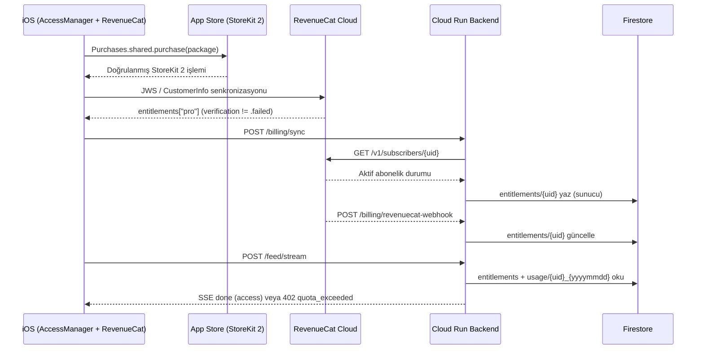
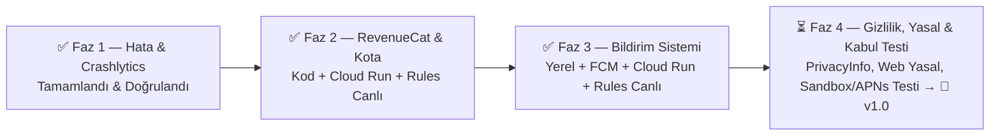

# 📊 Omakase — Proje Durum ve Teknik Mimari Raporu

> **Güncelleme Tarihi:** 22 Kasım 2026 · **Kapsam:** iOS İstemci ([omakase/](file:///Users/kuzey/projects/omakase/omakase)), Cloud Run Backend ([backend/](file:///Users/kuzey/projects/omakase/backend)), Firestore Güvenlik Kuralları ([firestore.rules](file:///Users/kuzey/projects/omakase/firestore.rules)) ve App Store / RevenueCat / Firebase Konsol Entegrasyonları
> **Amaç:** Omakase v1.0 uygulamasının güncel mimarisini, tamamlanan geliştirme fazlarını (Faz 1–3), canlı altyapı envanterini ve App Store yayını öncesi kalan son doğrulama adımlarını tek dokümanda toplamak.

---

## 0. Yönetici Özeti (Proje Durum Panosu)

| Alan / Sistem | Durum | Özet & Kanıt |
|---|---|---|
| **Çekirdek AI Akış, Keşif, Letterboxd & Önbellek** | ✅ **Tamamlandı** | Bento ilgi matrisi ([BentoTasteBox.swift](file:///Users/kuzey/projects/omakase/omakase/omakase/Interests/BentoTasteBox.swift)), Gemini SSE stream akışı (`feed`, `deep-dive`), 15–25 sn okuma ritüeli, Letterboxd RSS entegrasyonu ve SwiftData çevrimdışı önbelleği (`CachedPost` / [PostCacheService.swift](file:///Users/kuzey/projects/omakase/omakase/omakase/Services/PostCacheService.swift)) çalışıyor. |
| **Kimlik Doğrulama, Sosyal Katman & UGC Moderasyonu** | ✅ **Tamamlandı** | Firebase Auth + Sign in with Apple (Keychain + `getCredentialState` + revocation dinleyicisi) + Google Sign-In ([AuthService.swift](file:///Users/kuzey/projects/omakase/omakase/omakase/Auth/AuthService.swift)), Topluluk akışı, yorumlar, tepkiler, takipçi ağı, içerik filtresi, raporlama/engelleme ve hesap/veri silme ([FirestoreService.swift](file:///Users/kuzey/projects/omakase/omakase/omakase/Services/FirestoreService.swift)) canlı. |
| **Faz 1 — Hata Yönetimi & Firebase Crashlytics** | ✅ **Tamamlandı & Doğrulandı** | Canonical backend `code` + `Retry-After` sözleşmesi ([errors.py](file:///Users/kuzey/projects/omakase/backend/app/errors.py)), iOS [OmakaseError.swift](file:///Users/kuzey/projects/omakase/omakase/omakase/Services/OmakaseError.swift) + [L10n.swift](file:///Users/kuzey/projects/omakase/omakase/omakase/Localization/L10n.swift) (TR/EN), 3 katmanlı sunum (satır içi / toast / Tekrar Dene uyarısı) ve Firebase Crashlytics non-fatal telemetri devreye alındı; teknik metin sızıntısı sıfırlandı. |
| **Faz 2 — Monetizasyon (RevenueCat) & Erişim Kotası** | ✅ **Kod & Canlı Altyapı Tamamlandı** | `RevenueCat` SDK `5.103.2` (StoreKit 2 + `.informational` + `verification != .failed` kontrolü), [AccessManager.swift](file:///Users/kuzey/projects/omakase/omakase/omakase/Services/AccessManager.swift), [OmakasePaywallView.swift](file:///Users/kuzey/projects/omakase/omakase/omakase/Monetization/OmakasePaywallView.swift), [DailyLimitCardView.swift](file:///Users/kuzey/projects/omakase/omakase/omakase/Monetization/DailyLimitCardView.swift), Cloud Run `/billing/*` + `/feed/reward-share` + sunucu günlük kotaları ve [firestore.rules](file:///Users/kuzey/projects/omakase/firestore.rules) canlıda. App Store Connect ve RevenueCat temel bağlantıları kuruldu. *Kalan panel işleri:* Legal Entity adres güncellemesi, Paid Apps `Active` onayı ve Webhook/Sandbox uçtan uca testi. |
| **Faz 3 — Bildirim Sistemi (Yerel + APNs/FCM)** | ✅ **Kod & Canlı Altyapı Tamamlandı** | `FirebaseMessaging` (`12.13.0`), [omakase.entitlements](file:///Users/kuzey/projects/omakase/omakase/omakase/omakase.entitlements) (`aps-environment`), [NotificationManager.swift](file:///Users/kuzey/projects/omakase/omakase/omakase/Services/NotificationManager.swift), [omakaseApp.swift](file:///Users/kuzey/projects/omakase/omakase/omakase/App/omakaseApp.swift) (`AppDelegate`), bağlam içi izin (`[.alert, .sound]`, rozetsiz), yerel `omakase.daily-menu` hatırlatıcısı, derin bağlantı, Profil bildirim ayarları, `firestore.rules` ve Cloud Run `/notifications/*` canlıda. *Kalan panel işleri:* APNs `.p8` Firebase Console yüklemesi ve Cloud Scheduler job bağlanması. |
| **Faz 4 — Kabul Testleri, Gizlilik & App Store Review** | ⏳ **Sırada** | [PrivacyInfo.xcprivacy](file:///Users/kuzey/projects/omakase/omakase/omakase/PrivacyInfo.xcprivacy) güncellemesi (`PurchaseHistory`, Crashlytics/FCM doğrulaması) + birleşik Xcode Privacy Report, [terms.html](file:///Users/kuzey/projects/omakase/web/terms.html) / [privacy.html](file:///Users/kuzey/projects/omakase/web/privacy.html) abonelik hükümleri, Sandbox/APNs uçtan uca kabul testleri ve **v1.0 App Store Review gönderimi**. |

---

## 1. Güncel Sistem Mimarisi ve Canlı Altyapı Envanteri

### 1.1. iOS Uygulaması ([omakase/](file:///Users/kuzey/projects/omakase/omakase))
- **Kimlik & Hedef:** Bundle ID `kuzeysinay.omakase` · Team ID `S88MSGP5UR` · SwiftUI + `@Observable` + SwiftData · `SWIFT_DEFAULT_ACTOR_ISOLATION = MainActor`.
- **Swift Package Bağımlılıkları ([Package.resolved](file:///Users/kuzey/projects/omakase/omakase/omakase.xcodeproj/project.xcworkspace/xcshareddata/swiftpm/Package.resolved)):**
  - `firebase-ios-sdk` `12.13.0` (`FirebaseCore`, `FirebaseAuth`, `FirebaseFirestore`, `FirebaseCrashlytics`, `FirebaseMessaging`)
  - `GoogleSignIn-iOS` `10.0.0`
  - `purchases-ios-spm` (`RevenueCat`) `5.103.2`
- **Capabilities & Yetkiler ([omakase.entitlements](file:///Users/kuzey/projects/omakase/omakase/omakase/omakase.entitlements)):** `com.apple.developer.applesignin` (`Default`) + `aps-environment` (`development`).
- **Ana Uygulama Katmanları:**
  - **Yaşam Döngüsü & Yönlendirme:** [omakaseApp.swift](file:///Users/kuzey/projects/omakase/omakase/omakase/App/omakaseApp.swift), [ContentView.swift](file:///Users/kuzey/projects/omakase/omakase/omakase/App/ContentView.swift), [MainTabView.swift](file:///Users/kuzey/projects/omakase/omakase/omakase/App/MainTabView.swift) (`Akışım` / `Topluluk` / `Profil` + bildirim derin bağlantısı).
  - **Servisler:** [AccessManager.swift](file:///Users/kuzey/projects/omakase/omakase/omakase/Services/AccessManager.swift), [NotificationManager.swift](file:///Users/kuzey/projects/omakase/omakase/omakase/Services/NotificationManager.swift), [OmakaseError.swift](file:///Users/kuzey/projects/omakase/omakase/omakase/Services/OmakaseError.swift), [FirestoreService.swift](file:///Users/kuzey/projects/omakase/omakase/omakase/Services/FirestoreService.swift), [PostCacheService.swift](file:///Users/kuzey/projects/omakase/omakase/omakase/Services/PostCacheService.swift), [ContentModerationService.swift](file:///Users/kuzey/projects/omakase/omakase/omakase/Services/ContentModerationService.swift), [ShareService.swift](file:///Users/kuzey/projects/omakase/omakase/omakase/Services/ShareService.swift).
  - **Monetizasyon UI:** [OmakasePaywallView.swift](file:///Users/kuzey/projects/omakase/omakase/omakase/Monetization/OmakasePaywallView.swift), [DailyLimitCardView.swift](file:///Users/kuzey/projects/omakase/omakase/omakase/Monetization/DailyLimitCardView.swift).
  - **Cihaz Doğrulaması:** [launch-ios.sh](file:///Users/kuzey/projects/omakase/scripts/launch-ios.sh) ile fiziksel iPhone (`ADFC2ADA-EA3F-51A7-9C82-E2554869B97D`) üzerinde derlenip `0` hata ile kuruldu ve başlatıldı.

### 1.2. Cloud Run Backend ([backend/](file:///Users/kuzey/projects/omakase/backend))
- **Canlı Servis:** `omakase-backend` · Bölge `us-central1` · GCP/Firebase Proje `gen-lang-client-0120875563` · Canlı revizyon `omakase-backend-00014-qfr` (`https://omakase-backend-20235796246.us-central1.run.app`).
- **Bağımlılıklar ([requirements.txt](file:///Users/kuzey/projects/omakase/backend/requirements.txt)):** `fastapi==0.115.5`, `uvicorn[standard]==0.32.1`, `google-genai==1.47.0`, `pydantic==2.9.2`, `python-dotenv==1.0.1`, `firebase-admin==6.6.0`, `httpx==0.28.1`, `tzdata==2024.2`.
- **Aktif Uç Noktalar ([main.py](file:///Users/kuzey/projects/omakase/backend/main.py)):**

| Yöntem & Yol | Router | Yetkilendirme / Koruma | Görev |
|---|---|---|---|
| `GET /health` | [main.py](file:///Users/kuzey/projects/omakase/backend/main.py) | Açık | Minimal canlılık kontrolü (`{"status":"ok"}`) |
| `POST /feed/stream` | [feed.py](file:///Users/kuzey/projects/omakase/backend/app/routers/feed.py) | Firebase ID Token + rate limit + günlük kota (`plate`) | Tekil tabak SSE yayını; başarılı `done` çıktısında kota düşer |
| `POST /feed/deep-dive` | [feed.py](file:///Users/kuzey/projects/omakase/backend/app/routers/feed.py) | Firebase ID Token + rate limit + günlük kota (`deep_dive`) | Derinlemesine inceleme SSE yayını |
| `POST /feed/reward-share` | [feed.py](file:///Users/kuzey/projects/omakase/backend/app/routers/feed.py) | Firebase ID Token + rate limit + Firestore transaction | Günde 1 kez paylaşımla `+2` bonus Deep Dive açar |
| `POST /interests/suggest`, `/interests/expand-category` | [interests.py](file:///Users/kuzey/projects/omakase/backend/app/routers/interests.py) | Firebase ID Token + rate limit + günlük kota (`suggestion`) | İlgi alanı / alt kategori önerileri |
| `POST /letterboxd/films` | [letterboxd.py](file:///Users/kuzey/projects/omakase/backend/app/routers/letterboxd.py) | Firebase ID Token + rate limit | Letterboxd RSS okuma ve kanonik 404/403/502 eşlemesi |
| `GET /billing/status` | [billing.py](file:///Users/kuzey/projects/omakase/backend/app/routers/billing.py) | Firebase ID Token | Kullanıcının güncel Pro yetkisi + günlük kota özetini döner |
| `POST /billing/sync` | [billing.py](file:///Users/kuzey/projects/omakase/backend/app/routers/billing.py) | Firebase ID Token | Satın alma/restore sonrası RevenueCat REST ile `entitlements/{uid}` senkronu |
| `POST /billing/revenuecat-webhook` | [billing.py](file:///Users/kuzey/projects/omakase/backend/app/routers/billing.py) | `REVENUECAT_WEBHOOK_SECRET` (`hmac.compare_digest`) | RevenueCat abonelik yaşam döngüsü olaylarını Firestore'a işler |
| `POST /notifications/events` | [notifications.py](file:///Users/kuzey/projects/omakase/backend/app/routers/notifications.py) | Firebase ID Token + rate limit | Yorum, takip ve tepki olaylarını push/kuyruk kurallarına göre işler |
| `POST /notifications/process-queue` | [notifications.py](file:///Users/kuzey/projects/omakase/backend/app/routers/notifications.py) | `NOTIFICATION_CRON_SECRET` (`hmac.compare_digest`) | Zamanlanmış `notification_queue` teslimatı (gruplu yorum + günlük özet) |

- **Otomatik Testler:** [test_error_contract.py](file:///Users/kuzey/projects/omakase/backend/tests/test_error_contract.py), [test_billing_and_quota.py](file:///Users/kuzey/projects/omakase/backend/tests/test_billing_and_quota.py) ve [test_notifications.py](file:///Users/kuzey/projects/omakase/backend/tests/test_notifications.py) toplam **18/18** birim testiyle doğrulandı.
- *Tarihsel not:* Faz 1 öncesinde tespit edilen tüm eski hata/kota boşlukları (**H1–H11**) çözülmüş ve üretime alınmıştır.

### 1.3. Firestore Güvenlik Kuralları ([firestore.rules](file:///Users/kuzey/projects/omakase/firestore.rules))
Canlı `gen-lang-client-0120875563` projesine deploy edilmiş güncel erişim matrisi:

| Koleksiyon / Alt Koleksiyon | Okuma | Yazma / Silme | Güvenlik Kısıtları |
|---|---|---|---|
| `users/{userId}` | Oturumlu kullanıcı | Yalnızca sahip (`isOwner`) | Şema beyaz listesi + `isPro`, `entitlements`, `tier`, `plan`, `quota`, `usage` vb. ayrıcalıklı alanların yazımı kesin engelli |
| `users/{userId}/following`, `followers`, `blocked_users` | Oturumlu (`blocked_users`: sahip) | Sahip / karşı taraf kurallı | Engelli kullanıcıların takip edilmesini engelleyen çapraz `exists` kontrolü |
| `users/{userId}/devices/{deviceId}` | Sahip | Sahip | `deviceId <= 128`, `platform == 'ios'`, `fcmToken <= 512`, dil (`en`/`tr`), `timezone <= 64` |
| `users/{userId}/notification_prefs/{prefId}` | Sahip | Sahip | Yalnızca `prefId == 'settings'`; boolean bayraklar, saat `0..23`, dakika `0..59`, dil ve saat dilimi doğrulaması |
| `shared_posts/{postId}`, `reactions`, `comments` | Oturumlu | Kurallı sahip / etkileşim | Değişmez `authorId`, alan bazlı diff doğrulaması ve uzunluk sınırları |
| `moderation_reports/{reportId}` | Kapalı | Oturumlu (`create`) | `reporterUid == request.auth.uid` |
| `entitlements/{userId}` | Sahip | **Kapalı** (`false`) | Yalnızca Cloud Run Firebase Admin SDK yazar |
| `usage/{docId}` | Sahip (`^{uid}_[0-9]{8}$`) | **Kapalı** (`false`) | Yalnızca Cloud Run Firebase Admin SDK yazar |
| `notification_queue/{docId}`, `notification_cooldowns/{docId}` | **Kapalı** (`false`) | **Kapalı** (`false`) | Yalnızca backend erişir |

---

## 2. Monetizasyon, Paywall ve Erişim Yönetimi *(Faz 2 — Uygulandı)*

### 2.1. "Günün Menüsü" Freemium Modeli & Paylaşım Ödülü
"Omakase" = şefin seçtiği sınırlı menü. Günlük sınır, ürün kimliğinin parçası olarak sunulur; sadece AI maliyeti doğuran üretim limitlenir ([config.py](file:///Users/kuzey/projects/omakase/backend/app/config.py), [access_service.py](file:///Users/kuzey/projects/omakase/backend/app/services/access_service.py)):

| Özellik | Ücretsiz | Omakase Pro (Adil Kullanım Tavanı) |
|---|---|---|
| Şef tabağı (`feed` / özel konu / Letterboxd) | **Günde 5** | Sınırsız UI (sunucuda `100/gün`) |
| Deep Dive | **Günde 1** (+ **günde 1 kez paylaşımda `+2` ödül**) | Sınırsız UI (sunucuda `40/gün`) |
| Alt konu önerisi (`suggest` / `expand-category`) | **Günde 10** | Sınırsız UI (sunucuda `100/gün`) |
| Topluluk, yorum, tepki, yer imleri & Letterboxd | Tamamen ücretsiz | Tamamen ücretsiz + Profil/kartlarda `PRO` rozeti |
| Okuma bekleme süresi (cooldown ritüeli) | 15–25 sn | Aynı (marka değeri, ücretli kaldırılmaz) |

- **Doğru sayım:** Bir tabak yalnızca Gemini akışı başarıyla `event: done` verdiğinde düşülür (`on_complete` callback'i, [gemini_service.py](file:///Users/kuzey/projects/omakase/backend/app/services/gemini_service.py)); hata veya güvenlik engeli hak yemez. Gün sınırı kullanıcının gönderdiği IANA saat dilimine göre **yerel gece yarısı**dır.
- **Limit aşımı yanıtı:** Sunucu HTTP `402 Payment Required` + `{"code":"quota_exceeded","resets_at":"…","kind":"plate|deep_dive|suggestion"}` döner; iOS bunu hata değil limit kartı/paywall olarak işler.

### 2.2. Fiyat, Paketler ve 3 Temas Noktası
- Abonelik grubu: **Omakase Pro**
  - `omakase.pro.yearly` — **\$29.99/yıl** (**7 gün ücretsiz deneme** — yalnızca yıllıkta; 1 haftalık alışkanlık ritmini kapsar)
  - `omakase.pro.monthly` — **\$3.99/ay** (deneme yok)
- **3 Paywall Temas Noktası:**
  1. **İlk değer anından sonra yumuşak paywall (tek sefer):** İlk tabak okunup cooldown bittiğinde (`FeedView`).
  2. **Limit kartı / sheet:** 5. tabak tamamlandığında akış sonuna yerleşen satır içi **Bugünkü Menü Tamamlandı** kartı ([DailyLimitCardView.swift](file:///Users/kuzey/projects/omakase/omakase/omakase/Monetization/DailyLimitCardView.swift) — geri sayım, *Omakase Pro ile Devam Et*, *Yarın Hatırlat*); 2. Deep Dive denemesinde paywall sheet ve günlük `+2` paylaşım ipucu.
  3. **Profil → Üyelik bölümü:** Durum rozeti (Aktif / Ücretsiz Deneme / Ödeme Sorunu), yenilenme/bitiş tarihi, *Satın Alımları Geri Yükle* ve *Aboneliği Yönet* ([UserProfileSheet.swift](file:///Users/kuzey/projects/omakase/omakase/omakase/Social/UserProfileSheet.swift)).

### 2.3. Uygulanan Teknik Mimari

- **İstemci Uyum Notu:** `RevenueCat` `5.103.2` sürümünde `.enforced` doğrulama modu SDK tarafından `@available(*, unavailable)` işaretli olduğu için [AccessManager.swift](file:///Users/kuzey/projects/omakase/omakase/omakase/Services/AccessManager.swift) StoreKit 2 ile `.with(entitlementVerificationMode: .informational)` yapılandırıldı ve `applyCustomerInfo` içinde `(ent?.isActive == true) && (ent?.verification != .failed)` kontrolüyle imzası başarısız entitlement'ların Pro açması engellendi.
- **Panel Durumu (22 Kasım 2026):**
  - ✅ App Store Connect üzerinde `kuzeysinay.omakase` uygulaması, `omakase.pro.monthly`, `omakase.pro.yearly` ürünleri ve RevenueCat için `App Manager` API Key + IAP Key oluşturuldu.
  - ✅ RevenueCat üzerinde `pro` entitlement, 2 paketli (`$rc_annual`, `$rc_monthly`) `default` Current Offering bağlandı; `REVENUECAT_API_KEY` iOS `Info.plist`'e, secret/webhook anahtarları Cloud Run'a tanımlandı.
  - ⏳ *Kalan panel işlemleri:* Legal Entity adres talebinin sonuçlanması, App Store Connect'te **Paid Apps Agreement** (`Active`) onayı + eksik localization/review ekran görüntüsü tamamlanması, RevenueCat Webhook'un (`https://omakase-backend-20235796246.us-central1.run.app/billing/revenuecat-webhook`) **Send Test Event** ve Sandbox satın alma ile doğrulanması.

---

## 3. Bildirim Sistemi *(Faz 3 — Uygulandı)*

### 3.1. İzin Akışı ve Delegate Yaşam Döngüsü
- **Açılışta İzin Yok:** Uygulama açılışında veya onboarding'de izin istenmez; izin yalnızca kullanıcı aksiyonunda tetiklenir:
  1. Limit kartındaki **Yarın Hatırlat** butonu ([FeedView.swift](file:///Users/kuzey/projects/omakase/omakase/omakase/Feed/FeedView.swift)),
  2. Profil → **Bildirimler** anahtarları ([UserProfileSheet.swift](file:///Users/kuzey/projects/omakase/omakase/omakase/Social/UserProfileSheet.swift)),
  3. İlk yorum sonrası satır içi tek seferlik **Bildirimleri Aç** çubuğu ([CommentsView.swift](file:///Users/kuzey/projects/omakase/omakase/omakase/Social/CommentsView.swift)).
- **Yetkilendirme ([NotificationManager.swift](file:///Users/kuzey/projects/omakase/omakase/omakase/Services/NotificationManager.swift)):** Önce `notificationSettings()` kontrol edilir; `requestAuthorization(options: [.alert, .sound])` yalnızca `.notDetermined` iken çağrılır (rozet istenmez). `.provisional` ayrı durum olarak ele alınır; `.denied` iken iOS Ayarlar'a (`openNotificationSettingsURLString`) yönlendirilir.
- **Launch & Delegate ([omakaseApp.swift](file:///Users/kuzey/projects/omakase/omakase/omakase/App/omakaseApp.swift)):**
  - `AppDelegate.application(_:didFinishLaunchingWithOptions:)` bitmeden `UNUserNotificationCenter.current().delegate` atanır, `DAILY_MENU`, `COMMENT_NOTIFICATION`, `SOCIAL_DIGEST` kategorileri gizli önizleme yer tutucularıyla tek çağrıda kaydedilir ve `registerForRemoteNotifications()` izin penceresinden bağımsız çalıştırılır.
  - `willPresent` ön planda banner göstermez (`completionHandler([])`), bunun yerine `.omakaseDidReceiveForegroundNotification` ile arayüz sessizce yenilenir.
  - `didReceive` tüm `actionIdentifier` dallarında `completionHandler()` çağırır; dokunulduğunda [MainTabView.swift](file:///Users/kuzey/projects/omakase/omakase/omakase/App/MainTabView.swift) ve [TimelineView.swift](file:///Users/kuzey/projects/omakase/omakase/omakase/Social/TimelineView.swift) üzerinden `Akışım` veya ilgili `CommentsView(postId:)` sayfasına gider.
  - APNs kayıt hatasında exponential backoff (5s / 15s / 45s) ile yeniden deneme yapılır; çıkışta veya hesap silmede `users/{uid}/devices/{deviceId}` silinir.

### 3.2. Yerel Hatırlatıcı ve Sosyal Push Politikası
- **Yerel "Günün Menüsü" (`omakase.daily-menu`):** Kullanıcının seçtiği saatte (varsayılan `09:00`) ilgi alanlarını gün bazlı döndüren TR/EN içerik planlar. Kullanıcı o gün menüsünü zaten bitirdiyse sonraki güne tek seferlik ötelenerek gereksiz bildirim engellenir; kapatıldığında hem bekleyen hem teslim edilmiş bildirimler silinir ve `setBadgeCount(0)` doğrulanır.
- **Sosyal Push Kuralları ([notification_service.py](file:///Users/kuzey/projects/omakase/backend/app/services/notification_service.py)):**

| Olay | Gönderim Politikası | İçerik & Güvenlik Kuralları |
|---|---|---|
| **Yeni yorum** | İlk yorum anlık; aynı gönderide **30 dk içinde** gelen veya `22:00–08:00` yerel sessiz saate denk gelen yorumlar `notification_queue` üzerinde gruplanır ve pencere bitiminde/sabah `08:30`'da gönderilir | Ön izleme kapalıyken yedek metin (`Yeni yorum` / `New comment`); APNs payload'ında `badge` yok |
| **Yeni takipçi & Tepkiler** | **Günlük özet** (asla anlık gönderilmez; `19:00` yerel saat veya sessiz saatteyse `08:30`) | `followersCount` ve `reactionsCount` tek bildirimde birleşir |
| **Engelleme & Tercihler** | Çift taraflı `blocked_users` ve `notification_prefs/settings` zorunlu kontrolü | Kendine veya engelli tarafa bildirim üretilmez; `UnregisteredError` veren eski tokenlar silinir |

---

## 4. Hata Yönetimi ve Telemetri *(Faz 1 — Tamamlandı)*

### 4.1. İlkeler ve Sözleşme
1. **Kullanıcı asla teknik metin görmez:** `localizedDescription`, ham HTTP kodları veya geliştirici metinleri arayüze çıkmaz; ham `Error` örnekleri `ErrorReporter.record(...)` ile **Firebase Crashlytics**'e non-fatal olarak kaydedilir.
2. **Kanonsal hata sözleşmesi:** Backend her hata yanıtında ([errors.py](file:///Users/kuzey/projects/omakase/backend/app/errors.py)) ve SSE `error` çerçevesinde sabit bir `code` döner; istemci bunu [OmakaseError.swift](file:///Users/kuzey/projects/omakase/omakase/omakase/Services/OmakaseError.swift) → [L10n.swift](file:///Users/kuzey/projects/omakase/omakase/omakase/Localization/L10n.swift) (TR/EN) üzerinden 3 katmanda sunar:
   - **Satır içi durum / banner:** Çevrimdışı (`NWPathMonitor`), `quota_exceeded` (limit kartı), Topluluk yükleme hatası, Letterboxd profil bulunamadı/gizli durumu.
   - **Toast:** Paylaşım, yorum gönderme/silme, raporlama, engelleme, takip/takipten çıkma, tepki, `rate_limited` (`Retry-After`), `content_blocked` ve `billing_sync_failed`.
   - **Uyarı (alert):** Yalnızca aksiyon gerektiren akış hataları (*Tekrar Dene* / *Vazgeç*, süresi dolmuş oturumda *Tekrar Giriş Yap*, hesap silmede yeniden doğrulama).

### 4.2. Tamamlanan İş Listesi (E1–E12)

| # | Kapsam | Durum | İlgili Dosyalar |
|---|---|---|---|
| E1 | `SSEError.badResponse` (`401/402/429/5xx`) `OmakaseError` eşlemesi | ✅ Tamamlandı | [SSEClient.swift](file:///Users/kuzey/projects/omakase/omakase/omakase/Networking/SSEClient.swift), [FeedViewModel.swift](file:///Users/kuzey/projects/omakase/omakase/omakase/Feed/FeedViewModel.swift) |
| E2 | SSE `error` olayı `code` ayrıştırma, `"Unknown server error."` kaldırma | ✅ Tamamlandı | [FeedViewModel.swift](file:///Users/kuzey/projects/omakase/omakase/omakase/Feed/FeedViewModel.swift) |
| E3 | Backend SSE `code`, `content_blocked`, `Retry-After` ve kota yanıtları | ✅ Tamamlandı | [gemini_service.py](file:///Users/kuzey/projects/omakase/backend/app/services/gemini_service.py), [security.py](file:///Users/kuzey/projects/omakase/backend/app/security.py) |
| E4 | Auth akışı yerelleştirme, Google/Apple hata eşlemesi, dev string temizliği | ✅ Tamamlandı | [AuthService.swift](file:///Users/kuzey/projects/omakase/omakase/omakase/Auth/AuthService.swift), [AuthView.swift](file:///Users/kuzey/projects/omakase/omakase/omakase/Auth/AuthView.swift) |
| E5 | Paylaşım hatası toast'larının `L10n` üzerinden gösterilmesi | ✅ Tamamlandı | [FeedView.swift](file:///Users/kuzey/projects/omakase/omakase/omakase/Feed/FeedView.swift), [BookmarksSheet.swift](file:///Users/kuzey/projects/omakase/omakase/omakase/Feed/BookmarksSheet.swift) |
| E6 | Sosyal işlemlerde (yorum, rapor, engelleme, takip) sessiz `catch` temizliği | ✅ Tamamlandı | [CommentsView.swift](file:///Users/kuzey/projects/omakase/omakase/omakase/Social/CommentsView.swift), [UserProfileSheet.swift](file:///Users/kuzey/projects/omakase/omakase/omakase/Social/UserProfileSheet.swift), [UserSearchView.swift](file:///Users/kuzey/projects/omakase/omakase/omakase/Social/UserSearchView.swift), [TimelinePostCard.swift](file:///Users/kuzey/projects/omakase/omakase/omakase/Social/TimelinePostCard.swift) |
| E7 | `TimelineViewModel` yükleme hatası ve satır içi Tekrar Dene ekranı | ✅ Tamamlandı | [TimelineViewModel.swift](file:///Users/kuzey/projects/omakase/omakase/omakase/Social/TimelineViewModel.swift), [TimelineView.swift](file:///Users/kuzey/projects/omakase/omakase/omakase/Social/TimelineView.swift) |
| E8 | Letterboxd hatalarının satır içi banner ile yerelleştirilmiş sunumu | ✅ Tamamlandı | [FeedViewModel.swift](file:///Users/kuzey/projects/omakase/omakase/omakase/Feed/FeedViewModel.swift), [LetterboxdService.swift](file:///Users/kuzey/projects/omakase/omakase/omakase/Networking/LetterboxdService.swift) |
| E9 | Akış uyarılarında duruma özel başlık ve **Tekrar Dene** aksiyonu | ✅ Tamamlandı | [FeedView.swift](file:///Users/kuzey/projects/omakase/omakase/omakase/Feed/FeedView.swift) |
| E10 | Çevrimdışı üretim kilidi + banner uyumu | ✅ Tamamlandı | [FeedViewModel.swift](file:///Users/kuzey/projects/omakase/omakase/omakase/Feed/FeedViewModel.swift), [BentoTasteBox.swift](file:///Users/kuzey/projects/omakase/omakase/omakase/Interests/BentoTasteBox.swift) |
| E11 | Firebase Crashlytics dSYM/Run Script kurulumu ve non-fatal kayıt | ✅ SDK & Telemetri *(Faz 4: manifest denetimi)* | [omakaseApp.swift](file:///Users/kuzey/projects/omakase/omakase/omakase/App/omakaseApp.swift), [OmakaseError.swift](file:///Users/kuzey/projects/omakase/omakase/omakase/Services/OmakaseError.swift) |
| E12 | Tam TR/EN hata kataloğu | ✅ Tamamlandı | [L10n.swift](file:///Users/kuzey/projects/omakase/omakase/omakase/Localization/L10n.swift) |

---

## 5. Faz İlerlemesi, Kalan İşler ve v1.0 Yayın Kontrol Listesi

### 5.1. Kalan Kod & Web İşleri *(Faz 4)*
- [ ] **Gizlilik Manifesti & Birleşik Privacy Report:** [PrivacyInfo.xcprivacy](file:///Users/kuzey/projects/omakase/omakase/omakase/PrivacyInfo.xcprivacy) dosyasına `PurchaseHistory` ve telemetri/cihaz verisi beyanlarının eklenip arşiv sonrası Xcode `Generate Privacy Report` ile RevenueCat + Firebase birleşik çıktısının doğrulanması.
- [ ] **Yasal Web Sayfaları:** [terms.html](file:///Users/kuzey/projects/omakase/web/terms.html) ve [privacy.html](file:///Users/kuzey/projects/omakase/web/privacy.html) içine otomatik yenilenen abonelik, ücretsiz deneme iptali, Crashlytics ve push bildirimi cihaz tokenı maddelerinin eklenip Firebase Hosting'e deploy edilmesi.
- [ ] **Son Kabul Testleri:** TR ve EN cihaz dilinde uçak modu, 429 rate limit, yanlış Letterboxd, 5/1 kota sınırı, Sandbox satın alma/restore, yerel hatırlatıcı ve FCM push derin bağlantı testleri + GCP API anahtarı (`S-03`) kısıtlaması.

### 5.2. Kalan Dış Panel Aksiyonları *(Apple / RevenueCat / Firebase / GCP)*
- [ ] **Apple Developer & App Store Connect:** Legal Entity adres talebinin tamamlanması; **Paid Apps Agreement** (`Active`) onayı; her iki abonelik için fiyat + localization + review screenshot tamamlanması; RevenueCat Apple Server-to-Server V2 URL'sinin tanımlanması; App Store Gizlilik Etiketi ve **Small Business Program (%15)** başvurusu.
- [ ] **RevenueCat:** Webhook (`https://omakase-backend-20235796246.us-central1.run.app/billing/revenuecat-webhook`) yapılandırması + **Send Test Event** (`200 OK`) ve Sandbox satın alma doğrulaması.
- [ ] **Firebase & GCP:** Apple Developer'dan alınan **APNs `.p8`** anahtarının Firebase Console → Cloud Messaging altına yüklenmesi; Google Cloud Scheduler ile her 15 dakikada `POST https://omakase-backend-20235796246.us-central1.run.app/notifications/process-queue` (`X-Omakase-Cron-Secret`) tetiklemesinin kurulması.

### 5.3. Yayın Öncesi Teknik Kontrol Listesi
- [x] Sunucu tarafı günlük kota (5 tabak / 1 Deep Dive + paylaşımda `+2` ödül / 10 öneri) Cloud Run'da aktif ve test edildi
- [x] `entitlements/{uid}`, `usage/{docId}`, `notification_queue`, `notification_cooldowns`, `users/{uid}` ayrıcalıklı anahtar kısıtları ve `devices`/`notification_prefs` kuralları [firestore.rules](file:///Users/kuzey/projects/omakase/firestore.rules) içinde canlı deploy edildi
- [x] `OmakaseError` + TR/EN `L10n` + Crashlytics devreye alındı; hiçbir ekranda teknik hata metni bırakılmadı
- [x] Paywall UI (fiyat, süre, deneme, otomatik yenileme metni, Koşullar/Gizlilik bağlantıları, Geri Yükle) ve Limit Kartı entegre edildi
- [x] Bağlam içi bildirim izni, rozetsiz ayarlar, yerel hatırlatıcı, Profil bildirim tercihleri, derin bağlantı ve backend 30 dk gruplu yorum/günlük özet/sessiz saatler kuruldu
- [x] Git üzerinde açık secret sızıntısı yok (`CLEAN`); Backend birim testleri (`18/18`) ve fiziksel iPhone build/launch (`launch-ios.sh`) doğrulandı
- [ ] Paid Apps `Active` + Sandbox satın alma/restore + APNs `.p8` canlı push testleri ve [PrivacyInfo.xcprivacy](file:///Users/kuzey/projects/omakase/omakase/omakase/PrivacyInfo.xcprivacy) / web yasal metin denetimi (**Faz 4**)

---

## 6. Kullanılan Skill'ler ve Bilgi Sözleşmeleri (`AGENTS.md` gereği)

| Skill | Yüklenen Bilgi Sözleşmeleri (Knowledge Contracts) | Kullanım Amacı |
|---|---|---|
| `app-store-review-guidelines` | `digital-goods-iap`, `restore-purchases` | Dijital Pro yetkilerinin yalnızca IAP ile açılması ve Geri Yükle butonunun sunulması |
| `storekit` | `product-loading-and-purchase`, `transaction-verification-and-entitlements`, `transaction-updates-and-restoring-purchases` | Ürün yükleme, JWS doğrulama, `customerInfoStream` dinleyicisi ve kullanıcı tetiklemeli restore akışı |
| `usernotifications` | `authorization-request`, `local-notification-scheduling`, `remote-push-registration`, `notification-delegate-handling`, `notification-actions-and-categories`, `managing-pending-delivered-and-badge` | Ön ayar kontrolü, tek seferlik izin, sabit `omakase.daily-menu` tanımlayıcısı, önbelleksiz APNs/FCM kaydı, launch öncesi delegate, kategori yedek metni ve bekleyen/iletilen bildirim + rozet `0` temizliği |
| `human-interface-guidelines-patterns` | `notifications`, `feedback` | Bildirim içerik/zamanlama/önizleme yedek metni ve 3 katmanlı hata geri bildirim hiyerarşisi |
| `human-interface-guidelines` / `-components` | `privacy`, `alerts` | İznin açılış yerine bağlam içinde istenmesi ve uyarı/Tekrar Dene sınırları |
| `style-guide` | `app-state-and-error-terminology` | Kullanıcı dostu, suçlamasız TR/EN hata ve boş durum metinleri |

> [!NOTE]
> **Kit dışı 3. parti entegrasyonlar:** RevenueCat `purchases-ios` SDK'sı (`5.103.2`), RevenueCat REST/Webhook senkronizasyonu, Firebase Crashlytics ve `firebase-admin` Messaging payload'ları Apple Agent Kit kapsamı dışındadır; her birinin resmi SDK imzaları, canlı Cloud Run testleri ve fiziksel iPhone derlemeleriyle doğrulanmıştır.
