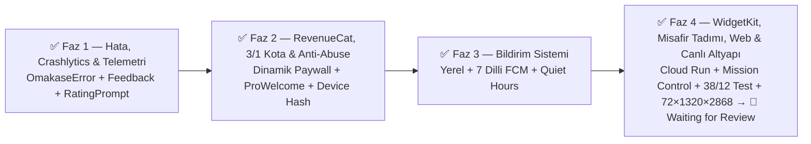

# 📊 Omakase — Proje Durum ve Teknik Mimari Raporu

> **Güncelleme Tarihi:** 26 Kasım 2026 (`v1.0 (1)` **Apple App Review'a Gönderildi — `Waiting for Review`** · `APP_ID: 6838044134`) · **Kapsam:** iOS İstemci ([omakase/](file:///Users/kuzey/projects/omakase/omakase)), WidgetKit Uzantısı ([omakaseWidget/](file:///Users/kuzey/projects/omakase/omakase/omakaseWidget)), UI Test Paketi ([omakaseUITests/](file:///Users/kuzey/projects/omakase/omakase/omakaseUITests)), Cloud Run Backend ([backend/](file:///Users/kuzey/projects/omakase/backend)), Mission Control Admin Paneli ([admin-web/](file:///Users/kuzey/projects/omakase/admin-web)), Tanıtım Web Sitesi ([web/](file:///Users/kuzey/projects/omakase/web)), Ekran Görüntüsü Stüdyosu ([app-store-screenshots/](file:///Users/kuzey/projects/omakase/app-store-screenshots)) ve Firestore Kuralları ([firestore.rules](file:///Users/kuzey/projects/omakase/firestore.rules))
> **Amaç:** Omakase v1.0 uygulamasının güncel mimarisini, tamamlanan geliştirme fazlarını (Faz 1–4 + WidgetKit + Misafir Tadımı + App Review gönderimi), cihaz-bazlı kota korumasını, Export Studio'yu, Mission Control admin/telemetri altyapısını ve canlı envanteri tek dokümanda toplamak.

---

## 0. Yönetici Özeti (Proje Durum Panosu)

| Alan / Sistem | Durum | Özet & Kanıt |
|---|---|---|
| **Çekirdek AI Akış, Bento, 7 Dil & WidgetKit** | ✅ **Tamamlandı** | 12 disiplinli `BentoTasteBox` ([BentoTasteBox.swift](file:///Users/kuzey/projects/omakase/omakase/omakase/Interests/BentoTasteBox.swift)) + **24 dikey merak merceği** (`prompts.py` — 10.626 kombinasyon) + ön-ısıtmalı alt konular + başparmak bölgesi **Şefin Seçimi (Chef's Pick)**, **7 dilde 528 yerelleştirme anahtarı** (`en, tr, ja, de, fr, es, ko`), zorunlu **birincil kaynakça** ([PostSourceView.swift](file:///Users/kuzey/projects/omakase/omakase/omakase/Theme/PostSourceView.swift)), 15–25 sn okuma molası, Letterboxd RSS, SwiftData önbellek hidrasyonu, [HapticManager.swift](file:///Users/kuzey/projects/omakase/omakase/omakase/Services/HapticManager.swift) ve **Ana Ekran / Kilit Ekranı WidgetKit uzantısı** ([OmakaseWidget.swift](file:///Users/kuzey/projects/omakase/omakase/omakaseWidget/OmakaseWidget.swift) + [WidgetDataBridge.swift](file:///Users/kuzey/projects/omakase/omakase/omakase/Services/WidgetDataBridge.swift)). |
| **Kimlik Doğrulama, Misafir Tadımı & Topluluk** | ✅ **Tamamlandı** | Sign in with Apple + Google Sign-In + E-posta ([AuthService.swift](file:///Users/kuzey/projects/omakase/omakase/omakase/Auth/AuthService.swift)), hesap açmadan önizleme sağlayan **Misafir Tadımı** ([GuestTasteView.swift](file:///Users/kuzey/projects/omakase/omakase/omakase/Onboarding/GuestTasteView.swift) + [GuestStaticCatalog.swift](file:///Users/kuzey/projects/omakase/omakase/omakase/Onboarding/GuestStaticCatalog.swift)), `ProfileSetupView`, atomik `usernames/{handle}` (**14 gün değişim beklemesi**), Hidden Folks tarzı `MonogramAvatarView`, 3 slaytlı ASCII suşi `OnboardingView`, Keşfet / Takip Edilenler segmentli topluluk + [FollowListSheet.swift](file:///Users/kuzey/projects/omakase/omakase/omakase/Social/FollowListSheet.swift), `reportAIPost` ve hesap silmede tam yerel temizlik. |
| **İnteraktif Dışa Aktarım Stüdyosu (Export Studio)** | ✅ **Tamamlandı** | [ExportPostSheet.swift](file:///Users/kuzey/projects/omakase/omakase/omakase/Feed/ExportPostSheet.swift) ve [ShareCardView.swift](file:///Users/kuzey/projects/omakase/omakase/omakase/Feed/ShareCardView.swift): 3D sürükleme eğimli önizleme, **3 oran** (`Story` 1080×1920, `Post` 1080×1350, `Kare` 1080×1080), **4 monokrom tema** (`paper`, `ink`, `editorial`, `midnight`), kaynak/etiket/motif anahtarları, `getomakase.app` kopyala barı ve Instagram Stories / WhatsApp / X / Fotoğraflar'a Kaydet / Kopyala / Paylaş rıhtımı. |
| **Faz 1 — Hata, Telemetri, Değerlendirme & Geri Bildirim** | ✅ **Tamamlandı & Doğrulandı** | Canonical backend `code` + `Retry-After` ([errors.py](file:///Users/kuzey/projects/omakase/backend/app/errors.py)), iOS [OmakaseError.swift](file:///Users/kuzey/projects/omakase/omakase/omakase/Services/OmakaseError.swift) + Crashlytics non-fatal kaydı, izleme dışı etkileşim toplayıcısı ([TelemetryService.swift](file:///Users/kuzey/projects/omakase/omakase/omakase/Services/TelemetryService.swift)), Kural 5.6.1/5.6.3 uyumlu yerel StoreKit değerlendirme yöneticisi ([RatingPromptManager.swift](file:///Users/kuzey/projects/omakase/omakase/omakase/Services/RatingPromptManager.swift)) ve [FeedbackSheetView.swift](file:///Users/kuzey/projects/omakase/omakase/omakase/Profile/FeedbackSheetView.swift) (`POST /feedback`). |
| **Faz 2 — RevenueCat, 3 Post + 1 Letterboxd & Cihaz Kotası** | ✅ **Tamamlandı & Canlıda** | `RevenueCat` SDK `5.103.2` (StoreKit 2), dinamik mağaza fiyatlı tek ekranlı ASCII suşi paywall ([OmakasePaywallView.swift](file:///Users/kuzey/projects/omakase/omakase/omakase/Monetization/OmakasePaywallView.swift)) + [ProWelcomeView.swift](file:///Users/kuzey/projects/omakase/omakase/omakase/Monetization/ProWelcomeView.swift), ücretsiz günde **3 post** (**1 Letterboxd/gün** dahil) + **1 Derin İnceleme** (`+1` paylaşım bonusu), Keychain `X-Omakase-Device-Id` + SHA-256 `device_usage` kilidi ve RevenueCat v2 metrik senkronu (`projfdc295f4`). |
| **Faz 3 — Bildirim Sistemi (Yerel + APNs/FCM)** | ✅ **Kod & Kurallar Canlıda** | `FirebaseMessaging` (`12.13.0`), [NotificationManager.swift](file:///Users/kuzey/projects/omakase/omakase/omakase/Services/NotificationManager.swift), bağlam içi izin (`[.alert, .sound]`, rozetsiz), `omakase.daily-menu` yerel hatırlatıcı, derin bağlantı, 7 dilli push şablonları (`notification_service.py`) ve 7 dili kapsayan canlı `firestore.rules`. |
| **Faz 4 — Mission Control, Web, Gizlilik & App Review** | ✅ **App Review'a Gönderildi** | Cloud Run `omakase-backend-00023-68f` ve Firebase `admin-web/` + `firestore:rules` canlıda; `web/` SEO/GEO + yasal sayfaları (26 Kasım) güncellendi; **8 veri tipli** [PrivacyInfo.xcprivacy](file:///Users/kuzey/projects/omakase/omakase/omakase/PrivacyInfo.xcprivacy) + widget manifesti, **38/38** backend testi, **12** XCUITest ve **72 × `1320×2868`** ekran görüntüsü ile `v1.0 (1)` **App Review'a gönderildi (`Waiting for Review`, `APP_ID: 6838044134`)**. |

---

## 1. Güncel Sistem Mimarisi ve Canlı Altyapı Envanteri

### 1.1. iOS Uygulaması & WidgetKit Uzantısı ([omakase/](file:///Users/kuzey/projects/omakase/omakase))
- **Kimlik & Hedef:** Bundle ID `kuzeysinay.omakase` · Team ID `S88MSGP5UR` · `TARGETED_DEVICE_FAMILY = 1` (iPhone-only) · `ITSAppUsesNonExemptEncryption = false` · SwiftUI + `@Observable` + SwiftData · `SWIFT_DEFAULT_ACTOR_ISOLATION = MainActor` · **7 Dil (`528` anahtar/dil)** (`en, tr, ja, de, fr, es, ko` `.lproj` + `AppLanguage.systemDefault`).
- **Swift Package Bağımlılıkları ([Package.resolved](file:///Users/kuzey/projects/omakase/omakase/omakase.xcodeproj/project.xcworkspace/xcshareddata/swiftpm/Package.resolved)):**
  - `firebase-ios-sdk` `12.13.0` (`FirebaseCore`, `FirebaseAuth`, `FirebaseFirestore`, `FirebaseCrashlytics`, `FirebaseMessaging`)
  - `GoogleSignIn-iOS` `10.0.0`
  - `purchases-ios-spm` (`RevenueCat`) `5.103.2`
- **Capabilities & `Info.plist` Yetkileri:**
  - [omakase.entitlements](file:///Users/kuzey/projects/omakase/omakase/omakase/omakase.entitlements) & [omakaseWidget.entitlements](file:///Users/kuzey/projects/omakase/omakase/omakaseWidget/omakaseWidget.entitlements): `com.apple.developer.applesignin` (`Default`), `aps-environment` ve `com.apple.security.application-groups` (`group.kuzeysinay.omakase`).
  - [Info.plist](file:///Users/kuzey/projects/omakase/omakase/omakase/Info.plist): `ITSAppUsesNonExemptEncryption = false`, `NSPhotoLibraryAddUsageDescription`, `LSApplicationQueriesSchemes` (`instagram-stories`, `instagram`, `whatsapp`, `twitter`), `OMAKASE_API_URL` ve `REVENUECAT_API_KEY`.
- **Ana Uygulama & Widget Katmanları:**
  - **Yaşam Döngüsü, Yönlendirme & Test Koşucuları:** [omakaseApp.swift](file:///Users/kuzey/projects/omakase/omakase/omakase/App/omakaseApp.swift), [ContentView.swift](file:///Users/kuzey/projects/omakase/omakase/omakase/App/ContentView.swift) (`AuthView` / `GuestTasteView` → `ProfileSetupView` → `OnboardingView` → `MainTabView`), [MainTabView.swift](file:///Users/kuzey/projects/omakase/omakase/omakase/App/MainTabView.swift) (`Akışım` / `Topluluk` / `Profil`), `#if DEBUG` [UITestHarness.swift](file:///Users/kuzey/projects/omakase/omakase/omakase/App/UITestHarness.swift) ve [ScreenshotPreviewHarness.swift](file:///Users/kuzey/projects/omakase/omakase/omakase/App/ScreenshotPreviewHarness.swift).
  - **Kayıt, Misafir Tadımı, Onboarding & Profil:** [AuthView.swift](file:///Users/kuzey/projects/omakase/omakase/omakase/Auth/AuthView.swift), [AuthService.swift](file:///Users/kuzey/projects/omakase/omakase/omakase/Auth/AuthService.swift), [GuestTasteView.swift](file:///Users/kuzey/projects/omakase/omakase/omakase/Onboarding/GuestTasteView.swift) ([GuestStaticCatalog.swift](file:///Users/kuzey/projects/omakase/omakase/omakase/Onboarding/GuestStaticCatalog.swift), [GuestStaticCatalogExtra.swift](file:///Users/kuzey/projects/omakase/omakase/omakase/Onboarding/GuestStaticCatalogExtra.swift)), [OnboardingView.swift](file:///Users/kuzey/projects/omakase/omakase/omakase/Onboarding/OnboardingView.swift) (+ `ProfileSetupView`), [ProfileTabView.swift](file:///Users/kuzey/projects/omakase/omakase/omakase/Profile/ProfileTabView.swift), [FeedbackSheetView.swift](file:///Users/kuzey/projects/omakase/omakase/omakase/Profile/FeedbackSheetView.swift) ve [UserProfileSheet.swift](file:///Users/kuzey/projects/omakase/omakase/omakase/Social/UserProfileSheet.swift) (+ [FollowListSheet.swift](file:///Users/kuzey/projects/omakase/omakase/omakase/Social/FollowListSheet.swift)).
  - **Akış, Bento & Dışa Aktarım:** [FeedView.swift](file:///Users/kuzey/projects/omakase/omakase/omakase/Feed/FeedView.swift), [FeedViewModel.swift](file:///Users/kuzey/projects/omakase/omakase/omakase/Feed/FeedViewModel.swift), [BentoTasteBox.swift](file:///Users/kuzey/projects/omakase/omakase/omakase/Interests/BentoTasteBox.swift), [ExportPostSheet.swift](file:///Users/kuzey/projects/omakase/omakase/omakase/Feed/ExportPostSheet.swift), [ShareCardView.swift](file:///Users/kuzey/projects/omakase/omakase/omakase/Feed/ShareCardView.swift) ve [PostSourceView.swift](file:///Users/kuzey/projects/omakase/omakase/omakase/Theme/PostSourceView.swift).
  - **WidgetKit (`omakaseWidget/`):** [OmakaseWidgetBundle.swift](file:///Users/kuzey/projects/omakase/omakase/omakaseWidget/OmakaseWidgetBundle.swift), [OmakaseWidget.swift](file:///Users/kuzey/projects/omakase/omakase/omakaseWidget/OmakaseWidget.swift), [WidgetTopicCatalog.swift](file:///Users/kuzey/projects/omakase/omakase/omakaseWidget/WidgetTopicCatalog.swift), [WidgetDataBridge.swift](file:///Users/kuzey/projects/omakase/omakase/omakase/Services/WidgetDataBridge.swift) ve [omakaseWidget/PrivacyInfo.xcprivacy](file:///Users/kuzey/projects/omakase/omakase/omakaseWidget/PrivacyInfo.xcprivacy).
  - **Servisler & Monetizasyon:** [AccessManager.swift](file:///Users/kuzey/projects/omakase/omakase/omakase/Services/AccessManager.swift), [TelemetryService.swift](file:///Users/kuzey/projects/omakase/omakase/omakase/Services/TelemetryService.swift), [RatingPromptManager.swift](file:///Users/kuzey/projects/omakase/omakase/omakase/Services/RatingPromptManager.swift), [HapticManager.swift](file:///Users/kuzey/projects/omakase/omakase/omakase/Services/HapticManager.swift), [NotificationManager.swift](file:///Users/kuzey/projects/omakase/omakase/omakase/Services/NotificationManager.swift), [OmakaseError.swift](file:///Users/kuzey/projects/omakase/omakase/omakase/Services/OmakaseError.swift), [FirestoreService.swift](file:///Users/kuzey/projects/omakase/omakase/omakase/Services/FirestoreService.swift), [PostCacheService.swift](file:///Users/kuzey/projects/omakase/omakase/omakase/Services/PostCacheService.swift), [ContentModerationService.swift](file:///Users/kuzey/projects/omakase/omakase/omakase/Services/ContentModerationService.swift), [ShareService.swift](file:///Users/kuzey/projects/omakase/omakase/omakase/Services/ShareService.swift), [OmakasePaywallView.swift](file:///Users/kuzey/projects/omakase/omakase/omakase/Monetization/OmakasePaywallView.swift), [ProWelcomeView.swift](file:///Users/kuzey/projects/omakase/omakase/omakase/Monetization/ProWelcomeView.swift), [DailyLimitCardView.swift](file:///Users/kuzey/projects/omakase/omakase/omakase/Monetization/DailyLimitCardView.swift).
  - **Otomatik UI Test Paketi ([omakaseUITests/](file:///Users/kuzey/projects/omakase/omakase/omakaseUITests)):** 5 test dosyasında (`AppLaunchSmokeUITests`, `AuthFlowUITests`, `OnboardingUITests`, `FeedAndBentoUITests`, `CommunityAndMonetizationUITests`) toplam **12 XCUITest** çevrimdışı `UITestHarness` üzerinde koşar.

### 1.2. Cloud Run Backend ([backend/](file:///Users/kuzey/projects/omakase/backend))
- **Servis:** `omakase-backend` (aktif revizyon `omakase-backend-00023-68f`) · Bölge `us-central1` · GCP/Firebase Proje `gen-lang-client-0120875563` · Canlı URL `https://omakase-backend-20235796246.us-central1.run.app` (tüm Faz 1–4 uç noktaları ve `S-16`–`S-28` güvenlik sertleştirmeleriyle `%100` trafikte canlı).
- **Bağımlılıklar ([requirements.txt](file:///Users/kuzey/projects/omakase/backend/requirements.txt)):** `fastapi==0.115.5`, `uvicorn[standard]==0.32.1`, `google-genai==1.47.0`, `pydantic==2.9.2`, `python-dotenv==1.0.1`, `firebase-admin==6.6.0`, `httpx==0.28.1`, `tzdata==2024.2`.
- **Aktif Uç Noktalar (7 Router — [main.py](file:///Users/kuzey/projects/omakase/backend/main.py)):**

| Yöntem & Yol | Router | Yetkilendirme / Koruma | Görev |
|---|---|---|---|
| `GET /health` | [main.py](file:///Users/kuzey/projects/omakase/backend/main.py) | Açık | Minimal canlılık kontrolü (`{"status":"ok"}`) |
| `POST /feed/stream` | [feed.py](file:///Users/kuzey/projects/omakase/backend/app/routers/feed.py) | Firebase ID Token (`check_revoked=True`) + rate limit (`20/dk`) + atomik `reserve_quota_slot` & `X-Omakase-Device-Id` | Tekil post SSE yayını; akış başında kota ayrılır, Gemini hatasında iade edilir |
| `POST /feed/deep-dive` | [feed.py](file:///Users/kuzey/projects/omakase/backend/app/routers/feed.py) | Firebase ID Token + rate limit (`20/dk`) + `deep_dive` kotası + `X-Omakase-Device-Id` | Derinlemesine inceleme SSE yayını |
| `POST /feed/reward-share` | [feed.py](file:///Users/kuzey/projects/omakase/backend/app/routers/feed.py) | Firebase ID Token + rate limit (`10/dk`) + Firestore transaction (`usage` + `device_usage`) | Günde 1 kez paylaşımla `+1` bonus Derin İnceleme açar |
| `POST /interests/suggest`, `/interests/expand-category` | [interests.py](file:///Users/kuzey/projects/omakase/backend/app/routers/interests.py) | Firebase ID Token + rate limit + günlük kota (`suggestion`) | İlgi alanı / 24 merak merceğiyle alt konu üretimi (7 dil) |
| `POST /letterboxd/films` | [letterboxd.py](file:///Users/kuzey/projects/omakase/backend/app/routers/letterboxd.py) | Firebase ID Token + rate limit (`10/dk`) | Letterboxd RSS okuma ve kanonik 404/403/502 eşlemesi |
| `GET /billing/status`, `POST /billing/sync` | [billing.py](file:///Users/kuzey/projects/omakase/backend/app/routers/billing.py) | Firebase ID Token + rate limit (`30/dk`, `10/dk`) + `X-Omakase-Device-Id` | Pro yetkisi + kullanıcı/cihaz birleşik günlük kota özeti ve RevenueCat REST v1 sync |
| `POST /billing/revenuecat-webhook` | [billing.py](file:///Users/kuzey/projects/omakase/backend/app/routers/billing.py) | `REVENUECAT_WEBHOOK_SECRET` (`hmac.compare_digest`) | RevenueCat abonelik olaylarını Firestore'a, `metrics_daily`'ye ve opsiyonel `ADMIN_ALERT_WEBHOOK_URL`'ye işler |
| `POST /notifications/events`, `/notifications/process-queue` | [notifications.py](file:///Users/kuzey/projects/omakase/backend/app/routers/notifications.py) | Firebase ID Token / `NOTIFICATION_CRON_SECRET` (`hmac.compare_digest`) | Firestore kanıtlı yorum/takip/tepki olayları ve `notification_queue` teslimatı |
| `POST /telemetry/events`, `POST /feedback` | [telemetry.py](file:///Users/kuzey/projects/omakase/backend/app/routers/telemetry.py) | Firebase ID Token + rate limit (`60/dk`, `5/dk`) | Allowlist'li izleme dışı ürün telemetrisi (`metrics_daily`, `daily_active`) ve uygulama içi geri bildirim (`user_feedback` + admin webhook uyarısı) |
| `GET /admin/me`, `/overview`, `/feedback`, `/reports`, `/users`, `/export`, `PATCH /admin/feedback/{id}`, `/reports/{id}` | [admin.py](file:///Users/kuzey/projects/omakase/backend/app/routers/admin.py) | `verify_admin_user` (`ADMIN_UIDS` / doğrulanmış `ADMIN_EMAILS`) + rate limit (`20–60/dk`) | Mission Control KPI, RevenueCat v2 (`projfdc295f4`) + Gemini maliyet analizi, geri bildirim/moderasyon triyajı ve kaçışlı AI Agent export (`launch`, `conversion`, `triage`, `growth`) |

- **Otomatik Backend Testleri:** [test_error_contract.py](file:///Users/kuzey/projects/omakase/backend/tests/test_error_contract.py), [test_billing_and_quota.py](file:///Users/kuzey/projects/omakase/backend/tests/test_billing_and_quota.py), [test_notifications.py](file:///Users/kuzey/projects/omakase/backend/tests/test_notifications.py), [test_stream_parser.py](file:///Users/kuzey/projects/omakase/backend/tests/test_stream_parser.py) ve [test_admin_and_telemetry.py](file:///Users/kuzey/projects/omakase/backend/tests/test_admin_and_telemetry.py) toplam **38/38** birim testiyle doğrulandı (26 Kasım 2026 itibarıyla geçti).

### 1.3. Firestore Güvenlik Kuralları ([firestore.rules](file:///Users/kuzey/projects/omakase/firestore.rules))
Güncel erişim matrisi (`gen-lang-client-0120875563` üzerinde canlıda):

| Koleksiyon / Alt Koleksiyon | Okuma | Yazma / Silme | Güvenlik Kısıtları |
|---|---|---|---|
| `users/{userId}` | Oturumlu kullanıcı | Yalnızca sahip (`isOwner`) | `hasOnly` şema beyaz listesi (`email` yasağı, `usernameUpdatedAt`, `profileSetupCompleted`), `isPro`/`quota`/`usage` yazım yasağı ve **14 gün `@username` bekleme zorunluluğu** |
| `usernames/{handle}` | Oturumlu kullanıcı | `create`: `uid == auth.uid`; `update`: **kapalı**; `delete`: sahip | `^[a-z0-9_.]{3,20}$` regex + `!exists(...)` ile atomik benzersizlik rezervasyonu |
| `users/{userId}/following`, `followers`, `blocked_users` | Oturumlu (`blocked_users`: sahip) | Sahip / karşı taraf kurallı | Kendini takip etme yasağı, engelli kullanıcıların takip etmesini engelleyen çapraz `exists` kontrolü ve `hasOnly` |
| `users/{userId}/devices/{deviceId}`, `notification_prefs/{prefId}` | Sahip | Sahip | `platform == 'ios'`, `prefId == 'settings'` ve **7 dil** (`en, tr, ja, de, fr, es, ko`) beyaz listesi canlıda |
| `shared_posts/{postId}`, `reactions`, `comments` | Oturumlu | Kurallı sahip / etkileşim | Değişmez `authorId`, `reportedBy` append-only kilidi, `reactionCounts` & `commentCount` ±1 atomik geçiş doğrulaması |
| `moderation_reports/{reportId}` | Kapalı | Oturumlu (`create`) | `reporterUid == request.auth.uid` (kullanıcı, yorum ve AI gönderi raporları) |
| `entitlements/{userId}`, `usage/{docId}` | Sahip (`^{uid}_[0-9]{8}$`) | **Kapalı** (`false`) | Yalnızca Cloud Run Firebase Admin SDK yazar |
| `device_usage/{docId}`, `metrics_daily/{date}`, `daily_active/{docId}`, `user_feedback/{id}`, `notification_queue/{docId}`, `notification_cooldowns/{docId}` | **Kapalı** (`false`) | **Kapalı** (`false`) | Varsayılan red (default-deny) altında yalnızca Cloud Run Admin SDK erişir |

### 1.4. Mission Control (`admin-web/`), Tanıtım Sitesi (`web/`) & Ekran Görüntüsü Stüdyosu (`app-store-screenshots/`)
- **Mission Control ([admin-web/](file:///Users/kuzey/projects/omakase/admin-web)):** `web/`'den tamamen ayrılıp yalnızca **Firebase Hosting**'e (`https://gen-lang-client-0120875563.web.app` — `"public": "admin-web"`, `/` → `/admin` 302 yönlendirmesi, `X-Robots-Tag: noindex, nofollow`, COOP, HSTS ve sıkı CSP) taşınmış ve canlıya alınmıştır. Google/E-posta Firebase Auth kapısı + Demo Modu, 5 sekme (`Genel Bakış`, `Gelir & AI`, `Geri Bildirim`, `Moderasyon`, `Kullanıcılar`), `7g`/`14g`/`30g` pencere seçimi, 60s canlı yenileme, Metrik Sözlüğü (`?`) ve **Agent'a Aktar** içerir.
- **Tanıtım Sitesi ([web/](file:///Users/kuzey/projects/omakase/web) — `getomakase.app`):** [wrangler.json](file:///Users/kuzey/projects/omakase/wrangler.json) ile **Cloudflare** statik barındırma üzerinden sunulur. Statik [web/en/index.html](file:///Users/kuzey/projects/omakase/web/en/index.html), çift yönlü `hreflang`, `@graph` JSON-LD, WebP/PNG 8 slaytlı vitrin, `privacy.html` / `terms.html` (26 Kasım güncellemesi), `robots.txt`, `sitemap.xml`, `llms.txt` ve `_headers` güvenlik başlıkları eklenmiştir.
- **App Store Screenshot Studio ([app-store-screenshots/](file:///Users/kuzey/projects/omakase/app-store-screenshots)):** Next.js editörü (`app-store-screenshots.json`) ile **8 slayt × 7 dil** (`en, tr, ja, de, fr, es, ko`), **4 iPhone çözünürlüğünde** (`1125×2436`, `1206×2622`, `1284×2778`, `1320×2868`) dışa aktarılarak repoda (`app-store-screenshots/exports/ios/`) arşivlenmiş; **9 App Store yerel ayarına 72 × `1320×2868`** ekran görüntüsü yüklenmiştir.

---

## 2. Monetizasyon, Paywall ve Cihaz-Bazlı Kota Koruması *(Faz 2 + App Review Güncellemesi)*

### 2.1. "Günün Menüsü" Freemium Modeli & Paylaşım Ödülü
Günlük sınırlar sunucu tarafında ([config.py](file:///Users/kuzey/projects/omakase/backend/app/config.py), [access_service.py](file:///Users/kuzey/projects/omakase/backend/app/services/access_service.py)) yönetilir:

| Özellik | Ücretsiz | Omakase Pro (Adil Kullanım Tavanı) |
|---|---|---|
| Günlük AI post (`feed` / Bento alt konu / Şefin Seçimi) | **Günde 3** (`Kalan: X/3` stres sayacı) | Sınırsız UI (sunucuda `100/gün`) |
| Letterboxd günlük post kotası | **Günde 1** (3 günlük post hakkının içinden sayılır) | Sınırsız UI (sunucuda `100/gün`) |
| Derin İnceleme (Deep Dive) | **Günde 1** (+ **günde 1 kez paylaşımda `+1` ödül**) | Sınırsız UI (sunucuda `40/gün`) |
| Alt konu önerisi (`suggest` / `expand-category`) | **Günde 10** | Sınırsız UI (sunucuda `100/gün`) |
| Topluluk (Keşfet/Takip), Export Studio & yer imleri | Tamamen ücretsiz | Tamamen ücretsiz + Profil/kartlarda `PRO` rozeti |
| Okuma bekleme süresi (cooldown ritüeli) | 15–25 sn | Aynı (marka değeri, ücretli kaldırılmaz) |

- **Doğru sayım & kopma koruması:** Kota üretim başında atomik `reserve_quota_slot` ile rezerve edilir; istemci bağlantıyı kesse dahi ücretsiz kota düşülür, yalnızca Gemini üretimi hata veya boş çıktı döndürdüğünde `refund_quota_slot` ile iade edilir.
- **Cihaz-Bazlı Anti-Abuse (`device_usage`):** [SSEClient.swift](file:///Users/kuzey/projects/omakase/omakase/omakase/Networking/SSEClient.swift) içinde Keychain'de saklanan anonim kurulum kimliği (`X-Omakase-Device-Id`, `REQUIRE_DEVICE_ID` ile zorunlu) sunucuda SHA-256 ile özetlenerek `device_usage/{hash}_{yyyymmdd}` belgesinde (UTC gün anahtarıyla) tutulur ve ücretsiz katman için `max(user_usage, device_usage)` birleşimi uygulanır.

### 2.2. Fiyat, Paketler ve 5 Paywall Temas Noktası
- Abonelik grubu: **`omakase pro`** — `omakase.pro.yearly` (**\$29.99/yıl**, `~$2.49/ay`, **7 gün ücretsiz deneme**) ve `omakase.pro.monthly` (**\$3.99/ay**).
- Tek ekranlı, iç kaydırmasız ASCII suşi arka planlı, buzlu karşılaştırma kartlı ve dinamik StoreKit fiyatlı [OmakasePaywallView.swift](file:///Users/kuzey/projects/omakase/omakase/omakase/Monetization/OmakasePaywallView.swift) 5 bağlamsal `PaywallSource` üzerinden açılır: `firstPlateSoft`, `plateLimit`, `deepDiveLimit`, `letterboxdLimit` ve `profile`. Satın alma sonrasında [ProWelcomeView.swift](file:///Users/kuzey/projects/omakase/omakase/omakase/Monetization/ProWelcomeView.swift) karşılaması gösterilir.

### 2.3. RevenueCat v1/v2 & Sunucu Senkronizasyonu
- İstemci tarafında StoreKit 2 + `.with(entitlementVerificationMode: .informational)` ve `verification != .failed` kontrolü çalışır ([AccessManager.swift](file:///Users/kuzey/projects/omakase/omakase/omakase/Services/AccessManager.swift)).
- Backend tarafında `/billing/sync` (v1 REST) ve `/billing/revenuecat-webhook` `entitlements/{uid}` belgesini günceller; ayrıca [billing_service.py](file:///Users/kuzey/projects/omakase/backend/app/services/billing_service.py) içinde `fetch_revenuecat_overview_metrics` (`REVENUECAT_V2_SECRET_API_KEY`, proje `projfdc295f4`, 5 dk TTL önbellek + Firestore fallback) ile Mission Control'e canlı 28 günlük RevenueCat metrikleri aktarılır.

---

## 3. Bildirim Sistemi *(Faz 3 — Uygulandı)*

### 3.1. İzin Akışı ve Delegate Yaşam Döngüsü
- Açılışta veya 3 slaytlı onboarding sırasında izin istenmez; izin yalnızca limit kartındaki **Yarın Hatırlat**, Profil/Ayarlar → **Bildirimler** anahtarları veya ilk yorum sonrası **Bildirimleri Aç** çubuğuyla tetiklenir.
- [NotificationManager.swift](file:///Users/kuzey/projects/omakase/omakase/omakase/Services/NotificationManager.swift) `[.alert, .sound]` ister (rozet yok), `omakaseApp.swift` launch öncesi delegate ve 3 kategori kaydeder; `willPresent` sessizce `.omakaseDidReceiveForegroundNotification` yayınlar, `didReceive` tüm dallarda `completionHandler()` çağırarak `Akışım` veya `CommentsView(postId:)` derin bağlantısına yönlendirir.

### 3.2. Yerel Hatırlatıcı ve Sosyal Push Politikası
- **Yerel "Günün Menüsü" (`omakase.daily-menu`):** Varsayılan `09:00` saatinde planlanır; o günkü menü bittiyse sonraki güne ötelenir.
- **Sosyal Push Kuralları ([notification_service.py](file:///Users/kuzey/projects/omakase/backend/app/services/notification_service.py)):** İlk yorum anlık, 30 dk içindeki veya `22:00–08:00` sessiz saatlerdeki yorumlar gruplanır (`08:30` teslim); takipçi/tepkiler yalnızca `19:00` günlük özetinde birleşir; tüm metinler 7 dili destekler ve Firestore belge kanıtı + çift taraflı `blocked_users` kontrolünden geçer.

---

## 4. Hata Yönetimi, Telemetri, Değerlendirme ve Geri Bildirim *(Faz 1 + v1.0 Güncellemesi)*

1. **Kanonsal Hata Sözleşmesi:** Backend her hatada ([errors.py](file:///Users/kuzey/projects/omakase/backend/app/errors.py)) sabit `code` + opsiyonel `Retry-After` döner; iOS [OmakaseError.swift](file:///Users/kuzey/projects/omakase/omakase/omakase/Services/OmakaseError.swift) + 7 dilli [L10n.swift](file:///Users/kuzey/projects/omakase/omakase/omakase/Localization/L10n.swift) ile teknik metin göstermeden satır içi banner, toast veya alert sunar ve ham hataları **Firebase Crashlytics**'e non-fatal kaydeder.
2. **İzleme Dışı Ürün Telemetrisi ([TelemetryService.swift](file:///Users/kuzey/projects/omakase/omakase/omakase/Services/TelemetryService.swift)):** `app_open`, `onboarding_started`, `onboarding_skipped`, `cooldown_completed`, `paywall_viewed` (kaynak bazlı), `source_tapped` gibi allowlist'li olayları 8 olaylık veya 15 sn'lik partiler halinde `POST /telemetry/events` ucuna gönderir (`metrics_daily` + `daily_active`). Reklam amaçlı cross-app tracking (`NSPrivacyTracking: false`) yoktur.
3. **Uygulama İçi Değerlendirme İstemi ([RatingPromptManager.swift](file:///Users/kuzey/projects/omakase/omakase/omakase/Services/RatingPromptManager.swift)):** 3 tamamlanmış okuma sonrasında (`minReads = 3`), 60 gün bekleme ve sürüm başına 1 kez kuralıyla doğrudan yerel `StoreKit.AppStore.requestReview(in: scene)` çağırır (App Review Kural 5.6.1/5.6.3 gereği özel memnuniyet ön-filtresi kullanılmaz).
4. **Uygulama İçi Geri Bildirim ([FeedbackSheetView.swift](file:///Users/kuzey/projects/omakase/omakase/omakase/Profile/FeedbackSheetView.swift)):** 4 kategori (`bug`, `idea`, `content`, `other`), opsiyonel 1–5★ memnuniyet puanı ve 3–2000 karakter mesajı `POST /feedback` ucuna iletir; `user_feedback` koleksiyonuna kaydedilir ve `ADMIN_ALERT_WEBHOOK_URL` tanımlıysa anlık bildirim atar.

---

## 5. Faz İlerlemesi ve v1.0 App Review Durumu

### 5.1. Tamamlanan Teknik, Yasal & App Store Connect Adımları
- [x] **Gizlilik Manifesti (`PrivacyInfo.xcprivacy`):** Ana uygulamada `CA92.1` + `1C8F.1` ve `DeviceID` dahil **8 veri tipi**, `omakaseWidget` için `1C8F.1` + `[]` eklendi; App Store Connect App Privacy yayınlandı.
- [x] **Otomatik Doğrulama:** Backend **38/38** birim testi ve iOS **12** XCUITest (`omakaseUITests/`) geçti.
- [x] **Canlı Dağıtımlar (Cloud Run & Firebase):** Cloud Run `omakase-backend-00023-68f` (`us-central1`), 7-dil `firestore.rules` ve Firebase Hosting (`admin-web/`) canlıya alındı; GCP `S-03` iOS/Browser API anahtar kısıtlamaları uygulandı.
- [x] **Yasal & Tanıtım Web Sayfaları (`web/`):** `privacy.html` ve `terms.html` (26 Kasım 2026) güncellendi; statik `en/index.html`, Schema.org JSON-LD, WebP vitrin ve `_headers` güvenlik kuralları eklendi.
- [x] **App Store Connect `v1.0 (1)` İnceleme Gönderimi (`Waiting for Review`):** `APP_ID: 6838044134`, `omakase pro` abonelikleri (`Monthly` + `Yearly`) bağlı, Email/Password + Demo Hesap (`reviewer@getomakase.app`) aktif, 9 yerel ayar metadata + 72 × `1320×2868` ekran görüntüsü yüklü ve 174 ülke (`CHN` kapalı) için 4 kalemli Review Submission (`243fa22d-ed73-4dc8-a8e8-ad362f0dc071`) gönderildi.

### 5.2. Yayın Günü / Sonrası Kalan Operasyonel Adımlar
- [ ] **Web Yayını & Smart App Banner (`web/`):** Güncel `web/` klasörünün `npx wrangler deploy` ile Cloudflare'e yayınlanması ve App Store onayı sonrası `index.html` / `en/index.html` içine `app-id=6838044134` Smart App Banner + mağaza linkinin açılması.
- [ ] **Firebase & RevenueCat Prodüksiyon Kontrolleri:** Firebase Console **APNs `.p8`** anahtarı / Cloud Scheduler (`/notifications/process-queue` 15 dk cron) ve RevenueCat Webhook olaylarının doğrulanması.

---

## 6. Kullanılan Skill'ler ve Bilgi Sözleşmeleri (`AGENTS.md` gereği)

| Skill | Yüklenen Bilgi Sözleşmeleri (Knowledge Contracts) | Kullanım Amacı |
|---|---|---|
| `app-store-review-guidelines` | `digital-goods-iap`, `restore-purchases`, `user-generated-content-moderation` | Dijital Pro yetkilerinin IAP ile açılması, Geri Yükle butonu ve AI/UGC raporlama |
| `storekit` | `product-loading-and-purchase`, `transaction-verification-and-entitlements`, `transaction-updates-and-restoring-purchases` | Ürün yükleme, JWS doğrulama, `customerInfoStream` ve restore akışı |
| `usernotifications` | `authorization-request`, `local-notification-scheduling`, `remote-push-registration`, `notification-delegate-handling`, `notification-actions-and-categories`, `managing-pending-delivered-and-badge` | Ön ayar kontrolü, tek seferlik izin, sabit `omakase.daily-menu`, launch öncesi delegate ve rozet `0` temizliği |
| `human-interface-guidelines-patterns` | `notifications`, `feedback`, `onboarding` | Bildirim zamanlama, 3 katmanlı hata geri bildirimi ve sürtünmesiz 3 slaytlı başlangıç |
| `human-interface-guidelines` / `-components` | `privacy`, `alerts` | Bağlam içi izin ve uyarı sınırları |
| `style-guide` | `app-state-and-error-terminology` | Kullanıcı dostu, suçlamasız çok dilli hata ve boş durum metinleri |

> [!NOTE]
> **Kit dışı 3. parti entegrasyonlar:** RevenueCat `purchases-ios` SDK'sı (`5.103.2`), RevenueCat REST v1/v2 & Webhook senkronizasyonu, Firebase Crashlytics, `firebase-admin` Messaging, Cloudflare Wrangler statik barındırma ve Mission Control admin arayüzü Apple Agent Kit kapsamı dışındadır; kod incelemesi ve backend birim testleriyle (`38/38`) doğrulanmıştır.
