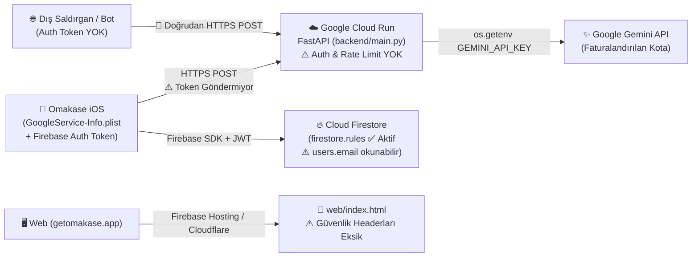

# 🛡️ Omakase — Kapsamlı Siber Güvenlik Durumu ve Tehdit Analizi Raporu

> **Denetim Tarihi:** 13 Kasım 2026  
> **Kapsam:** Tüm Omakase ekosistemi — iOS İstemcisi (`omakase/`), FastAPI & Cloud Run Backend (`backend/`), Cloud Firestore Kuralları (`firestore.rules`), Web & Hosting Altyapısı (`web/`, `firebase.json`), API Anahtarları ve Sır (Secret) Yönetimi.  
> **Dayanak:** Kod tabanı statik güvenlik denetimi, git geçmişi taraması, [OWASP Mobile Top 10 / MASVS](https://mas.owasp.org/), [OWASP API Security Top 10](https://owasp.org/API-Security/) ve Apple [`knowledge.app-store-review-guidelines.data-security`](file:///Users/kuzey/projects/omakase/.agents/knowledge/app-store-review-guidelines/data-security.md).

---

## İçindekiler

1. [Yönetici Özeti & Güvenlik Karnesi](#1-yönetici-özeti--güvenlik-karnesi)
2. [Güven Sınırları (Trust Boundaries) & Mimari Harita](#2-güven-sınırları-trust-boundaries--mimari-harita)
3. [Bölüm 1: API Anahtarları, Sırlar (Secrets) ve Kimlik Bilgisi Yönetimi](#3-bölüm-1-api-anahtarları-sırlar-secrets-ve-kimlik-bilgisi-yönetimi)
4. [Bölüm 2: Backend & Google Cloud Run Güvenlik Analizi (`backend/`)](#4-bölüm-2-backend--google-cloud-run-güvenlik-analizi-backend)
5. [Bölüm 3: Cloud Firestore & Sosyal Grafik Güvenlik Analizi (`firestore.rules`)](#5-bölüm-3-cloud-firestore--sosyal-grafik-güvenlik-analizi-firestorerules)
6. [Bölüm 4: iOS İstemci & Web (`web/`) Güvenlik Analizi](#6-bölüm-4-ios-i̇stemci--web-web-güvenlik-analizi)
7. [Bölüm 5: Önceliklendirilmiş Siber Güvenlik Eylem Planı (Remediation Roadmap)](#7-bölüm-5-önceliklendirilmiş-siber-güvenlik-eylem-planı-remediation-roadmap)

---

## 1. Yönetici Özeti & Güvenlik Karnesi

Omakase uygulaması **temel gizlilik ve App Store hijyeni** açısından sağlam bir zemine sahiptir: `GEMINI_API_KEY` iOS paketinin (`.ipa`) içine gömülmemiştir, git geçmişine sızdırılmamıştır, Apple Sign-In kriptografik SHA-256 nonce + iOS Keychain kullanmaktadır ve `firestore.rules` ilk denetimden geçirilerek sıkılaştırılmıştır.

Buna karşın **prodüksiyonda finansal suistimale, PII sızıntısına ve hizmet kesintisine yol açabilecek kritik mimari açıklar** mevcuttur. En büyük risk, **`GEMINI_API_KEY`'in kendisinin sızması değil, bu anahtarı tüketen Cloud Run uç noktalarının (`https://omakase-backend-20235796246.us-central1.run.app`) sıfır kimlik doğrulama ve sıfır rate-limit ile dış dünyaya açık bir LLM proxy'si gibi çalışmasıdır.**

### Risk Matrisi (Özet Tablo)

| # | Önem | Alan | Bulgu / Zafiyet Başlığı | Etki | İlgili Konum |
|---|------|------|-------------------------|------|--------------|
| **S-01** | 🚨 **KRİTİK (P0)** | Backend API / LLM | Kimlik doğrulamasız (Unauthenticated) Gemini uç noktaları — **Denial of Wallet / LLM Jacking** | Herkes `GEMINI_API_KEY` kotanızı ve faturanızı sınırsız tüketebilir | [`backend/main.py`](file:///Users/kuzey/projects/omakase/backend/main.py#L1037-L1081) |
| **S-02** | 🔴 **YÜKSEK (P0)** | Backend API / DoS | Rate Limiting yokluğu ve `DeepDiveRequest` / `letterboxd_films` sınırsız girdi boyutları | Dev payload'larla token tüketimi ve OOM / DoS | [`backend/main.py#L121-L249`](file:///Users/kuzey/projects/omakase/backend/main.py#L121-L249) |
| **S-03** | 🔴 **YÜKSEK (P1)** | Secrets / GCP | `GoogleService-Info.plist` içindeki Firebase `API_KEY`'in (`AIzaSyBr65...`) GCP kısıtlama riski | Aynı GCP projesi (`gen-lang-client-0120875563`) Gemini API içeriyorsa yetkisiz kullanım riski | [`GoogleService-Info.plist#L9-L18`](file:///Users/kuzey/projects/omakase/omakase/omakase/GoogleService-Info.plist#L9-L18) |
| **S-04** | 🔴 **YÜKSEK (P1)** | Firestore / PII | `users/{userId}` belgelerinde `email` alanının tüm giriş yapmış kullanıcılara açık okunması | Kullanıcı e-posta adreslerinin toplu kazınması (PII Enumeration) | [`FirestoreService.swift#L69`](file:///Users/kuzey/projects/omakase/omakase/omakase/Services/FirestoreService.swift#L69), [`firestore.rules#L153-L154`](file:///Users/kuzey/projects/omakase/firestore.rules#L153-L154) |
| **S-05** | 🟠 **YÜKSEK (P1)** | Backend / SSRF | `/letterboxd/films` uç noktasında doğrulanmamış `username` path traversal & `ElementTree` XML riski | URL manipülasyonu, sınırsız response belleği ve XML DoS | [`backend/main.py#L1095-L1165`](file:///Users/kuzey/projects/omakase/backend/main.py#L1095-L1165) |
| **S-06** | 🟠 **ORTA-YÜKSEK (P1)** | Firestore Rules | `following` / `followers` kurallarında "Forced Follow" ve `shared_posts` sayaç/rapor manipülasyonu | İzinsiz takip ettirme, beğeni/yorum sayacı veya `reportedBy` bozma | [`firestore.rules#L161-L209`](file:///Users/kuzey/projects/omakase/firestore.rules#L161-L209) |
| **S-07** | 🟡 **ORTA (P2)** | Backend / Hardening | `str(exc)` ile ham hata sızıntısı, `/health` model/key ifşası, `CORS *` ve `Dockerfile` root kullanıcısı | İç sistem bilgisi sızıntısı ve konteyner yetki yüzeyi | [`backend/main.py`](file:///Users/kuzey/projects/omakase/backend/main.py#L113-L118), [`backend/Dockerfile`](file:///Users/kuzey/projects/omakase/backend/Dockerfile) |
| **S-08** | 🟡 **ORTA (P2)** | Backend / AI | Doğrudan metin birleştirmeye dayalı Prompt Injection yüzeyi | Sistem talimatı manipülasyonu ve çıktı formatı bozma | [`backend/main.py#L407-L473`](file:///Users/kuzey/projects/omakase/backend/main.py#L407-L473) |
| **S-09** | 🟡 **ORTA (P2)** | Web & Auth | `firebase.json` eksik güvenlik başlıkları (CSP/HSTS) ve zayıf 6 karakter parola sınırı | Clickjacking / kaba kuvvet parola saldırılarına karşı düşük direnç | [`firebase.json`](file:///Users/kuzey/projects/omakase/firebase.json), [`AuthService.swift#L154`](file:///Users/kuzey/projects/omakase/omakase/omakase/Auth/AuthService.swift#L154) |
| **S-10** | ✅ **GÜVENLİ** | iOS / Depolama | `GEMINI_API_KEY` gizliliği, Sign in with Apple SHA-256 Nonce + Keychain ve ATS uyumluluğu | İstemci tarafı sır sızıntısı yok; Apple kimlik saklama güvenli | [`AuthService.swift`](file:///Users/kuzey/projects/omakase/omakase/omakase/Auth/AuthService.swift#L582-L638), [`Info.plist`](file:///Users/kuzey/projects/omakase/omakase/omakase/Info.plist) |

---

## 2. Güven Sınırları (Trust Boundaries) & Mimari Harita



Yukarıdaki diyagramda görüldüğü gibi **Firestore katmanı** `request.auth != null` ile kimlik doğrulama kapısının arkasında dururken, **Cloud Run backend katmanı** bu kapının tamamen dışında, herkese açık bir şekilde `GEMINI_API_KEY` yetkisini proxy'lemektedir.

---

## 3. Bölüm 1: API Anahtarları, Sırlar (Secrets) ve Kimlik Bilgisi Yönetimi

### 3.1. `GEMINI_API_KEY` (Google GenAI API Anahtarı) — Anahtar Güvende, Proxy Açık
* **İnceleme Sonucu (✅ Doğru Uygulananlar):**
  * `GEMINI_API_KEY` iOS uygulama kodu (`omakase/`), `Info.plist` veya herhangi bir derleme çıktısı içine gömülmemiştir. Bu durum [`knowledge.app-store-review-guidelines.data-security`](file:///Users/kuzey/projects/omakase/.agents/knowledge/app-store-review-guidelines/data-security.md) **Rule 3** ile tam uyumludur.
  * Sunucu tarafında [`backend/main.py#L42`](file:///Users/kuzey/projects/omakase/backend/main.py#L42) üzerinden `os.getenv("GEMINI_API_KEY")` ile ortam değişkeninden okunmaktadır.
  * `.env` dosyaları hem kök [`.gitignore`](file:///Users/kuzey/projects/omakase/.gitignore#L17) hem de `backend/.gitignore` ile Git dışı bırakılmış, [`backend/.dockerignore#L3`](file:///Users/kuzey/projects/omakase/backend/.dockerignore#L3) ile Docker imaj katmanlarına kopyalanması engellenmiştir.
  * Git geçmişi (`git log --all --full-history -- "*/.env*" ".env*"`) tarandığında repoya hiç `.env` dosyası veya `GEMINI_API_KEY` commit edilmediği doğrulanmıştır.
* **Kritik Dolaylı Risk (🚨 S-01):**
  * Anahtarın değerini gizlemek tek başına yeterli değildir. `https://omakase-backend-20235796246.us-central1.run.app/feed/stream`, `/feed/deep-dive`, `/interests/suggest` ve `/interests/expand-category` uç noktaları herhangi bir **API anahtarı, JWT veya App Check doğrulaması istememektedir**.
  * Dış dünyadan herhangi bir betik, uygulamanın adını bile bilmeden doğrudan Cloud Run URL'sine `curl` atarak Google Gemini 3.5 Flash (`thinking_budget=1024`) ve Gemini 3.1 Flash-Lite kotanızı tüketebilir.

### 3.2. Firebase `API_KEY` (`GoogleService-Info.plist`) ve GCP Proje Kısıtlama Riski (🔴 S-03)
* **İlgili Dosya:** [`omakase/omakase/GoogleService-Info.plist`](file:///Users/kuzey/projects/omakase/omakase/omakase/GoogleService-Info.plist#L5-L18)
* **Bulgular:**
  * Dosya Git reposunda (commit `64b0e93` ve `be4f77b`) ve dağıtılan her `.ipa` paketinin kökünde açık metin olarak yer almaktadır (`API_KEY`: `AIzaSyBr65...`, `PROJECT_ID`: `gen-lang-client-0120875563`, `CLIENT_ID`: `20235796246-...`).
* **Teknik Değerlendirme:**
  * Firebase belgelerine göre Firebase iOS `API_KEY` değeri gizli bir sır değil, uygulamanızı Firebase projenize bağlayan **genel (public) bir proje tanımlayıcısıdır**. Dolayısıyla `.ipa` içinde yer alması normaldir.
  * **KRİTİK UYARI:** `PROJECT_ID` alanının **`gen-lang-client-0120875563`** olması, bu Firebase projesinin aynı zamanda **Google AI Studio / Generative Language API** ile aynı Google Cloud projesini paylaştığını göstermektedir. Eğer Google Cloud Console üzerinden bu `AIzaSyBr65...` anahtarına **API Kısıtlaması (API Restrictions)** uygulanmadıysa, `.ipa` veya GitHub reposundan bu anahtarı okuyan bir saldırgan **doğrudan `generativelanguage.googleapis.com` API'sine** istek atmayı deneyebilir veya kısıtlanmamış Firebase Auth hesap oluşturma (`identitytoolkit`) kotasını sömürebilir.
* **Zorunlu Önlem:**
  1. **Google Cloud Console → APIs & Services → Credentials** ekranına gidin ve `AIzaSyBr65...` (iOS auto-created API key) anahtarını açın.
  2. **Application restrictions:** `iOS apps` seçip yalnızca `kuzeysinay.omakase` Bundle ID'sini yetkilendirin.
  3. **API restrictions:** `Restrict key` seçerek **yalnızca** `Identity Toolkit API`, `Token Service API`, `Firebase Installations API` ve `Cloud Firestore API` izinlerini bırakın; **`Generative Language API`'nin kesinlikle seçili olmadığından** emin olun.
  4. **Firebase App Check:** Cloud Firestore ve Authentication isteklerini yalnızca Apple **DeviceCheck / App Attest** ile doğrulanmış gerçek Omakase iOS ikilileriyle sınırlandırın.

### 3.3. İstemci Tarafı Kimlik & Oturum Saklama (✅ S-10)
* [`AuthService.swift`](file:///Users/kuzey/projects/omakase/omakase/omakase/Auth/AuthService.swift#L610-L638) içinde Sign in with Apple kullanıcı kimliği (`com.omakase.auth.appleIDUser`) `UserDefaults` yerine `SecItemAdd` / `SecItemCopyMatching` ile iOS **Keychain**'de, `kSecAttrAccessibleAfterFirstUnlockThisDeviceOnly` erişilebilirlik seviyesinde saklanmaktadır.
* Kriptografik nonce üretimi `SecRandomCopyBytes` ve `CryptoKit.SHA256` ile doğru uygulanmıştır ([`AuthService.swift#L582-L606`](file:///Users/kuzey/projects/omakase/omakase/omakase/Auth/AuthService.swift#L582-L606)).
* `UserDefaults` ([`BookmarkStore.swift`](file:///Users/kuzey/projects/omakase/omakase/omakase/Feed/BookmarkStore.swift)) ve `SwiftData` ([`PostCacheService.swift`](file:///Users/kuzey/projects/omakase/omakase/omakase/Services/PostCacheService.swift)) yalnızca genel gönderi metinlerini, dil/tema tercihlerini ve yer imlerini tutmaktadır; hassas token veya parola içermez.

---

## 4. Bölüm 2: Backend & Google Cloud Run Güvenlik Analizi (`backend/`)

### 4.1. [🚨 KRİTİK — S-01] Kimlik Doğrulamasız LLM Uç Noktaları ("Denial of Wallet")
* **Konum:** [`backend/main.py`](file:///Users/kuzey/projects/omakase/backend/main.py#L900-L1135) (`/feed/stream`, `/feed/deep-dive`, `/interests/suggest`, `/interests/expand-category`, `/letterboxd/films`).
* **Açık:** Hiçbir endpoint `Authorization: Bearer <token>` başlığı beklememekte veya doğrulamamaktadır. Cloud Run servisi herkese açık (`--allow-unauthenticated`) dağıtıldığında, internet üzerindeki herkes bu API'yi kendi sınırsız AI metin/öneri motoru gibi kullanabilir.
* **Önerilen Çözüm (Firebase ID Token Doğrulaması):**
  1. `backend/requirements.txt` dosyasına `firebase-admin` ekleyin.
  2. `main.py` içinde FastAPI dependency yazın:
     ```python
     from fastapi import Depends, Header, HTTPException
     from firebase_admin import auth, initialize_app

     initialize_app()

     async def verify_firebase_token(authorization: str = Header(...)) -> dict:
         if not authorization.startswith("Bearer "):
             raise HTTPException(status_code=401, detail="Missing Bearer token")
         token = authorization.removeprefix("Bearer ").strip()
         try:
             return auth.verify_id_token(token)
         except Exception:
             raise HTTPException(status_code=401, detail="Invalid or expired token")
     ```
  3. Tüm `POST` uç noktalarına `user: dict = Depends(verify_firebase_token)` ekleyin.
  4. iOS tarafında [`SSEClient.swift`](file:///Users/kuzey/projects/omakase/omakase/omakase/Networking/SSEClient.swift), [`CategoryExpansionService.swift`](file:///Users/kuzey/projects/omakase/omakase/omakase/Networking/CategoryExpansionService.swift), [`InterestSuggestor.swift`](file:///Users/kuzey/projects/omakase/omakase/omakase/Networking/InterestSuggestor.swift) ve [`LetterboxdService.swift`](file:///Users/kuzey/projects/omakase/omakase/omakase/Networking/LetterboxdService.swift) isteklerine `Auth.auth().currentUser?.getIDToken()` başlığını ekleyin.

### 4.2. [🔴 YÜKSEK — S-02] Rate Limiting Yokluğu & Sınırsız İstek Yükleri (Payload Limits)
* **Rate Limit Eksikliği:** Aynı IP veya kullanıcı UID saniyede yüzlerce `POST /feed/stream` (her çağrıda `thinking_budget=1024`) isteği göndererek Cloud Run CPU ve Gemini API kotasını tüketebilir. `slowapi` (UID bazlı kota, örn. dakikada max 15 post / 20 öneri) + Google Cloud Armor / Cloud Run eşzamanlılık sınırı uygulanmalıdır.
* **Model Girdi Doğrulama Boşlukları (`Pydantic`):**
  * [`DeepDiveRequest`](file:///Users/kuzey/projects/omakase/backend/main.py#L235-L249): `original_title: str` ve `original_text: str` alanlarında `max_length` kısıtı yoktur (`Field(..., max_length=...)` eksik). Saldırgan tek bir POST isteğinde 5 MB metin göndererek devasa input token maliyeti üretebilir. (`original_title` <= 300, `original_text` <= 8000, `interests` öğeleri `_validate_interests` ile doğrulanmalıdır.)
  * [`FeedRequest.letterboxd_films`](file:///Users/kuzey/projects/omakase/backend/main.py#L136): Tipi `Optional[list[dict]]` olarak açık bırakılmıştır; dizi uzunluğu (`max_length=50`) veya her film objesindeki `title` karakter uzunluğu (`<= 200`) sınırlandırılmamıştır. Ayrıca [`ExpandCategoryRequest.existing_interests`](file:///Users/kuzey/projects/omakase/backend/main.py#L207) alanı `_validate_interests` filtresinden geçmemektedir.

### 4.3. [🟠 YÜKSEK — S-05] `/letterboxd/films` URL Manipülasyonu (Path Traversal / SSRF) ve XML Riski
* **Konum:** [`backend/main.py#L1095-L1165`](file:///Users/kuzey/projects/omakase/backend/main.py#L1095-L1165)
* **Zafiyetler:**
  1. **Regex Doğrulamasız URL Birleştirme:** `LetterboxdFilmsRequest.username` yalnızca `min_length=1, max_length=100` kontrolüne sahiptir; ardından doğrudan `rss_url = f"https://letterboxd.com/{req.username}/rss/"` içine yerleştirilmektedir. Kullanıcı adına `../film/some-page#` veya query parametreleri enjekte edilebilir. Sıkı whitelist regex (`^[a-zA-Z0-9_]{1,40}$`) zorunlu kılınmalıdır.
  2. **Sınırsız Yanıt Okuma (`resp.read()`):** `urlopen(request, timeout=10)` dönen cevabın boyutunu kontrol etmeden tüm veriyi RAM'e almaktadır (`resp.read(2_000_000)` ile maks. ~2 MB sınırı konmalıdır).
  3. **Standart `xml.etree.ElementTree` Kullanımı:** Güvenilmeyen harici XML verisi `ET.fromstring` ile ayrıştırılmaktadır; XML bombası / entity expansion saldırılarına karşı `defusedxml.ElementTree` kullanılmalıdır.

### 4.4. [🟡 ORTA — S-08] Prompt Injection (İstem Enjeksiyonu) Yüzeyi
* [`backend/main.py#L407-L473`](file:///Users/kuzey/projects/omakase/backend/main.py#L407-L473) ve [`#L719-L732`](file:///Users/kuzey/projects/omakase/backend/main.py#L719-L732) içindeki şablonlarda kullanıcı girdileri (`interests`, `draft`, `original_title`, `letterboxd_films[i]['title']`) ham olarak string içine gömülmektedir.
* `_BLOCKLIST_RE` ve Gemini `_SAFETY_SETTINGS` zararlı/NSFW kelimeleri filtrelese de, `"Ignore all previous instructions and..."` biçimindeki talimat enjeksiyonları modelin formatını (`TITLE:` / `TAGS:`) veya tonunu bozabilir. Kullanıcı girdileri `<user_input>` XML sınır etiketleri içine alınmalı ve sistem talimatına bu etiketlerin veri olarak işlenmesi gerektiği açıkça yazılmalıdır.

### 4.5. [🟡 ORTA — S-07] Bilgi Sızıntısı, Geniş CORS ve Root Konteyner
* **Hata Mesajlarında Sızıntı:** [`backend/main.py`](file:///Users/kuzey/projects/omakase/backend/main.py#L695) (satır 695, 792, 953, 1026, 1164) yakalanan istisnaları doğrudan `str(exc)` / `str(payload)` olarak istemciye döndürmektedir. Bu durum iç SDK sürümü, kota bilgisi veya ağ hatalarını saldırgana ifşa eder; istemciye genel hata kodu dönülüp detaylar yalnızca Cloud Logging'e yazılmalıdır.
* **`/health` İfşası ([satır 1032-1034](file:///Users/kuzey/projects/omakase/backend/main.py#L1032-L1034)):** `model` adını ve `has_api_key` bilgisini herkese açık döndürmektedir. Yalnızca `{"status": "ok"}` dönmelidir.
* **CORS Politikası ([satır 113-118](file:///Users/kuzey/projects/omakase/backend/main.py#L113-L118)):** `allow_origins=["*"]`, `allow_methods=["*"]`, `allow_headers=["*"]` olarak bırakılmıştır. Yerel iOS istemcisi CORS'a tabi değildir; yalnızca `https://getomakase.app` gerekiyorsa açıkça listelenmeli, aksi halde `*` kaldırılmalıdır.
* **`Dockerfile` Root Kullanıcısı ([`backend/Dockerfile`](file:///Users/kuzey/projects/omakase/backend/Dockerfile)):** Konteyner `root` kullanıcısı ile çalışmaktadır. Least-privilege prensibi gereği imaj içinde yetkisiz bir `appuser` oluşturulup `USER appuser` ile çalıştırılmalıdır.

---

## 5. Bölüm 3: Cloud Firestore & Sosyal Grafik Güvenlik Analizi (`firestore.rules`)

`firestore.rules` dosyası son güncellemeyle herkese açık okuma/yazma açığından kurtarılmış, alan tipi/uzunluk doğrulamaları ve `moderation_reports` gizliliği sağlanmıştır. Ancak kalan **4 önemli mantıksal açık** kapatılmalıdır:

### 5.1. [🔴 YÜKSEK — S-04] `users/{userId}` Üzerinden E-posta (PII) Sızıntısı
* **Konum:** [`FirestoreService.swift#L69`](file:///Users/kuzey/projects/omakase/omakase/omakase/Services/FirestoreService.swift#L69) ve [`firestore.rules#L153-L154`](file:///Users/kuzey/projects/omakase/firestore.rules#L153-L154)
* **Sorun:** `ensureUserProfile` kullanıcının `email` adresini herkese açık profil belgesine (`users/{uid}`) yazmakta ve `firestore.rules` içinde `allow read: if isAuthenticated();` tanımı bulunmaktadır. Oturum açan **herhangi bir kullanıcı**, Firestore REST/SDK sorgusu ile `users` koleksiyonunu listeleyip uygulamadaki tüm kullanıcıların **e-posta adreslerini toplayabilir**.
* **Çözüm:** `email` alanı `users/{uid}` belgesinden tamamen kaldırılmalıdır (kullanıcının kendi e-postası zaten `FirebaseAuth.Auth.auth().currentUser?.email` üzerinden güvenle okunur). Eğer sunucu/ekip için tutulması şartsa yalnızca sahibinin okuyabileceği `users/{uid}/private/info` alt belgesine taşınmalıdır.

### 5.2. [🟠 ORTA-YÜKSEK — S-06] `following` / `followers` Üzerinde "Forced Follow" Yetki Aşımı
* **Konum:** [`firestore.rules#L161-L177`](file:///Users/kuzey/projects/omakase/firestore.rules#L161-L177)
* **Sorun:** `match /following/{targetUid}` altında `allow create, update: if isAuthenticated() && (request.auth.uid == userId || request.auth.uid == targetUid)`. Bu ifade engelleme sırasında karşı tarafın linkini *silmek* için eklenmiş olsa da `create, update` işlemlerine de `request.auth.uid == targetUid` izni vermektedir. Kötü niyetli bir Kullanıcı B, Kullanıcı A'nın `users/A/following/B` dokümanını oluşturarak A'yı **kendisini takip ediyormuş gibi** gösterebilir.
* **Çözüm:** `create, update` yalnızca `isOwner(userId)` ile sınırlandırılmalı; `request.auth.uid == targetUid` yetkisi **yalnızca `delete` işlemine** verilmelidir. (Aynı ayrım `followers` ve `reactions` için de geçerlidir.)

### 5.3. [🟠 ORTA-YÜKSEK — S-06] `shared_posts` Sayaç & `reportedBy` Manipülasyonu
* **Konum:** [`firestore.rules#L199-L209`](file:///Users/kuzey/projects/omakase/firestore.rules#L199-L209)
* **Sorun:** Başka bir kullanıcı yalnızca `['reactionCounts', 'totalReactions', 'commentCount', 'reportedBy']` anahtarlarını güncelleyebilse de, değerin ne kadar değişebileceği denetlenmemektedir. Bir saldırgan popüler bir gönderinin `totalReactions` sayacını `999999` yapabilir, `0`'a sıfırlayabilir veya başkasının `reportedBy` dizisini boşaltabilir.
* **Çözüm:** `commentCount` için ±1 değişim sınırı (`request.resource.data.commentCount - resource.data.commentCount in [-1, 1]`), `reportedBy` için ise yalnızca kendi UID'sini ekleme (`request.resource.data.reportedBy.toSet().difference(resource.data.reportedBy.toSet()) == [request.auth.uid].toSet()`) kuralı yazılmalı; tercihen sayaç güncellemeleri Cloud Functions trigger'ına taşınmalıdır.

### 5.4. [🟡 DÜŞÜK-ORTA] `@username` Benzersizlik Yarış Durumu (Race Condition)
* **Konum:** [`FirestoreService.swift#L97-L112`](file:///Users/kuzey/projects/omakase/omakase/omakase/Services/FirestoreService.swift#L97-L112)
* **Sorun:** Kullanıcı adı kontrolü önce `isUsernameAvailable` sorgusu yapıp ardından kullanıcı profilini yazmaktadır. Eşzamanlı iki kayıt aynı `@username`'i alabilir.
* **Çözüm:** `usernames/{lowercaseUsername}` koleksiyonu açılıp `allow create: if isAuthenticated() && !exists(...)` ile atomik kilit (`WriteBatch` / `Transaction`) uygulanmalıdır.

---

## 6. Bölüm 4: iOS İstemci & Web (`web/`) Güvenlik Analizi

### 6.1. iOS İstemci Ağı ve Derleme Güvenliği
* **ATS & TLS (✅):** [`omakase/omakase/Info.plist`](file:///Users/kuzey/projects/omakase/omakase/omakase/Info.plist) temizlenmiştir (`NSAllowsArbitraryLoads` veya yerel HTTP istisnaları yoktur). Tüm canlı trafik HTTPS üzerinden akar.
* **Ephemeral SSE Oturumu (✅):** [`SSEClient.swift#L65-L66`](file:///Users/kuzey/projects/omakase/omakase/omakase/Networking/SSEClient.swift#L65-L66) `URLSessionConfiguration.ephemeral` ve `.reloadIgnoringLocalCacheData` kullanarak disk önbelleğinde gereksiz ağ izi bırakmaz.
* **Küçük İyileştirme Önerisi:** [`CategoryExpansionService.swift#L21`](file:///Users/kuzey/projects/omakase/omakase/omakase/Networking/CategoryExpansionService.swift#L21), [`InterestSuggestor.swift#L29`](file:///Users/kuzey/projects/omakase/omakase/omakase/Networking/InterestSuggestor.swift#L29) ve [`LetterboxdService.swift#L51`](file:///Users/kuzey/projects/omakase/omakase/omakase/Networking/LetterboxdService.swift#L51) içindeki `http://127.0.0.1:8000` fallback satırları `#if DEBUG` içine alınmalı, `Release` derlemelerinde güvenli şekilde hata vermesi (`fatalError` veya kapalı hata durumu) sağlanmalıdır.

### 6.2. Kimlik Doğrulama & Parola Politikası ([`AuthService.swift`](file:///Users/kuzey/projects/omakase/omakase/omakase/Auth/AuthService.swift))
* E-posta ile kayıtta şu an minimum parola uzunluğu **`6` karakterdir** ([satır 154](file:///Users/kuzey/projects/omakase/omakase/omakase/Auth/AuthService.swift#L154)). Modern NIST / OWASP standartlarına göre en az **8–10 karakter** zorunluluğu ve Firebase Console üzerinden **Email Enumeration Protection** (Kayıtlı e-posta tahmin koruması) aktif edilmelidir.

### 6.3. Web Sitesi & Hosting ([`web/`](file:///Users/kuzey/projects/omakase/web/index.html), [`firebase.json`](file:///Users/kuzey/projects/omakase/firebase.json))
* **DOM XSS Koruması (✅):** [`web/app.js`](file:///Users/kuzey/projects/omakase/web/app.js) içinde dinamik içeriklerin tamamı `.innerHTML` yerine `.textContent` ile yazılmaktadır; bu sayede DOM XSS riski bulunmamaktadır.
* **Eksik HTTP Güvenlik Başlıkları (`firebase.json`):** `hosting` konfigürasyonunda `headers` bloğu yoktur. `Strict-Transport-Security`, `X-Content-Type-Options: nosniff`, `X-Frame-Options: DENY`, `Referrer-Policy: strict-origin-when-cross-origin` ve `Content-Security-Policy` eklenmelidir.
* **Waitlist Formu (`web/app.js#L885-L887`):** TestFlight bekleme listesi e-postaları sunucuya değil yalnızca kullanıcının kendi tarayıcısındaki `localStorage` (`omakase_waitlist`) anahtarına kaydedilmektedir; sunucuya aktarılacaksa HTTPS + doğrulamalı bir endpoint üzerinden alınmalıdır.

---

## 7. Bölüm 5: Önceliklendirilmiş Siber Güvenlik Eylem Planı (Remediation Roadmap)

### Faz 1: Acil / Lansman Öncesi (P0 — Maliyet & Sızma Koruması)
- [ ] **1. Google Cloud Console'da `AIzaSyBr65...` (`GoogleService-Info.plist`) Anahtarını Kısıtla:** iOS Bundle ID (`kuzeysinay.omakase`) kısıtı koy ve **API Restrictions** altından `Generative Language API` erişimini kesinlikle kapat.
- [ ] **2. Backend Uç Noktalarına Firebase Auth ID Token Zorunluluğu Getir:** `backend/main.py` içinde `firebase_admin.auth.verify_id_token` ekle; iOS servislerinden (`SSEClient`, `InterestSuggestor`, `CategoryExpansionService`, `LetterboxdService`) `Authorization: Bearer <idToken>` gönder.
- [ ] **3. Rate Limiting ve Pydantic Uzunluk Sınırlarını Ekle:** `DeepDiveRequest` (`original_title`, `original_text`) ve `FeedRequest.letterboxd_films` alanlarına katı boyut limitleri koy; kullanıcı/IP başına hız sınırı (`slowapi` + Cloud Armor) uygula.
- [ ] **4. Firebase App Check'i Etkinleştir:** iOS üzerinde **App Attest** sağlayıcısını açarak Firestore ve Auth kotalarını yalnızca gerçek Omakase uygulamasına sınırla.

### Faz 2: Kısa Vadeli Kritik Düzeltmeler (P1 — Veri Gizliliği & Yetki Bütünlüğü)
- [ ] **5. `users/{uid}` İçinden `email` (PII) Alanını Kaldır:** Diğer kullanıcıların `users` koleksiyonunu sorgulayarak e-posta adreslerini toplamasını tamamen engelle.
- [ ] **6. `firestore.rules` Sosyal Grafik ve Sayaç Kurallarını Sıkılaştır:** `following` / `followers` / `reactions` için karşı tarafın `create, update` yetkisini kaldır (sadece `delete` bırak); `shared_posts` sayaç/rapor değişimlerini doğrula.
- [ ] **7. `/letterboxd/films` SSRF & XML Sertleştirmesi:** `username` için `^[a-zA-Z0-9_]{1,40}$` regex zorunluluğu getir, `resp.read(2_000_000)` byte limiti koy ve `defusedxml.ElementTree` kullan.

### Faz 3: Orta Vadeli Sertleştirme (P2 — Savunma Derinliği)
- [ ] **8. Backend Sertleştirme:** `str(exc)` yerine güvenli hata mesajları dön, `/health` içinden `model`/`has_api_key` detayını çıkar, `CORS *` kaldır ve `Dockerfile` içine non-root `USER` ekle.
- [ ] **9. Prompt Injection Sınırlandırması:** Kullanıcı girdilerini `<user_input>` blokları içinde izole et ve sistem promptunda talimat ezme (override) girişimlerini reddet.
- [ ] **10. Web Başlıkları & Parola Politikası:** `firebase.json` içine CSP/HSTS/X-Frame-Options başlıklarını ekle; minimum şifreyi 8 karaktere çıkar ve Firebase Console'da Email Enumeration Protection'ı aktif et.
