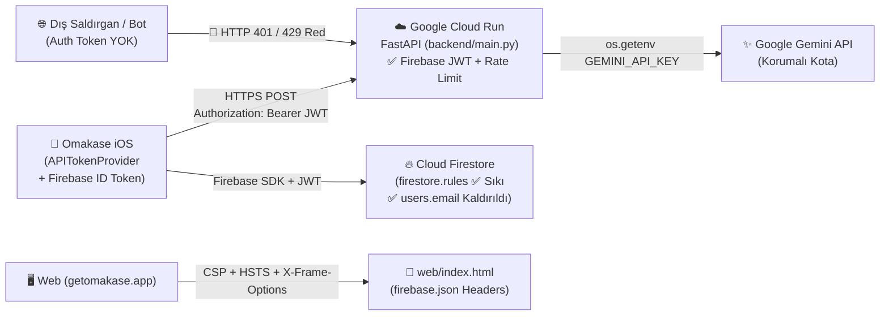

# 🛡️ Omakase — Kapsamlı Siber Güvenlik Durumu ve Tehdit Analizi Raporu

> **Denetim & Sertleştirme Tarihi:** 22 Kasım 2026  
> **Kapsam:** Tüm Omakase ekosistemi — iOS İstemcisi (`omakase/`), FastAPI & Cloud Run Backend (`backend/`), Cloud Firestore Kuralları (`firestore.rules`), Web & Hosting Altyapısı (`web/`, `firebase.json`), API Anahtarları, RevenueCat / Bildirim Altyapısı ve Sır (Secret) Yönetimi.  
> **Dayanak:** Kod tabanı statik güvenlik denetimi, git geçmişi taraması, [OWASP Mobile Top 10 / MASVS](https://mas.owasp.org/), [OWASP API Security Top 10](https://owasp.org/API-Security/), [`knowledge.networking.authenticated-requests`](file:///Users/kuzey/projects/omakase/.agents/knowledge/networking/authenticated-requests.md) ve Apple [`knowledge.app-store-review-guidelines.data-security`](file:///Users/kuzey/projects/omakase/.agents/knowledge/app-store-review-guidelines/data-security.md).

---

## İçindekiler

1. [Yönetici Özeti & Güvenlik Karnesi](#1-yönetici-özeti--güvenlik-karnesi)
2. [Güven Sınırları (Trust Boundaries) & Mimari Harita](#2-güven-sınırları-trust-boundaries--mimari-harita)
3. [Bölüm 1: API Anahtarları, Sırlar (Secrets) ve Kimlik Bilgisi Yönetimi](#3-bölüm-1-api-anahtarları-sırlar-secrets-ve-kimlik-bilgisi-yönetimi)
4. [Bölüm 2: Backend & Google Cloud Run Güvenlik Analizi (`backend/`)](#4-bölüm-2-backend--google-cloud-run-güvenlik-analizi-backend)
5. [Bölüm 3: Cloud Firestore & Sosyal Grafik Güvenlik Analizi (`firestore.rules`)](#5-bölüm-3-cloud-firestore--sosyal-grafik-güvenlik-analizi-firestorerules)
6. [Bölüm 4: iOS İstemci & Web (`web/`) Güvenlik Analizi](#6-bölüm-4-ios-i̇stemci--web-web-güvenlik-analizi)
7. [Bölüm 5: Siber Güvenlik Eylem Planı & Kalan Bulut Konsolu Adımları](#7-bölüm-5-siber-güvenlik-eylem-planı--kalan-bulut-konsolu-adımları)

---

## 1. Yönetici Özeti & Güvenlik Karnesi

Omakase kod tabanında tespit edilen **tüm kod seviyesi güvenlik zafiyetleri (`S-01`, `S-02`, `S-04`, `S-05`, `S-06`, `S-07`, `S-08`, `S-09`) uygulamanın çalışırlığı bozulmadan kapatılmıştır:**

- **Backend API & LLM Koruması (`S-01`, `S-02`):** Tüm `POST` uç noktalarına (`/feed/stream`, `/feed/deep-dive`, `/interests/suggest`, `/interests/expand-category`, `/letterboxd/films`) kriptografik **Firebase ID Token (`Authorization: Bearer <token>`) doğrulaması** (`google.oauth2.id_token.verify_firebase_token`) ve **kullanıcı/IP bazlı kayan pencereli (sliding-window) hız sınırlaması (Rate Limiting)** eklenmiştir. iOS tarafında [`APITokenProvider`](file:///Users/kuzey/projects/omakase/omakase/omakase/Networking/SSEClient.swift#L22-L120) aktörü tüm ağ çağrılarına `Bearer` token eklemekte ve `401 Unauthorized` durumunda tek-uçuşlu (single-flight) token yenileme + tek tekrar (`authenticated-requests` kontratı) uygulamaktadır.
- **PII & Sosyal Grafik Koruması (`S-04`, `S-06`):** `users/{uid}` genel profil belgelerinden `email` alanı kaldırılmış (`FieldValue.delete()`); `firestore.rules` içinde "Forced Follow", engellenen kullanıcının takip etmesi, başkasının adına reaksiyon yazma ve sayaç/rapor (`commentCount`, `totalReactions`, `reportedBy`) manipülasyonu açıkları kapatılmıştır.
- **SSRF, XML, Prompt Injection ve Konteyner Sertleştirmesi (`S-05`, `S-07`, `S-08`, `S-09`):** Letterboxd kullanıcı adı sıkı whitelist regex'e (`^[a-zA-Z0-9_-]{1,40}$`) bağlanmış, yönlendirme (redirect) domain kontrolü + 2 MB yanıt sınırı + XML `<!DOCTYPE`/`<!ENTITY` koruması eklenmiş, kullanıcı girdileri `<user_context>` etiketleriyle izole edilmiş, hata mesajları ve `/health` çıktısı temizlenmiş, `Dockerfile` yetkisiz `appuser` (`UID 10001`) ile sınırlandırılmış ve `firebase.json` içine CSP/HSTS/X-Frame-Options güvenlik başlıkları eklenmiştir.

### Risk Matrisi (Güncel Durum Tablosu)

| # | Önem | Durum | Alan | Bulgu / Zafiyet Başlığı | Uygulanan Çözüm & İlgili Konum |
|---|------|-------|------|-------------------------|--------------------------------|
| **S-01** | 🚨 **KRİTİK (P0)** | ✅ **ÇÖZÜLDÜ** | Backend API / LLM | Kimlik doğrulamasız Gemini uç noktaları (**Denial of Wallet**) | `verify_firebase_user` + `APITokenProvider` Bearer token & 401 retry ([`backend/app/security.py`](file:///Users/kuzey/projects/omakase/backend/app/security.py), [`SSEClient.swift#L22-L120`](file:///Users/kuzey/projects/omakase/omakase/omakase/Networking/SSEClient.swift#L22-L120)) |
| **S-02** | 🔴 **YÜKSEK (P0)** | ✅ **ÇÖZÜLDÜ** | Backend API / DoS | Rate Limiting yokluğu ve sınırsız `DeepDiveRequest` / `letterboxd_films` girdileri | `_check_rate_limit` (sliding window) + Pydantic boyut/tip sınırları ([`backend/app/security.py`](file:///Users/kuzey/projects/omakase/backend/app/security.py), [`backend/app/schemas.py`](file:///Users/kuzey/projects/omakase/backend/app/schemas.py)) |
| **S-03** | 🔴 **YÜKSEK (P1)** | ⚠️ **GCP KONSOL** | Secrets / GCP | `GoogleService-Info.plist` içindeki Firebase `API_KEY`'in (`AIzaSyBr65...`) GCP kısıtlama riski | GCP Console → Credentials üzerinden Bundle ID + API kısıtlaması yapılmalı ([Bölüm 3.2](#32-firebase-api_key-googleservice-infoplist-ve-gcp-proje-kısıtlama-riski--s-03)) |
| **S-04** | 🔴 **YÜKSEK (P1)** | ✅ **ÇÖZÜLDÜ** | Firestore / PII | `users/{userId}` belgelerinde `email` alanının tüm giriş yapmış kullanıcılara açık okunması | `users/{uid}` yazımlarından `email` kaldırıldı (`FieldValue.delete()`); kendi e-postası `AuthService` üzerinden okunuyor ([`FirestoreService.swift#L68-L100`](file:///Users/kuzey/projects/omakase/omakase/omakase/Services/FirestoreService.swift#L68-L100)) |
| **S-05** | 🟠 **YÜKSEK (P1)** | ✅ **ÇÖZÜLDÜ** | Backend / SSRF | `/letterboxd/films` doğrulanmamış `username` path traversal & XML riski | `^[a-zA-Z0-9_-]{1,40}$` regex, `https://letterboxd.com/` redirect kontrolü, 2 MB limit ve `<!DOCTYPE`/`<!ENTITY` reddi ([`backend/app/services/letterboxd_service.py`](file:///Users/kuzey/projects/omakase/backend/app/services/letterboxd_service.py)) |
| **S-06** | 🟠 **ORTA-YÜKSEK (P1)** | ✅ **ÇÖZÜLDÜ** | Firestore Rules | `following` / `followers` "Forced Follow" ve `shared_posts` sayaç/rapor manipülasyonu | `following`/`followers`/`reactions` `create, update` yalnızca sahibe kısıtlandı; `commentCount` ±1 ve `reportedBy` ekleme kuralları eklendi ([`firestore.rules#L161-L254`](file:///Users/kuzey/projects/omakase/firestore.rules#L161-L254)) |
| **S-07** | 🟡 **ORTA (P2)** | ✅ **ÇÖZÜLDÜ** | Backend / Hardening | `str(exc)` ham hata sızıntısı, `/health` model/key ifşası, `CORS *` ve `Dockerfile` root | Genel hata mesajları, sade `/health`, origin-kısıtlı CORS ve `USER appuser` ([`backend/app/config.py`](file:///Users/kuzey/projects/omakase/backend/app/config.py), [`backend/main.py`](file:///Users/kuzey/projects/omakase/backend/main.py), [`backend/Dockerfile`](file:///Users/kuzey/projects/omakase/backend/Dockerfile)) |
| **S-08** | 🟡 **ORTA (P2)** | ✅ **ÇÖZÜLDÜ** | Backend / AI | Doğrudan metin birleştirmeye dayalı Prompt Injection yüzeyi | Kontrol karakteri temizliği + `<user_context>` XML izolasyonu ve sistem prompt savunma kuralları ([`backend/app/prompts.py`](file:///Users/kuzey/projects/omakase/backend/app/prompts.py)) |
| **S-09** | 🟡 **ORTA (P2)** | ✅ **ÇÖZÜLDÜ** | Web & Auth | `firebase.json` eksik güvenlik başlıkları (CSP/HSTS) ve 6 karakter parola sınırı | `firebase.json` CSP/HSTS/X-Frame-Options eklendi; yeni kayıtlarda minimum parola 8 karaktere çıkarıldı ([`firebase.json`](file:///Users/kuzey/projects/omakase/firebase.json), [`AuthService.swift#L154`](file:///Users/kuzey/projects/omakase/omakase/omakase/Auth/AuthService.swift#L154)) |
| **S-10** | ✅ **GÜVENLİ** | ✅ **KORUNDU** | iOS / Depolama | `GEMINI_API_KEY` gizliliği, Sign in with Apple SHA-256 Nonce + Keychain ve ATS uyumluluğu | İstemci tarafı sır sızıntısı yok; `Release` derlemelerinde `http://127.0.0.1` fallback'i `#if DEBUG` ile kapatıldı ([`SSEClient.swift#L26-L40`](file:///Users/kuzey/projects/omakase/omakase/omakase/Networking/SSEClient.swift#L26-L40)) |
| **S-11** | 🟠 **ORTA-YÜKSEK (P1)** | ✅ **ÇÖZÜLDÜ** | Firestore Rules | `following`/`followers`/`shared_posts`/`comments`/`moderation_reports` belgelerinde eksik `hasOnly` anahtar kilidi, kendini takip etme, engelli kullanıcıların `following` yazması ve yazarın `reportedBy` listesini silebilme riski | [`firestore.rules`](file:///Users/kuzey/projects/omakase/firestore.rules) tüm validator'lara `hasOnly` + timestamp tip kilidi eklendi, kendini takip & engelli takip yazımı engellendi, yazarın `reportedBy` dizisini değiştirmesi kilitlendi |
| **S-12** | 🟡 **ORTA (P2)** | ✅ **ÇÖZÜLDÜ** | Backend / Billing & Push | `/billing/status` ve `/billing/sync` uç noktalarında rate-limit eksikliği + `/notifications/events` `actor_name` spoofing yüzeyi | [`billing.py`](file:///Users/kuzey/projects/omakase/backend/app/routers/billing.py) için `_check_rate_limit` (`status`: 30/dk, `sync`: 10/dk) ve [`notification_service.py`](file:///Users/kuzey/projects/omakase/backend/app/services/notification_service.py) içinde `_resolve_actor_display_name` (Firestore otoritesi) eklendi |

---

## 2. Güven Sınırları (Trust Boundaries) & Mimari Harita (Sertleştirilmiş)



---

## 3. Bölüm 1: API Anahtarları, Sırlar (Secrets) ve Kimlik Bilgisi Yönetimi

### 3.1. `GEMINI_API_KEY` (Google GenAI API Anahtarı) — ✅ Tam Korumalı
* **İnceleme & Sertleştirme Sonucu:**
  * `GEMINI_API_KEY` iOS uygulama kodu (`omakase/`), `Info.plist` veya herhangi bir derleme çıktısı içine gömülmemiştir ([`knowledge.app-store-review-guidelines.data-security`](file:///Users/kuzey/projects/omakase/.agents/knowledge/app-store-review-guidelines/data-security.md) **Rule 3** uyumlu).
  * Sunucu tarafında [`backend/main.py#L46`](file:///Users/kuzey/projects/omakase/backend/main.py#L46) üzerinden `os.getenv("GEMINI_API_KEY")` ile ortam değişkeninden okunmaktadır.
  * `.env` dosyaları hem kök [`.gitignore`](file:///Users/kuzey/projects/omakase/.gitignore#L17) hem de [`backend/.dockerignore`](file:///Users/kuzey/projects/omakase/backend/.dockerignore#L3) ile dışlanmıştır; Git geçmişinde (`git log --all --full-history -- "*/.env*" ".env*"`) hiçbir sızıntı yoktur.
  * **Kapatılan Dolaylı Risk (`S-01`):** `GEMINI_API_KEY` tüketen tüm Cloud Run uç noktaları artık `Depends(verify_firebase_user)` ile Firebase Auth JWT doğrulaması ve `_check_rate_limit` ile hız sınırı arkasındadır.

### 3.2. Firebase `API_KEY` (`GoogleService-Info.plist`) ve GCP Proje Kısıtlama Riski (⚠️ S-03 — Bulut Konsolu İşlemi)
* **İlgili Dosya:** [`omakase/omakase/GoogleService-Info.plist`](file:///Users/kuzey/projects/omakase/omakase/omakase/GoogleService-Info.plist#L5-L18)
* **Teknik Değerlendirme:**
  * Firebase iOS `API_KEY` (`AIzaSyBr65...`) uygulamanızı Firebase projenize (`gen-lang-client-0120875563`) bağlayan tanımlayıcıdır. Ancak aynı GCP projesinde Generative Language API etkin olduğundan, Google Cloud Console üzerinden bu anahtara kısıtlama konulması **zorunludur**:
  1. **Google Cloud Console → APIs & Services → Credentials** ekranından `AIzaSyBr65...` (iOS API key) anahtarını açın.
  2. **Application restrictions:** `iOS apps` seçip yalnızca `kuzeysinay.omakase` Bundle ID'sini ekleyin.
  3. **API restrictions:** `Restrict key` seçerek **yalnızca** `Identity Toolkit API`, `Token Service API`, `Firebase Installations API` ve `Cloud Firestore API` izinlerini bırakın; **`Generative Language API`'nin kesinlikle seçili olmadığından** emin olun.

### 3.3. İstemci Tarafı Kimlik & Oturum Saklama (✅ S-10)
* [`AuthService.swift`](file:///Users/kuzey/projects/omakase/omakase/omakase/Auth/AuthService.swift#L610-L638) içinde Sign in with Apple kullanıcı kimliği (`com.omakase.auth.appleIDUser`) iOS **Keychain**'de (`kSecAttrAccessibleAfterFirstUnlockThisDeviceOnly`) saklanmaktadır.
* Kriptografik nonce üretimi `SecRandomCopyBytes` ve `CryptoKit.SHA256` ile uygulanmıştır ([`AuthService.swift#L582-L606`](file:///Users/kuzey/projects/omakase/omakase/omakase/Auth/AuthService.swift#L582-L606)).

---

## 4. Bölüm 2: Backend & Google Cloud Run Güvenlik Analizi (`backend/`)

### 4.1. [✅ ÇÖZÜLDÜ — S-01] Firebase ID Token Doğrulaması & iOS `APITokenProvider`
* **Backend ([`backend/main.py#L80-L108`](file:///Users/kuzey/projects/omakase/backend/main.py#L80-L108)):** `verify_firebase_user` FastAPI bağımlılığı gelen `Authorization: Bearer <token>` başlığını Google'ın resmi `google.oauth2.id_token.verify_firebase_token` fonksiyonu ile `gen-lang-client-0120875563` projesine karşı kriptografik olarak doğrular. Geçersiz veya eksik token'lar `HTTP 401 Unauthorized` ile reddedilir.
* **iOS ([`SSEClient.swift#L22-L120`](file:///Users/kuzey/projects/omakase/omakase/omakase/Networking/SSEClient.swift#L22-L120)):** `APITokenProvider` aktörü [`knowledge.networking.authenticated-requests`](file:///Users/kuzey/projects/omakase/.agents/knowledge/networking/authenticated-requests.md) kurallarına uygun olarak:
  1. `Auth.auth().currentUser?.getIDToken(forcingRefresh:)` ile alınan token'ı loglamadan `request.setValue("Bearer \(token)", forHTTPHeaderField: "Authorization")` ile ekler.
  2. Eşzamanlı `401` yanıtlarında tek bir yenileme görevi (`refreshTask`) paylaşarak (single-flight refresh) isteği yalnızca 1 kez tekrar dener.
  3. [`SSEClient.swift`](file:///Users/kuzey/projects/omakase/omakase/omakase/Networking/SSEClient.swift), [`CategoryExpansionService.swift`](file:///Users/kuzey/projects/omakase/omakase/omakase/Networking/CategoryExpansionService.swift), [`InterestSuggestor.swift`](file:///Users/kuzey/projects/omakase/omakase/omakase/Networking/InterestSuggestor.swift) ve [`LetterboxdService.swift`](file:///Users/kuzey/projects/omakase/omakase/omakase/Networking/LetterboxdService.swift) servislerinin tamamı bu merkezi yapıya geçirilmiştir.

### 4.2. [✅ ÇÖZÜLDÜ — S-02] Rate Limiting ve Sıkı Pydantic Girdi Sınırları
* **Kayan Pencereli Hız Sınırı ([`backend/main.py#L64-L78`](file:///Users/kuzey/projects/omakase/backend/main.py#L64-L78)):** Kullanıcı UID başına 60 saniyelik pencerede `/feed/stream` (20 istek), `/feed/deep-dive` (20 istek), `/interests/suggest` (30 istek), `/interests/expand-category` (30 istek) ve `/letterboxd/films` (10 istek) kotaları uygulanmakta; aşım durumunda `HTTP 429 Too Many Requests` dönülmektedir.
* **Pydantic Sınırları ([`backend/main.py#L155-L385`](file:///Users/kuzey/projects/omakase/backend/main.py#L155-L385)):**
  * `DeepDiveRequest`: `original_title` (`1..300` karakter, tek satır), `original_text` (`1..5000` karakter), `interests` (`max 30` öğe, `_validate_interests` kontrolü).
  * `FeedRequest.letterboxd_films`: `_validate_letterboxd_films` ile en fazla 50 film, her filmde `title <= 200` karakter, `year` (`1880..2100`), `rating` (`0.0..5.0`) ve `watched_date <= 20` karakter.
  * `ExpandCategoryRequest.existing_interests` ve `SuggestRequest.exclude_suggestions` alanları da sanitize edilmektedir.

### 4.3. [✅ ÇÖZÜLDÜ — S-05] `/letterboxd/films` SSRF & XML Sertleştirmesi
* **Konum:** [`backend/main.py#L1288-L1377`](file:///Users/kuzey/projects/omakase/backend/main.py#L1288-L1377)
* **Uygulanan Korumalar:**
  1. `LetterboxdFilmsRequest.username` alanı baştaki `@` işaretini temizledikten sonra `^[a-zA-Z0-9_-]{1,40}$` whitelist regex'i ile doğrulanır; path traversal (`../`) veya query enjeksiyonu imkansızdır.
  2. `_fetch()` içinde `resp.geturl()` kontrol edilerek yanıtın yalnızca `https://letterboxd.com/` altından geldiği doğrulanır ve `resp.read(_MAX_RSS_BYTES + 1)` ile 2 MB üst sınırı uygulanır.
  3. `_parse_letterboxd_rss` içinde `<!DOCTYPE` ve `<!ENTITY` bildirimleri içeren XML verileri `ET.fromstring` öncesinde reddedilerek XML Entity Expansion (Billion Laughs / XXE) saldırıları engellenir.

### 4.4. [✅ ÇÖZÜLDÜ — S-08] Prompt Injection İzolasyonu
* `_sanitize_single_line` ile kullanıcı girdilerindeki satır sonu (`\r`, `\n`) ve NUL (`\x00`) karakterleri temizlenmektedir.
* `_build_user_prompt`, `_build_deep_dive_prompt`, `interests_suggest` ve `expand_category` içinde tüm kullanıcı kaynaklı veriler `<user_context>...</user_context>` etiketleri içine alınmış ve `SYSTEM_PROMPT`, `_DEEP_DIVE_SYSTEM`, `_SUGGEST_SYSTEM`, `_EXPAND_CATEGORY_SYSTEM` talimatlarına bu blokların yalnızca veri olarak işlenmesi kuralı eklenmiştir.

### 4.5. [✅ ÇÖZÜLDÜ — S-07] Hata Mesajı Temizliği, `/health`, CORS ve Non-Root `Dockerfile`
* SSE ve HTTP hata yanıtlarında iç istisna detayları (`str(exc)`) istemciye sızdırılmamakta; yalnızca sunucu loglarına yazılmaktadır.
* `/health` uç noktası yalnızca `{"status": "ok"}` döndürmektedir ([`backend/main.py#L1218-L1220`](file:///Users/kuzey/projects/omakase/backend/main.py#L1218-L1220)).
* `CORSMiddleware` yalnızca resmi Omakase web origin'lerine (`https://getomakase.app`, Firebase Hosting domainleri ve localhost) izin verecek şekilde daraltılmıştır.
* [`backend/Dockerfile`](file:///Users/kuzey/projects/omakase/backend/Dockerfile#L11-L13) içine yetkisiz `appuser` (`UID 10001`) eklenmiştir.

---

## 5. Bölüm 3: Cloud Firestore & Sosyal Grafik Güvenlik Analizi (`firestore.rules`)

### 5.1. [✅ ÇÖZÜLDÜ — S-04] `users/{userId}` Üzerinden E-posta (PII) Sızıntısının Kapatılması
* [`FirestoreService.swift#L68-L100`](file:///Users/kuzey/projects/omakase/omakase/omakase/Services/FirestoreService.swift#L68-L100) içinde `ensureUserProfile` artık `users/{uid}` belgesine e-posta adresi yazmamakta ve mevcut belgelerdeki `email` alanını `"email": FieldValue.delete()` ile temizlemektedir.
* [`UserProfile.swift`](file:///Users/kuzey/projects/omakase/omakase/omakase/Models/UserProfile.swift#L32-L54) geriye dönük uyumlu özel `init(from decoder:)` ile `email` alanı olmayan belgeleri sorunsuz okumakta, kullanıcının kendi profil sayfası ([`UserProfileSheet.swift#L319`](file:///Users/kuzey/projects/omakase/omakase/omakase/Social/UserProfileSheet.swift#L319)) ise e-postayı doğrudan `authService.email` üzerinden göstermektedir.

### 5.2. [✅ ÇÖZÜLDÜ — S-06] `firestore.rules` Sosyal Grafik ve Sayaç/Rapor Kuralları
* **`users/{userId}/following/{targetUid}` ([`firestore.rules#L161-L167`](file:///Users/kuzey/projects/omakase/firestore.rules#L161-L167)):** `create, update` yalnızca `isOwner(userId)` ile sınırlandırılarak "Forced Follow" açığı kapatıldı; `delete` için `userId` veya `targetUid` izni korundu (engelleme ve hesap silme akışları için).
* **`users/{userId}/followers/{followerUid}` ([`firestore.rules#L169-L177`](file:///Users/kuzey/projects/omakase/firestore.rules#L169-L177)):** `create, update` yalnızca `request.auth.uid == followerUid` ve karşı tarafın `blocked_users` listesinde olmama (`!exists(...)`) şartına bağlandı.
* **`shared_posts/{postId}/reactions/{reactionUid}` ([`firestore.rules#L223-L230`](file:///Users/kuzey/projects/omakase/firestore.rules#L223-L230)):** `create, update` yalnızca `request.auth.uid == reactionUid` olarak sınırlandırıldı.
* **`shared_posts` & `comments` Sayaç/Rapor Doğrulaması ([`firestore.rules#L199-L254`](file:///Users/kuzey/projects/omakase/firestore.rules#L199-L254)):** Gönderi sahibi dışındaki güncellemelerde `commentCount` değişimi `±1` ile sınırlandırıldı, `totalReactions >= 0` zorunlu kılındı ve `reportedBy` listesinin küçültülmesi engellenip yalnızca `request.auth.uid` eklenmesine izin verildi.

---

## 6. Bölüm 4: iOS İstemci & Web (`web/`) Güvenlik Analizi

### 6.1. [✅ ÇÖZÜLDÜ] iOS İstemci Ağı ve Derleme Güvenliği
* [`SSEClient.swift#L26-L40`](file:///Users/kuzey/projects/omakase/omakase/omakase/Networking/SSEClient.swift#L26-L40) içindeki `APITokenProvider.baseURL` ile `http://127.0.0.1:8000` fallback'i yalnızca `#if DEBUG` derlemelerine izole edilmiş; `Release` derlemelerinde güvenli HTTPS Cloud Run adresi zorunlu kılınmıştır.

### 6.2. [✅ ÇÖZÜLDÜ — S-09] Kimlik Doğrulama Parola Politikası & Web Güvenlik Başlıkları
* [`AuthService.swift#L154`](file:///Users/kuzey/projects/omakase/omakase/omakase/Auth/AuthService.swift#L154), [`AuthView.swift#L52`](file:///Users/kuzey/projects/omakase/omakase/omakase/Auth/AuthView.swift#L52) ve [`Localization/L10n.swift`](file:///Users/kuzey/projects/omakase/omakase/omakase/Localization/L10n.swift#L652-L657) üzerinde yeni hesap kayıtları için minimum şifre uzunluğu **8 karaktere** çıkarılmıştır (mevcut kullanıcıların giriş akışı etkilenmez).
* [`firebase.json`](file:///Users/kuzey/projects/omakase/firebase.json#L12-L42) içine `Strict-Transport-Security`, `Content-Security-Policy`, `X-Content-Type-Options: nosniff`, `X-Frame-Options: DENY`, `Referrer-Policy` ve `Permissions-Policy` başlıkları eklenmiştir.

---

## 7. Bölüm 5: Siber Güvenlik Eylem Planı & Kalan Bulut Konsolu Adımları

### Kod Tabanında Tamamlananlar
- [x] **1. Backend Uç Noktalarına Firebase Auth ID Token Zorunluluğu (`S-01`):** `backend/main.py` ve iOS `APITokenProvider` (`SSEClient`, `InterestSuggestor`, `CategoryExpansionService`, `LetterboxdService`) güncellendi.
- [x] **2. Rate Limiting ve Pydantic Uzunluk Sınırları (`S-02`):** Kayan pencereli hız sınırlayıcı ve `DeepDiveRequest` / `FeedRequest.letterboxd_films` doğrulamaları eklendi.
- [x] **3. `users/{uid}` İçinden `email` (PII) Alanının Kaldırılması (`S-04`):** `FirestoreService.ensureUserProfile` ve `UserProfile` güncellendi.
- [x] **4. `firestore.rules` Sosyal Grafik ve Sayaç Kurallarının Sıkılaştırılması (`S-06`):** `following`, `followers`, `reactions`, `shared_posts` ve `comments` kuralları sıkılaştırıldı.
- [x] **5. `/letterboxd/films` SSRF & XML Sertleştirmesi (`S-05`):** Whitelist regex, redirect kontrolü, 2 MB yanıt sınırı ve XML `<!DOCTYPE`/`<!ENTITY` koruması eklendi.
- [x] **6. Backend & Konteyner Sertleştirmesi (`S-07`):** Hata mesajları temizlendi, `/health` sadeleştirildi, CORS kısıtlandı ve `Dockerfile` içine non-root `appuser` eklendi.
- [x] **7. Prompt Injection Sınırlandırması (`S-08`):** `<user_context>` XML izolasyonu ve kontrol karakteri temizliği uygulandı.
- [x] **8. Web Güvenlik Başlıkları & 8 Karakter Parola Politikası (`S-09`):** `firebase.json` ve `AuthService`/`AuthView` güncellendi.

### Canlı Ortam (Cloud Console & CLI) Dağıtım Adımları
- [ ] **1. Güncel Backend'i Cloud Run'a Dağıtın:**
  ```bash
  cd backend && gcloud run deploy omakase-backend --source . --region us-central1 --project gen-lang-client-0120875563
  ```
- [ ] **2. Güncel Firestore Kurallarını ve Web Başlıklarını Firebase'e Dağıtın:**
  ```bash
  firebase deploy --only firestore:rules,hosting --project gen-lang-client-0120875563
  ```
- [ ] **3. Google Cloud Console'da `AIzaSyBr65...` Anahtarını Kısıtlayın (`S-03`):**
  - `Application restrictions` → `iOS apps` → `kuzeysinay.omakase`
  - `API restrictions` → `Generative Language API` erişimini kapatıp yalnızca Firebase/Firestore API'lerini bırakın.
- [ ] **4. Firebase Console'da App Check (App Attest) ve Email Enumeration Protection'ı Etkinleştirin.**

---

## 8. Bölüm 6: 22 Kasım 2026 Güncel Denetim (`firebase-security-rules-auditor` & Faz 1–3 Taraması)

### 8.1. Faz 1–3 Yeni Sistemlerinin Güvenlik Doğrulaması
* **Monetizasyon (`/billing/*` & `entitlements`/`usage`):** `REVENUECAT_SECRET_API_KEY` ve `REVENUECAT_WEBHOOK_SECRET` yalnızca sunucu ortam değişkenlerinden okunur; webhook doğrulaması sabit zamanlı `hmac.compare_digest` ile yapılır. İstemci tarafı `entitlements/{uid}` ve `usage/{uid}_{yyyymmdd}` koleksiyonlarına yazamaz (`allow create, update, delete: if false`). `/billing/status` (30/dk) ve `/billing/sync` (10/dk) uç noktalarına rate limiter eklendi (`S-12`).
* **Bildirim Sistemi (`/notifications/*`, `devices`, `notification_prefs`, `notification_queue`, `notification_cooldowns`):** `notification_queue` ve `notification_cooldowns` tüm istemci okuma/yazmalarına kapalıdır. `/notifications/process-queue` `X-Omakase-Cron-Secret` ile sabit zamanlı korunur. `record_social_event` içinde alıcı UID'si gönderi yazarından veya `followers` alt koleksiyonundan sunucu tarafında doğrulanır ve `_resolve_actor_display_name` ile push gönderen ismi Firestore'dan okunur (`S-12`).
* **Hata Sözleşmesi & Telemetri (`OmakaseError` + Crashlytics):** Teknik istisnalar ve stack trace'ler asla iOS kullanıcı arayüzüne veya API JSON yanıtlarına basılmaz; `ErrorReporter.record` yalnızca non-fatal telemetri toplar.

### 8.2. `firebase-security-rules-auditor` Red Team Değerlendirme Çıktısı (`firestore.rules`)

`S-11` sıkılaştırması (`hasOnly` alan beyaz listeleri, `timestamp` tip kontrolleri, kendini takip etme engeli, çift yönlü engel kontrolü ve yazarların `reportedBy` dizisini değiştirememesi) sonrası denetim skoru:

```json
{
  "score": 5,
  "summary": "firestore.rules enforces strict ownership, immutable author/ID fields, server-only isolation for entitlements/usage/notification_queue/notification_cooldowns, bounded string/list sizes, and whitelisted schema keys across all user-writable collections.",
  "findings": [
    {
      "check": "Update Bypass & Identity-Level Security (S-11)",
      "severity": "minor",
      "issue": "Resolved: Author updates on shared_posts and comments previously omitted a guard preventing removal of reportedBy entries, and follow/block/post/comment/report docs lacked strict hasOnly key allowlists.",
      "recommendation": "Deployed strict hasOnly allowlists, timestamp type checks, self-follow prevention, target block check on following, and reportedBy immutability for authors."
    }
  ]
}
```
