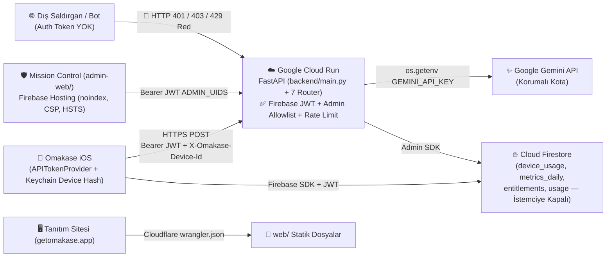

# 🛡️ Omakase — Kapsamlı Siber Güvenlik Durumu ve Tehdit Analizi Raporu

> **Denetim & Sertleştirme Tarihi:** 26 Kasım 2026  
> **Son Bağımsız Yeniden Denetim:** 26 Kasım 2026 — Cloudflare [`security-audit-skill`](https://github.com/cloudflare/security-audit-skill) (Run 1; keşif → kapsam güdümlü avlanma → doğrulama → `findings.json` → bağımsız doğrulama)  
> **Kapsam:** Tüm Omakase ekosistemi — iOS İstemcisi (`omakase/`), FastAPI & Cloud Run Backend (`backend/`), Mission Control Admin Paneli (`admin-web/`, Firebase Hosting), Tanıtım Web Sitesi (`web/`, Cloudflare `wrangler.json`), Cloud Firestore Kuralları (`firestore.rules`), API Anahtarları, RevenueCat / Bildirim Altyapısı ve Sır (Secret) Yönetimi.  
> **Dayanak:** Kod tabanı statik güvenlik denetimi, git geçmişi taraması, [OWASP Mobile Top 10 / MASVS](https://mas.owasp.org/), [OWASP API Security Top 10](https://owasp.org/API-Security/), [`knowledge.networking.authenticated-requests`](file:///Users/kuzey/projects/omakase/.agents/knowledge/networking/authenticated-requests.md) ve Apple [`knowledge.app-store-review-guidelines.data-security`](file:///Users/kuzey/projects/omakase/.agents/knowledge/app-store-review-guidelines/data-security.md).

---

## İçindekiler

1. [Yönetici Özeti & Güvenlik Karnesi](#1-yönetici-özeti--güvenlik-karnesi)
2. [Güven Sınırları (Trust Boundaries) & Mimari Harita](#2-güven-sınırları-trust-boundaries--mimari-harita)
3. [Bölüm 1: API Anahtarları, Sırlar (Secrets) ve Kimlik Bilgisi Yönetimi](#3-bölüm-1-api-anahtarları-sırlar-secrets-ve-kimlik-bilgisi-yönetimi)
4. [Bölüm 2: Backend & Google Cloud Run Güvenlik Analizi (`backend/`)](#4-bölüm-2-backend--google-cloud-run-güvenlik-analizi-backend)
5. [Bölüm 3: Cloud Firestore & Sosyal Grafik Güvenlik Analizi (`firestore.rules`)](#5-bölüm-3-cloud-firestore--sosyal-grafik-güvenlik-analizi-firestorerules)
6. [Bölüm 4: iOS İstemci, Mission Control (`admin-web/`) & Web (`web/`) Güvenlik Analizi](#6-bölüm-4-ios-i̇stemci-mission-control-admin-web--web-web-güvenlik-analizi)
7. [Bölüm 5: Siber Güvenlik Eylem Planı & Kalan Bulut Konsolu Adımları](#7-bölüm-5-siber-güvenlik-eylem-planı--kalan-bulut-konsolu-adımları)
8. [Bölüm 6: Güncel Denetim (26 Kasım 2026 — Faz 1–4, Admin & Cihaz Kota Koruması)](#8-bölüm-6-güncel-denetim-26-kasım-2026--faz-14-admin--cihaz-kota-koruması)
9. [Bölüm 7: Bağımsız Yeniden Denetim (26 Kasım 2026 — `security-audit-skill` Run 1)](#9-bölüm-7-bağımsız-yeniden-denetim-26-kasım-2026--security-audit-skill-run-1)

---

## 1. Yönetici Özeti & Güvenlik Karnesi

Önceki denetimde tespit edilen **tüm kritik ve yüksek öncelikli kod seviyesi zafiyetler (`S-01`, `S-02`, `S-04`–`S-15`) uygulamanın çalışırlığı bozulmadan kapatılmıştır:**

- **Backend API, LLM & Admin Koruması (`S-01`, `S-02`, `S-12`, `S-14`):** Tüm kullanıcı uç noktalarına kriptografik **Firebase ID Token (`Authorization: Bearer <token>`) doğrulaması** ve **sliding-window hız sınırlaması** eklenmiştir. Tüm `/admin/*` uç noktaları ayrıca `verify_admin_user` (`ADMIN_UIDS` / doğrulanmış `ADMIN_EMAILS`, 401/403) ile korunur. iOS tarafında [`APITokenProvider`](file:///Users/kuzey/projects/omakase/omakase/omakase/Networking/SSEClient.swift#L16-L133) aktörü single-flight `401` yenileme ve `X-Omakase-Device-Id` eklemesi yapar.
- **Cihaz-Bazlı Kota Suistimali Koruması (`S-13`):** Ücretsiz günlük 3 post / 1 Letterboxd / 1 Derin İnceleme sınırının Apple, Google ve E-posta hesapları arasında geçiş yapılarak veya hesap silip yeniden açılarak aşılmasını önlemek için Keychain tabanlı anonim kurulum kimliği (`quotaDeviceID`) + sunucu tarafı SHA-256 `device_usage/{hash}_{yyyymmdd}` birleştirmesi devreye alınmıştır.
- **PII, Atomik Kullanıcı Adı & Sosyal Grafik (`S-04`, `S-06`, `S-11`, `S-15`):** `users/{uid}` belgelerinden `email` ve üçüncü taraf `photoURL` alanları temizlenmiştir (`FieldValue.delete()`); `usernames/{handle}` koleksiyonu ile atomik benzersizlik ve `firestore.rules` içinde **14 günlük kullanıcı adı değiştirme beklemesi** (`isValidUsernameUpdate`) zorunlu kılınmıştır.
- **Mission Control İzolasyonu, SSRF, XXE & Prompt Injection (`S-05`, `S-07`, `S-08`, `S-09`, `S-14`):** `admin-web/` paneli `web/`'den tamamen ayrılarak Firebase Hosting üzerinde `noindex, nofollow`, COOP, HSTS ve sıkı CSP ile izole edilmiştir; `web/` (`getomakase.app`) ise Cloudflare (`wrangler.json`) üzerinden sunulur.

> **26 Kasım 2026 Sertleştirme & Dağıtım Güncellemesi:** Cloudflare `security-audit-skill` ile yapılan ikinci tur denetimdeki **9 bulgunun tamamı (`S-16`–`S-24`)**, ek olarak tespit edilen **4 doğrulama/sertleştirme bulgusu (`S-25`–`S-28`)**, 7 dilli `firestore.rules` genişletmesi ve son kalan GCP Console adımı **`S-03`** (`iOS key` → `kuzeysinay.omakase` + 7 minimal API; `Browser key` → Firebase Hosting origin + 5 minimal API) tamamlandı; **38/38 backend birim testi** ve iOS fiziksel cihaz derlemesi başarıyla geçti, Cloud Run (`omakase-backend-00023-68f`) ile Firebase (`firestore:rules` + `hosting`) canlıya alındı (`0965ee9` / `a6f2982`). Tüm **28/28 güvenlik bulgusu** kapatılmıştır.

### Risk Matrisi (Güncel Durum Tablosu)

| # | Önem | Durum | Alan | Bulgu / Zafiyet Başlığı | Uygulanan Çözüm & İlgili Konum |
|---|------|-------|------|-------------------------|--------------------------------|
| **S-01** | 🚨 **KRİTİK (P0)** | ✅ **ÇÖZÜLDÜ** | Backend API / LLM | Kimlik doğrulamasız Gemini uç noktaları (**Denial of Wallet**) | `verify_firebase_user` + `APITokenProvider` Bearer token & 401 retry ([`backend/app/security.py`](file:///Users/kuzey/projects/omakase/backend/app/security.py#L89-L140), [`SSEClient.swift#L16-L133`](file:///Users/kuzey/projects/omakase/omakase/omakase/Networking/SSEClient.swift#L16-L133)) |
| **S-02** | 🔴 **YÜKSEK (P0)** | ✅ **ÇÖZÜLDÜ** | Backend API / DoS | Rate Limiting yokluğu ve sınırsız `DeepDiveRequest` / `letterboxd_films` girdileri | `_check_rate_limit` (sliding window) + Pydantic boyut/tip sınırları ([`backend/app/security.py#L64-L87`](file:///Users/kuzey/projects/omakase/backend/app/security.py#L64-L87), [`backend/app/schemas.py`](file:///Users/kuzey/projects/omakase/backend/app/schemas.py)) |
| **S-03** | 🔴 **YÜKSEK (P1)** | ✅ **ÇÖZÜLDÜ & CANLIDA** | Secrets / GCP | `GoogleService-Info.plist` içindeki Firebase `API_KEY`'in (`AIzaSyBr65...`) GCP kısıtlama riski | `gcloud services api-keys update` ile iOS key `kuzeysinay.omakase` + 7 minimal API'ye (`Generative Language API` kapalı), Browser key Firebase Hosting origin + 5 API'ye kilitlendi ([Bölüm 3.2](#32-firebase-api_key-googleservice-infoplist-ve-gcp-proje-kısıtlama-riski--s-03)) |
| **S-04** | 🔴 **YÜKSEK (P1)** | ✅ **ÇÖZÜLDÜ** | Firestore / PII | `users/{userId}` belgelerinde `email` alanının tüm giriş yapmış kullanıcılara açık okunması | `users/{uid}` yazımlarından `email` ve `photoURL` silindi (`FieldValue.delete()`); e-posta `AuthService`'ten okunuyor ([`FirestoreService.swift#L89-L93`](file:///Users/kuzey/projects/omakase/omakase/omakase/Services/FirestoreService.swift#L89-L93)) |
| **S-05** | 🟠 **YÜKSEK (P1)** | ✅ **ÇÖZÜLDÜ** | Backend / SSRF | `/letterboxd/films` doğrulanmamış `username` path traversal & XML riski | `^[a-zA-Z0-9_-]{1,40}$` regex, `https://letterboxd.com/` redirect kontrolü, 2 MB limit ve `<!DOCTYPE`/`<!ENTITY` reddi ([`letterboxd_service.py`](file:///Users/kuzey/projects/omakase/backend/app/services/letterboxd_service.py)) |
| **S-06** | 🟠 **ORTA-YÜKSEK (P1)** | ✅ **ÇÖZÜLDÜ** | Firestore Rules | `following` / `followers` "Forced Follow" ve `shared_posts` sayaç/rapor manipülasyonu | `following`/`followers`/`reactions` `create, update` sahibe kısıtlandı; `commentCount` ±1 ve `reportedBy` ekleme kuralları eklendi ([`firestore.rules#L409-L537`](file:///Users/kuzey/projects/omakase/firestore.rules#L409-L537)) |
| **S-07** | 🟡 **ORTA (P2)** | ✅ **ÇÖZÜLDÜ** | Backend / Hardening | Ham hata sızıntısı, `/health` ifşası, `CORS *` ve `Dockerfile` root | Genel hata mesajları ([`errors.py`](file:///Users/kuzey/projects/omakase/backend/app/errors.py)), sade `/health` ([`main.py#L102-L105`](file:///Users/kuzey/projects/omakase/backend/main.py#L102-L105)), `ALLOWED_CORS_ORIGINS` ([`config.py#L89-L96`](file:///Users/kuzey/projects/omakase/backend/app/config.py#L89-L96)) ve `USER appuser` ([`Dockerfile#L12-L13`](file:///Users/kuzey/projects/omakase/backend/Dockerfile#L12-L13)) |
| **S-08** | 🟡 **ORTA (P2)** | ✅ **ÇÖZÜLDÜ** | Backend / AI | Doğrudan metin birleştirmeye dayalı Prompt Injection yüzeyi | `_sanitize_single_line` + `<user_context>` XML izolasyonu ve sistem prompt savunma kuralları ([`backend/app/prompts.py`](file:///Users/kuzey/projects/omakase/backend/app/prompts.py)) |
| **S-09** | 🟡 **ORTA (P2)** | ✅ **ÇÖZÜLDÜ** | Web & Auth | Hosting güvenlik başlıkları (CSP/HSTS) ve 6 karakter parola sınırı | `firebase.json` CSP/HSTS/COOP/X-Frame-Options eklendi; yeni kayıtlarda minimum parola 8 karaktere çıkarıldı ([`firebase.json`](file:///Users/kuzey/projects/omakase/firebase.json), [`AuthService.swift`](file:///Users/kuzey/projects/omakase/omakase/omakase/Auth/AuthService.swift)) |
| **S-10** | ✅ **GÜVENLİ** | ✅ **KORUNDU** | iOS / Depolama | `GEMINI_API_KEY` gizliliği, Apple SHA-256 Nonce + Keychain ve ATS uyumluluğu | İstemci tarafı API sır sızıntısı yok; `Release` derlemelerinde `http://127.0.0.1` fallback'i `#if DEBUG` ile izole ([`SSEClient.swift#L25-L37`](file:///Users/kuzey/projects/omakase/omakase/omakase/Networking/SSEClient.swift#L25-L37)) |
| **S-11** | 🟠 **ORTA-YÜKSEK (P1)** | ✅ **ÇÖZÜLDÜ** | Firestore Rules | Eksik `hasOnly` anahtar kilidi, kendini takip, engelli takip ve `reportedBy` silme riski | [`firestore.rules`](file:///Users/kuzey/projects/omakase/firestore.rules) tüm validator'lara `hasOnly` + timestamp tip kilidi eklendi, kendini takip & engelli takip engellendi, yazarın `reportedBy` değiştirmesi kilitlendi |
| **S-12** | 🟡 **ORTA (P2)** | ✅ **ÇÖZÜLDÜ** | Backend / Billing & Push | `/billing/status`, `/billing/sync` rate-limit eksikliği + `actor_name` spoofing | [`billing.py`](file:///Users/kuzey/projects/omakase/backend/app/routers/billing.py) rate limit (`30/dk`, `10/dk`) + [`notification_service.py`](file:///Users/kuzey/projects/omakase/backend/app/services/notification_service.py) `_resolve_actor_display_name` eklendi |
| **S-13** | 🟠 **YÜKSEK (P1)** | ✅ **ÇÖZÜLDÜ** | Kota / Anti-Abuse | Ücretsiz kullanıcıların hesap değiştirerek/silerek günlük 3 post sınırını atlaması | Keychain `quotaDeviceID` (`kSecAttrAccessibleAfterFirstUnlockThisDeviceOnly`) + `X-Omakase-Device-Id` + sunucu SHA-256 `device_usage` ([`SSEClient.swift#L42-L79`](file:///Users/kuzey/projects/omakase/omakase/omakase/Networking/SSEClient.swift#L42-L79), [`access_service.py#L182-L299`](file:///Users/kuzey/projects/omakase/backend/app/services/access_service.py#L182-L299)) |
| **S-14** | 🔴 **YÜKSEK (P1)** | ✅ **ÇÖZÜLDÜ** | Admin & Hosting | Mission Control uç noktalarının korunması ve admin panelinin halka açık siteden ayrılması | `verify_admin_user` (`ADMIN_UIDS` / verified `ADMIN_EMAILS`) + `/admin/*` rate limits ([`security.py#L150-L235`](file:///Users/kuzey/projects/omakase/backend/app/security.py#L150-L235), [`admin.py`](file:///Users/kuzey/projects/omakase/backend/app/routers/admin.py)); `admin-web/` `firebase.json` üzerinde `noindex, nofollow` + CSP ile izole |
| **S-15** | 🟡 **ORTA (P2)** | ✅ **ÇÖZÜLDÜ** | Firestore / Kimlik | `@username` yarış durumu (race condition) ve sınırsız kimlik değiştirme | Atomik `usernames/{handle}` koleksiyonu + `isValidUsernameUpdate()` ile 14 günlük sunucu zamanlı bekleme ([`firestore.rules#L187-L213`](file:///Users/kuzey/projects/omakase/firestore.rules#L187-L213), [`firestore.rules#L454-L463`](file:///Users/kuzey/projects/omakase/firestore.rules#L454-L463)) |

### 1.1. Bağımsız Yeniden Denetim & Ek Sertleştirme Özeti (S-16–S-28)

| # | Önem | Durum | Alan | Bulgu | Uygulanan Çözüm & İlgili Konum |
|---|------|-------|------|-------|--------------------------------|
| **S-16** | 🟠 **ORTA** | ✅ **ÇÖZÜLDÜ & CANLIDA** | Backend / Kota | SSE bağlantısı kesildiğinde günlük kota düşülmüyor; Gemini maliyeti kotasız üretilebiliyor | Üretim başında atomik `reserve_quota_slot` & hata/boş çıktı iadesi `refund_quota_slot` ([`access_service.py`](file:///Users/kuzey/projects/omakase/backend/app/services/access_service.py), [`gemini_service.py`](file:///Users/kuzey/projects/omakase/backend/app/services/gemini_service.py), [`feed.py`](file:///Users/kuzey/projects/omakase/backend/app/routers/feed.py), [`interests.py`](file:///Users/kuzey/projects/omakase/backend/app/routers/interests.py)) |
| **S-17** | 🟠 **ORTA** | ✅ **ÇÖZÜLDÜ & CANLIDA** | Backend / Bildirim | Sosyal bildirimler gerçek yorum/reaksiyon kaydına bağlı değil; sahte push ve içerik enjeksiyonu | `comment_id` yol doğrulaması ([`schemas.py`](file:///Users/kuzey/projects/omakase/backend/app/schemas.py)), Firestore `comments`/`reactions` + `reactorUids` kanıt doğrulaması ve sunucu metni kullanımı ([`notification_service.py`](file:///Users/kuzey/projects/omakase/backend/app/services/notification_service.py), [`FirestoreService.swift`](file:///Users/kuzey/projects/omakase/omakase/omakase/Services/FirestoreService.swift)) |
| **S-18** | 🟡 **DÜŞÜK** | ✅ **ÇÖZÜLDÜ & CANLIDA** | Firestore / Bütünlük | Herhangi bir kullanıcı gönderi sayaçlarını (`reactionCounts`, `totalReactions`) keyfi değiştirebiliyor | `isValidReactionKeyDelta`, `isValidReactionUpdate` ve `isValidCommentCountUpdate` ile ±1 tekil anahtar ve `reactions/{uid}` atomik kilidi ([`firestore.rules`](file:///Users/kuzey/projects/omakase/firestore.rules)) |
| **S-19** | 🟡 **DÜŞÜK** | ✅ **ÇÖZÜLDÜ & CANLIDA** | Firestore / PII | `users/{uid}` kuralları `email` alanını kabul ediyor ve tüm oturum açmış kullanıcılara okutuyor | `email` `isValidUserProfile` içinden çıkarıldı; `UserProfile.swift` `CodingKeys` + `encode(to:)` `email` yazımını durdurdu; 7 dil kurala eklendi ([`firestore.rules`](file:///Users/kuzey/projects/omakase/firestore.rules), [`UserProfile.swift`](file:///Users/kuzey/projects/omakase/omakase/omakase/Models/UserProfile.swift)) |
| **S-20** | 🟡 **DÜŞÜK** | ✅ **ÇÖZÜLDÜ & CANLIDA** | Backend / DoS | Hız sınırlayıcı süreç içi ve sınırsız büyüyor; çoklu Cloud Run örneklerinde aşılabilir | `_RATE_BUCKET_LAST_SEEN`, `_MAX_RATE_BUCKET_KEYS = 4096`, `300s` idle TTL ve `_prune_rate_buckets` eklendi ([`security.py`](file:///Users/kuzey/projects/omakase/backend/app/security.py)) |
| **S-21** | 🟡 **DÜŞÜK** | ✅ **ÇÖZÜLDÜ & CANLIDA** | Yapılandırma / Yetki | Yönetici UID'si ve 50 tabak kota istisnası kaynak kodda varsayılan olarak gömülü | Sabit UID varsayılanları kaldırıldı (fail-closed); `USER_DAILY_PLATES_OVERRIDES` env (`uid:limit,...`) üzerinden okunuyor ([`config.py`](file:///Users/kuzey/projects/omakase/backend/app/config.py), [`backend/.env.example`](file:///Users/kuzey/projects/omakase/backend/.env.example)) |
| **S-22** | 🟡 **DÜŞÜK** | ✅ **ÇÖZÜLDÜ & CANLIDA** | Admin / CSP | Mission Control CSP'si `script-src 'unsafe-inline'` ve üretimde localhost `connect-src` içeriyor | `script-src`'ten `'unsafe-inline'`, `connect-src`'ten `127.0.0.1:8000` ve `localhost:8000` kaldırıldı ([`firebase.json#L53`](file:///Users/kuzey/projects/omakase/firebase.json#L53)) |
| **S-23** | 🟡 **DÜŞÜK** | ✅ **ÇÖZÜLDÜ & CANLIDA** | Firestore / Moderasyon | `reportedBy` listesi kısmen değiştirilebiliyor; moderasyon kanıtı silinebilir/forjenebilir | `isValidReportedByAppend()` eklendi; oluştururken önceden doldurma, yazar güncellemesinde değiştirme yasaklandı; `hasAll(oldList)` + `size <= old + 1` zorunlu ([`firestore.rules`](file:///Users/kuzey/projects/omakase/firestore.rules)) |
| **S-24** | 🟡 **DÜŞÜK** | ✅ **ÇÖZÜLDÜ & CANLIDA** | Kota / Anti-abuse | Cihaz kotası istemci başlığına bağlı; başlık atlanarak/döndürülerek S-13 koruması devre dışı bırakılabilir | `REQUIRE_DEVICE_ID` (`OMAKASE_REQUIRE_DEVICE_ID=true`) + `_require_device_id_if_needed` (ücretsiz katmanda eksik/geçersiz başlığa HTTP 400); `/interests/*` başlık iletimi ([`config.py`](file:///Users/kuzey/projects/omakase/backend/app/config.py), [`access_service.py`](file:///Users/kuzey/projects/omakase/backend/app/services/access_service.py), [`interests.py`](file:///Users/kuzey/projects/omakase/backend/app/routers/interests.py)) |
| **S-25** | 🟠 **ORTA** | ✅ **ÇÖZÜLDÜ & CANLIDA** | Backend / Kota | İstemci saat dilimi manipülasyonuyla (`X-Omakase-Timezone`) günlük kota penceresini çoğaltma | `resolve_user_day` yalnızca UTC gün anahtarı ve bir sonraki UTC gece yarısına (`resets_at`) sabitlendi ([`access_service.py`](file:///Users/kuzey/projects/omakase/backend/app/services/access_service.py)) |
| **S-26** | 🟠 **ORTA** | ✅ **ÇÖZÜLDÜ & CANLIDA** | Backend / Dayanıklılık | Kalıcı Firestore başlatma hatası kilidi ve fail-open kota atlatma | 30 sn cooldown yeniden denemesi (`_init_failed_until`); Firestore erişilemezken `_check_quota_sync` ve `_reserve_quota_sync` `503 service_unavailable` ile fail-closed döner ([`firestore_admin.py`](file:///Users/kuzey/projects/omakase/backend/app/services/firestore_admin.py), [`access_service.py`](file:///Users/kuzey/projects/omakase/backend/app/services/access_service.py)) |
| **S-27** | 🟡 **DÜŞÜK** | ✅ **ÇÖZÜLDÜ & CANLIDA** | Admin / AI | `/admin/export?format=markdown` çıktısında dolaylı prompt / Markdown enjeksiyonu | `_sanitize_md_field` kontrol karakteri/Markdown kaçışı ve `<untrusted_user_submissions>` izolasyonu ([`admin_service.py`](file:///Users/kuzey/projects/omakase/backend/app/services/admin_service.py)) |
| **S-28** | 🟠 **ORTA** | ✅ **ÇÖZÜLDÜ & CANLIDA** | Backend / Kimlik | İptal edilmiş/devre dışı Firebase ID token'larının 300 sn önbellek penceresinde kabulü | `_VERIFIED_TOKEN_CACHE` ve `_VERIFIED_ADMIN_CACHE` kaldırıldı; `verify_firebase_user` & `verify_admin_user` `firebase_admin.auth.verify_id_token(token, check_revoked=True)` kullanır ([`security.py`](file:///Users/kuzey/projects/omakase/backend/app/security.py)) |
| **S-03** | 🔴 **YÜKSEK (koşullu)** | ✅ **ÇÖZÜLDÜ & CANLIDA** | Secrets / GCP | Firebase iOS API anahtarının GCP kısıtlamaları | iOS key `kuzeysinay.omakase` + 7 minimal Firebase API'ye, Browser key `gen-lang-client-0120875563.{web.app,firebaseapp.com}/*` + 5 API'ye kilitlendi; `generativelanguage.googleapis.com` kapalı doğrulandı ([`GoogleService-Info.plist#L10`](file:///Users/kuzey/projects/omakase/omakase/omakase/GoogleService-Info.plist#L10)) |

---

## 2. Güven Sınırları (Trust Boundaries) & Mimari Harita



---

## 3. Bölüm 1: API Anahtarları, Sırlar (Secrets) ve Kimlik Bilgisi Yönetimi

### 3.1. Sunucu Sırları (`GEMINI_API_KEY`, RevenueCat & Cron/Webhook) — ✅ Tam Korumalı
* [`backend/app/config.py#L21-L41`](file:///Users/kuzey/projects/omakase/backend/app/config.py#L21-L41) üzerinden tüm hassas anahtarlar (`GEMINI_API_KEY`, `REVENUECAT_SECRET_API_KEY`, `REVENUECAT_V2_SECRET_API_KEY`, `REVENUECAT_WEBHOOK_SECRET`, `NOTIFICATION_CRON_SECRET`, `ADMIN_ALERT_WEBHOOK_URL`) yalnızca ortam değişkenlerinden okunur; iOS istemcisine (`omakase/`) hiçbir sunucu gizli anahtarı gömülmemiştir ([`knowledge.app-store-review-guidelines.data-security`](file:///Users/kuzey/projects/omakase/.agents/knowledge/app-store-review-guidelines/data-security.md) **Rule 3** uyumlu).
* `.env` dosyaları kök [`.gitignore`](file:///Users/kuzey/projects/omakase/.gitignore) ve `backend/.dockerignore` ile dışlanmıştır.
* `REVENUECAT_WEBHOOK_SECRET` ve `NOTIFICATION_CRON_SECRET` doğrulamaları sabit zamanlı `hmac.compare_digest` ile yapılır.

### 3.2. Firebase `API_KEY` (`GoogleService-Info.plist`) ve GCP Proje Kısıtlama Riski (✅ ÇÖZÜLDÜ — S-03)
* **İlgili Dosya:** [`omakase/omakase/GoogleService-Info.plist`](file:///Users/kuzey/projects/omakase/omakase/omakase/GoogleService-Info.plist)
* **Uygulanan Çözüm (`gcloud services api-keys update` — 26 Kasım 2026):**
  1. **`iOS key` (`0d3d4fa9-b442-477b-9bb7-49948e734e56`):** `iosKeyRestrictions.allowedBundleIds` yalnızca `["kuzeysinay.omakase"]` olarak kilitlendi; `apiTargets` 27 servisten yalnızca gereken 7 Firebase/GCP servisine düşürüldü (`identitytoolkit.googleapis.com`, `securetoken.googleapis.com`, `firestore.googleapis.com`, `firebaseinstallations.googleapis.com`, `fcmregistrations.googleapis.com`, `firebase.googleapis.com`, `firebaseappcheck.googleapis.com`). `generativelanguage.googleapis.com`, `firebasevertexai.googleapis.com`, `sqladmin.googleapis.com` vb. kapalıdır.
  2. **`Browser key` (`378c70eb-32bb-458a-913d-ac0dda9b2986` — Mission Control):** `browserKeyRestrictions.allowedReferrers` yalnızca `https://gen-lang-client-0120875563.web.app/*` ve `https://gen-lang-client-0120875563.firebaseapp.com/*` kökenlerine; `apiTargets` yalnızca 5 servise (`identitytoolkit`, `securetoken`, `firebaseinstallations`, `firebasehosting`, `firebase`) kısıtlandı.

### 3.3. İstemci Tarafı Kimlik & Cihaz Özeti Saklama (✅ S-10 & S-13)
* [`AuthService.swift`](file:///Users/kuzey/projects/omakase/omakase/omakase/Auth/AuthService.swift) içinde Sign in with Apple kullanıcı kimliği (`com.omakase.auth.appleIDUser`) iOS **Keychain**'de (`kSecAttrAccessibleAfterFirstUnlockThisDeviceOnly`) saklanır; kriptografik nonce `SecRandomCopyBytes` + `CryptoKit.SHA256` ile üretilir.
* [`SSEClient.swift#L42-L72`](file:///Users/kuzey/projects/omakase/omakase/omakase/Networking/SSEClient.swift#L42-L72) içindeki `APITokenProvider.quotaDeviceID`, Keychain'de (`kuzeysinay.omakase.device` / `quota_device_id`, `kSecAttrAccessibleAfterFirstUnlockThisDeviceOnly`) yalnızca anonim kota suistimali önlemi için saklanır; iCloud'a yedeklenmez/senkronlanmaz ve reklam amaçlı takip kimliği içermez.

---

## 4. Bölüm 2: Backend & Google Cloud Run Güvenlik Analizi (`backend/`)

### 4.1. [✅ ÇÖZÜLDÜ — S-01 & S-14] Firebase ID Token & Admin Allowlist Doğrulaması
* **Kullanıcı Uç Noktaları ([`backend/app/security.py`](file:///Users/kuzey/projects/omakase/backend/app/security.py)):** `verify_firebase_user` gelen `Bearer` token'ı doğrudan `firebase_admin.auth.verify_id_token(token, check_revoked=True)` ile doğrular (300 sn token önbelleği `S-28` kapsamında kaldırılmıştır; iptal edilmiş/devre dışı hesaplar anında reddedilir). İstemci tarafında [`APITokenProvider`](file:///Users/kuzey/projects/omakase/omakase/omakase/Networking/SSEClient.swift#L16-L133) single-flight `401` token yenileme uygular.
* **Admin Uç Noktaları ([`backend/app/security.py#L150-L235`](file:///Users/kuzey/projects/omakase/backend/app/security.py#L150-L235)):** `verify_admin_user` bağımlılığı `uid in ADMIN_UIDS` veya `email_verified and email in ADMIN_EMAILS` kontrolü yapar; yetkisiz oturumları `403 Forbidden`, eksik/geçersiz token'ları `401 Unauthorized` ile reddeder.

### 4.2. [✅ ÇÖZÜLDÜ — S-02 & S-12] Rate Limiting ve Sıkı Pydantic Girdi Sınırları
* **Sliding-Window Hız Sınırı ([`security.py#L64-L87`](file:///Users/kuzey/projects/omakase/backend/app/security.py#L64-L87)):** `/feed/stream` (`20/dk`), `/feed/deep-dive` (`20/dk`), `/feed/reward-share` (`10/dk`), `/interests/suggest` (`30/dk`), `/interests/expand-category` (`30/dk`), `/letterboxd/films` (`10/dk`), `/billing/status` (`30/dk`), `/billing/sync` (`10/dk`), `/telemetry/events` (`60/dk`), `/feedback` (`5/dk`), `/admin/overview` (`30/dk`), `/admin/export` (`20/dk`), `/admin/*` okuma/yazma (`60/dk`).
* **Pydantic Sınırları ([`backend/app/schemas.py`](file:///Users/kuzey/projects/omakase/backend/app/schemas.py)):** `FeedRequest`, `DeepDiveRequest`, `SuggestRequest`, `ExpandCategoryRequest`, `LetterboxdFilmsRequest`, `TelemetryBatchRequest` ve `FeedbackSubmitRequest` üzerinde alan uzunluğu, maksimum öğe sayısı ve `_BLOCKLIST_RE` kontrolleri zorunludur.

### 4.3. [✅ ÇÖZÜLDÜ — S-05] `/letterboxd/films` SSRF & XML Sertleştirmesi
* [`backend/app/services/letterboxd_service.py`](file:///Users/kuzey/projects/omakase/backend/app/services/letterboxd_service.py): `^[a-zA-Z0-9_-]{1,40}$` whitelist regex, yalnızca `https://letterboxd.com/` redirect kabulü, 2 MB yanıt üst sınırı (`_MAX_RSS_BYTES`) ve `ET.fromstring` öncesi `<!DOCTYPE` / `<!ENTITY` reddi uygulanır.

### 4.4. [✅ ÇÖZÜLDÜ — S-08] Prompt Injection İzolasyonu
* [`backend/app/prompts.py`](file:///Users/kuzey/projects/omakase/backend/app/prompts.py): Kullanıcı girdileri `_sanitize_single_line` ile temizlenip `<user_context>...</user_context>` etiketleri içinde izole edilir; tüm sistem promptlarında veri olarak işlenmesi zorunlu kılınır.

### 4.5. [✅ ÇÖZÜLDÜ — S-07] Hata Mesajı Temizliği, `/health`, CORS ve Non-Root `Dockerfile`
* `OmakaseAPIError` ([`errors.py`](file:///Users/kuzey/projects/omakase/backend/app/errors.py)) istemciye ham istisna detaylarını sızdırmaz; `/health` ([`main.py#L102-L105`](file:///Users/kuzey/projects/omakase/backend/main.py#L102-L105)) yalnızca `{"status": "ok"}` döner.
* `CORSMiddleware` ([`config.py#L89-L96`](file:///Users/kuzey/projects/omakase/backend/app/config.py#L89-L96)) yalnızca resmi Omakase domainleri (`https://getomakase.app`, `https://www.getomakase.app`, `https://gen-lang-client-0120875563.web.app`, `.firebaseapp.com` ve localhost dev portları) ile sınırlıdır ve `X-Omakase-Device-Id`, `X-Omakase-Timezone` başlıklarına izin verir.
* [`backend/Dockerfile#L12-L13`](file:///Users/kuzey/projects/omakase/backend/Dockerfile#L12-L13) `appuser` (`UID 10001`) olarak çalışır.

---

## 5. Bölüm 3: Cloud Firestore & Sosyal Grafik Güvenlik Analizi (`firestore.rules`)

### 5.1. [✅ ÇÖZÜLDÜ — S-04 & S-15] `users/{userId}` PII Temizliği ve `usernames/{handle}` Atomik Kilidi
* [`FirestoreService.swift#L89-L93`](file:///Users/kuzey/projects/omakase/omakase/omakase/Services/FirestoreService.swift#L89-L93) içinde `ensureUserProfile` artık `users/{uid}` belgelerine `email` veya `photoURL` yazmamakta ve mevcut belgelerdeki eski alanları `"email": FieldValue.delete()`, `"photoURL": FieldValue.delete()` ile temizlemektedir.
* [`firestore.rules#L187-L213`](file:///Users/kuzey/projects/omakase/firestore.rules#L187-L213) ve [`#L454-L463`](file:///Users/kuzey/projects/omakase/firestore.rules#L454-L463): `usernames/{handle}` (`^[a-z0-9_.]{3,20}$`) koleksiyonu `!exists(...)` ve `uid == request.auth.uid` kontrolüyle aynı kullanıcı adının iki hesaba verilmesini engeller; `isValidUsernameUpdate()` ise `usernameUpdatedAt` üzerinden sunucu saatiyle (`request.time`) **14 günlük değişim beklemesini** zorunlu kılar.

### 5.2. [✅ ÇÖZÜLDÜ — S-06 & S-11] Sosyal Grafik, Sayaçlar ve Sunucu Koleksiyonları
* `following`, `followers`, `blocked_users`, `shared_posts`, `reactions`, `comments` ve `moderation_reports` belgelerinin tamamında `hasOnly` alan beyaz listeleri, `timestamp` tip doğrulaması, kendini takip etme engeli, çift yönlü engel kontrolü ve yazarın `reportedBy` listesini silememesi uygulanmıştır.
* `entitlements/{userId}` ve `usage/{docId}` istemci yazımına kapalıdır (`allow create, update, delete: if false`).
* `device_usage`, `metrics_daily`, `daily_active`, `user_feedback`, `notification_queue`, `notification_cooldowns` koleksiyonları varsayılan red (`allow read, write: if false`) ile tüm istemci erişimine kapalıdır.
* *7-Dil Uyumu (✅ Tamamlandı & Canlıda):* [`firestore.rules`](file:///Users/kuzey/projects/omakase/firestore.rules) içinde `devices` ve `notification_prefs` belgelerindeki `language` beyaz listesi 7 dile (`['en', 'tr', 'ja', 'de', 'fr', 'es', 'ko']`) genişletilmiş ve canlıya alınmıştır.

---

## 6. Bölüm 4: iOS İstemci, Mission Control (`admin-web/`) & Web (`web/`) Güvenlik Analizi

### 6.1. [✅ ÇÖZÜLDÜ — S-10] iOS İstemci Ağı, Derleme ve Hesap Silme Güvenliği
* [`SSEClient.swift#L25-L37`](file:///Users/kuzey/projects/omakase/omakase/omakase/Networking/SSEClient.swift#L25-L37) içinde `http://127.0.0.1:8000` yalnızca `#if DEBUG` derlemelerinde aktiftir; `Release` derlemeleri yalnızca HTTPS Cloud Run adresini kullanır.
* [`AuthService.swift#L446-L483`](file:///Users/kuzey/projects/omakase/omakase/omakase/Auth/AuthService.swift#L446-L483) içinde hesap silme (`deleteAccount`) Apple token iptalini, tüm Firestore verilerinin silinmesini, Firebase Auth silinmesini ve yerel `PostCacheService` + `BookmarkStore` + `UserDefaults` temizliğini eksiksiz uygular.

### 6.2. [✅ ÇÖZÜLDÜ — S-09 & S-14] Mission Control (`admin-web/`) ve Tanıtım Web (`web/`) Ayrımı
* **Mission Control (`admin-web/`):** 25 Kasım'da `web/` dizininden çıkarılarak yalnızca Firebase Hosting üzerinden sunulacak şekilde izole edilmiştir ([`firebase.json`](file:///Users/kuzey/projects/omakase/firebase.json)). `X-Robots-Tag: noindex, nofollow`, `Strict-Transport-Security`, `Content-Security-Policy`, `X-Content-Type-Options: nosniff`, `X-Frame-Options: DENY`, `Cross-Origin-Opener-Policy: same-origin-allow-popups`, `Referrer-Policy` ve `Permissions-Policy` başlıkları tanımlıdır.
* **Tanıtım Sitesi (`web/` — `getomakase.app`):** [`wrangler.json`](file:///Users/kuzey/projects/omakase/wrangler.json) ile Cloudflare statik barındırmada sunulur; hiçbir admin kodu, özel API anahtarı veya yönetim arayüzü içermez. *(Öneri: Cloudflare yanıt başlıklarına da HSTS / `X-Content-Type-Options: nosniff` / CSP kuralları eklenmesi savunma derinliğini artırır.)*

---

## 7. Bölüm 5: Siber Güvenlik Eylem Planı & Kalan Bulut Konsolu Adımları

### Kod Tabanında Tamamlananlar
- [x] **S-01, S-02, S-04 – S-12:** Firebase JWT, Sliding-Window Rate Limiting, Pydantic sınırları, PII temizliği, `firestore.rules` sertleştirmesi (`5/5`), Letterboxd SSRF/XXE, Prompt Injection `<user_context>`, non-root `Dockerfile`, 8 karakter parola, billing/notification sertleştirmeleri.
- [x] **S-13 (Cihaz Bazlı Kota Koruması):** Keychain `quotaDeviceID` + `X-Omakase-Device-Id` + SHA-256 `device_usage` ([`access_service.py`](file:///Users/kuzey/projects/omakase/backend/app/services/access_service.py)).
- [x] **S-14 (Mission Control Güvenliği):** `verify_admin_user`, `/admin/*` rate limits, `admin-web/` ayrı Firebase Hosting izolasyonu ve güvenlik başlıkları.
- [x] **S-15 (`@username` Atomikliği & Bekleme Süresi):** `usernames/{handle}` + 14 gün sunucu zamanlı bekleme kuralı.

### Bağımsız Yeniden Denetim & Ek Sertleştirme Aksiyonları (S-16–S-28)
- [x] **S-16 (Orta):** Kota tüketimi akış sonundan çıkarılıp üretim başında atomik `reserve_quota_slot` rezervasyonuna geçirildi; istemci kopmasında rezervasyon korunuyor, yalnızca Gemini hatası/boş çıktıda `refund_quota_slot` ile iade ediliyor ([`access_service.py`](file:///Users/kuzey/projects/omakase/backend/app/services/access_service.py), [`gemini_service.py`](file:///Users/kuzey/projects/omakase/backend/app/services/gemini_service.py)).
- [x] **S-17 (Orta):** `/notifications/events` `comment_id` yol doğrulamasıyla gerçek `comments`/`reactions` belgelerine (`authorId == actor_uid`, `reactorUids` deduplikasyonu) bağlandı ve push metni Firestore'daki `text` alanından alınıyor ([`schemas.py`](file:///Users/kuzey/projects/omakase/backend/app/schemas.py), [`notification_service.py`](file:///Users/kuzey/projects/omakase/backend/app/services/notification_service.py), [`FirestoreService.swift`](file:///Users/kuzey/projects/omakase/omakase/omakase/Services/FirestoreService.swift)).
- [x] **S-18 (Düşük):** `shared_posts` sayaç güncellemeleri [`firestore.rules`](file:///Users/kuzey/projects/omakase/firestore.rules) içinde `isValidReactionKeyDelta`, `isValidReactionUpdate` ve `isValidCommentCountUpdate` ile ±1 tekil anahtar ve `reactions/{uid}` atomik geçişine bağlandı.
- [x] **S-19 (Düşük):** `email` alanı `isValidUserProfile` içinden çıkarıldı; `UserProfile.swift` `CodingKeys` + `encode(to:)` üzerinden `email` yazımı engellendi ve 7 dil kurala eklendi.
- [x] **S-20 (Düşük):** Süreç içi hız sınırlayıcıya `_RATE_BUCKET_LAST_SEEN`, `_MAX_RATE_BUCKET_KEYS = 4096` ve 300 sn TTL `_prune_rate_buckets` temizliği eklendi ([`security.py`](file:///Users/kuzey/projects/omakase/backend/app/security.py)). *(Not: Çoklu örnekte küresel kota için Cloud Armor/Redis isteğe bağlı ileri aşama olarak bırakıldı.)*
- [x] **S-21 (Düşük):** Sabit `ADMIN_UIDS` varsayılanı kaldırıldı (fail-closed) ve `USER_DAILY_PLATES_OVERRIDES` ortam değişkeninden (`uid:limit,...`) okunur hale getirildi ([`config.py`](file:///Users/kuzey/projects/omakase/backend/app/config.py)).
- [x] **S-22 (Düşük):** Admin CSP'sinden `'unsafe-inline'` ve localhost `connect-src` kökenleri çıkarıldı ([`firebase.json#L53`](file:///Users/kuzey/projects/omakase/firebase.json#L53)).
- [x] **S-23 (Düşük):** `isValidReportedByAppend()` ile `reportedBy` oluşturmada önceden doldurma ve yazar tarafından değiştirme yasaklandı; yalnızca `hasAll(oldList)` + `size <= old + 1` ekleme izni bırakıldı.
- [x] **S-24 (Düşük):** `REQUIRE_DEVICE_ID` (`OMAKASE_REQUIRE_DEVICE_ID=true`) ile ücretsiz katmanda eksik/geçersiz `X-Omakase-Device-Id` reddi (`400`) eklendi; `/interests/*` başlık iletimi bağlandı. *(App Attest/DeviceCheck ileri aşama opsiyonel.)*
- [x] **S-25 (Orta):** `resolve_user_day` yalnızca UTC gün anahtarı ve UTC gece yarısı sıfırlamasına sabitlenerek saat dilimi kota çoğaltma açığı kapatıldı ([`access_service.py`](file:///Users/kuzey/projects/omakase/backend/app/services/access_service.py)).
- [x] **S-26 (Orta):** Kalıcı Firestore başlatma hatası kilidi 30 sn cooldown ile yenilenebilir hale getirildi; Firestore erişilemezken kota kontrolleri `503 service_unavailable` ile fail-closed döner ([`firestore_admin.py`](file:///Users/kuzey/projects/omakase/backend/app/services/firestore_admin.py), [`access_service.py`](file:///Users/kuzey/projects/omakase/backend/app/services/access_service.py)).
- [x] **S-27 (Düşük):** `/admin/export?format=markdown` çıktısı `_sanitize_md_field` kaçışı ve `<untrusted_user_submissions>` izolasyonuyla dolaylı prompt/Markdown enjeksiyonuna karşı sertleştirildi ([`admin_service.py`](file:///Users/kuzey/projects/omakase/backend/app/services/admin_service.py)).
- [x] **S-28 (Orta):** 300 sn token önbellekleri kaldırıldı; `verify_firebase_user` ve `verify_admin_user` `check_revoked=True` ile anlık iptal/devre dışı hesap kontrolüne geçirildi ([`security.py`](file:///Users/kuzey/projects/omakase/backend/app/security.py)).
- [x] **S-03 (Konsol/CLI):** `gcloud services api-keys update` ile iOS key `kuzeysinay.omakase` + 7 minimal API'ye, Browser key Firebase Hosting origin + 5 API'ye kilitlendi (`Generative Language API` kapalı doğrulandı).

### Canlı Ortam (Cloud Console & CLI) Dağıtım Adımları
- [x] **1. Güncel Backend Cloud Run'a Dağıtıldı** (`omakase-backend-00023-68f` — `S-16`..`S-28` dahil, **38/38 birim testi PASS**, `%100` trafikte):
  ```bash
  gcloud run deploy omakase-backend --source /Users/kuzey/projects/omakase/backend --region us-central1 --project gen-lang-client-0120875563 --quiet
  ```
- [x] **2. Güncel Firestore Kuralları (7 dil + `S-18`/`S-19`/`S-23`) ve Mission Control Hosting (`S-22` CSP) Dağıtıldı:**
  ```bash
  npx --yes firebase-tools deploy --only firestore:rules,hosting --project gen-lang-client-0120875563
  ```
- [x] **3. GCP API Anahtar Kısıtlamaları (`S-03`) Uygulandı & Doğrulandı:** `iOS key` (`kuzeysinay.omakase`, 7 API) ve `Browser key` (Firebase Hosting originleri, 5 API).
- [ ] **4. Tanıtım Sitesini (`web/`) Cloudflare'e Dağıtın** ve Cloudflare Transform Rules üzerinden `nosniff` / HSTS başlıklarını doğrulayın.
- [ ] **5. (İsteğe Bağlı İleri Sertleştirme):** Firebase Console'da **App Check (App Attest)** + **Email Enumeration Protection**'ı etkinleştirin.

---

## 8. Bölüm 6: Güncel Denetim (26 Kasım 2026 — Faz 1–4, Admin & Cihaz Kota Koruması)

### 8.1. Yeni Sistemlerin Güvenlik Doğrulaması
* **Cihaz-Bazlı Kota Koruması (`S-13`):** İstemcinin gönderdiği `X-Omakase-Device-Id` en az 8, en fazla 128 karakter doğrulanır ve sunucuda sabit tuzlu (`omakase-device-quota:`) SHA-256 hash'ine dönüştürülerek 32 karakterlik özet olarak `device_usage/{hash}_{yyyymmdd}` belgesinde saklanır. Ham cihaz ID'si veritabanında tutulmaz; `device_usage` istemci okumasına/yazmasına tamamen kapalıdır ve `test_device_quota_prevents_free_account_switching_abuse` birim testiyle doğrulanmıştır.
* **Mission Control & Telemetri (`S-14`):** `POST /telemetry/events` (`60/dk`) ve `POST /feedback` (`5/dk`) yalnızca doğrulanmış Firebase kullanıcısı kabul eder ve `metrics_daily`, `daily_active`, `user_feedback` koleksiyonlarına yalnızca Admin SDK yazar. Tüm `/admin/*` uç noktaları `verify_admin_user` ile korunur; `test_admin_and_telemetry.py` tarafından red-team erişim testlerinden geçirilmiştir.
* **Monetizasyon & Bildirimler:** RevenueCat v1/v2 anahtarları ve `NOTIFICATION_CRON_SECRET` yalnızca sunucu ortamındadır; `entitlements/{uid}` ve `usage/{uid}_{yyyymmdd}` istemci yazımına kapalıdır.

### 8.2. `firestore.rules` Güvenlik Durumu Özeti
`S-11` ve `S-15` sonrası `firestore.rules`:
- Tüm kullanıcı yazılabilir koleksiyonlarda sıkı `hasOnly` anahtar beyaz listeleri, tip/uzunluk sınırları, sunucu zamanı tabanlı 14 gün `@username` beklemesi, kendini/engelliyi takip yasağı ve `reportedBy` değişmezliği uygulanmaktadır.
- İdari ve sunucu koleksiyonları (`entitlements`, `usage`, `device_usage`, `metrics_daily`, `daily_active`, `user_feedback`, `notification_queue`, `notification_cooldowns`) istemci yazımına (ve `usage`/`entitlements` dışındakiler istemci okumasına da) tamamen kapalıdır.
- *7-Dil Uyumu (✅ Tamamlandı & Canlıda):* `devices` ve `notification_prefs` içindeki `language` listesi 7 dile (`en, tr, ja, de, fr, es, ko`) genişletildi ve `firebase deploy --only firestore:rules` ile yayınlandı.

---

## 9. Bölüm 7: Bağımsız Yeniden Denetim (26 Kasım 2026 — `security-audit-skill` Run 1)

### 9.1. Metodoloji ve Kapsam

Bu tur, [Cloudflare `security-audit-skill`](https://github.com/cloudflare/security-audit-skill) metodolojisiyle yürütülmüştür:

1. **Keşif (Reconnaissance):** Depo yapısı, güven sınırları, kimlik doğrulama akışı, kota/faturalama, Firestore kuralları, iOS istemcisi, admin paneli ve hosting yapılandırması haritalandı.
2. **Kapsam güdümlü avlanma (Coverage-led hunting):** Her alt sistem için saldırı sınıfları (yetkilendirme, kota/DoS, veri bütünlüğü, PII, XSS, SSRF, sır sızıntısı, prompt injection) eşlendi.
3. **Aday doğrulama:** Kaynak izi (entrypoint → propagation → sink), mevcut testler ve kural semantiği ile doğrulandı.
4. **Yapılandırılmış bulgular:** `findings.json` (13 bulgu: 9 doğrulanmış, 1 doğrulama bekleyen, 3 reddedilmiş) ve `coverage-ledger.json` (14 kapsam birimi) üretildi; skill'in `validate-findings.cjs` ve `validate-coverage-ledger.cjs` doğrulayıcılarıyla **PASS** alındı.
5. **Bağımsız doğrulama ve raporlama:** Bulgular hedeften bağımsız, kanıt ve yeniden üretim adımlarıyla raporlandı.

**Sınır:** Bu tur statik/kaynak güdümlü bir denetimdir; canlı ortamda exploit çalıştırılmamıştır. GCP/Firebase konsol durumu (S-03), RevenueCat paneli, APNs sertifikaları ve üçüncü taraf CVE taraması kapsam dışıdır.

### 9.2. Yeni Bulgular — Ayrıntılı Analiz

#### S-16 — Bağlantı kesintisinde kota düşülmüyor (Orta)

- **Kök neden:** Kota tüketimi `on_complete` callback'ine bağlı; akış sırasında bağlantı kesilirse `gemini_service._stream_post` "skipping quota deduction" loguyla erken dönüyor ([`gemini_service.py#L334`](file:///Users/kuzey/projects/omakase/backend/app/services/gemini_service.py#L334), [`#L402`](file:///Users/kuzey/projects/omakase/backend/app/services/gemini_service.py#L402)). Gemini çağrısı ve token üretimi ise çoktan başlamış oluyor.
- **Saldırı:** Doğrulanmış kullanıcı `/feed/stream` çağırır, ilk `event: token` çerçevesini okur ve bağlantıyı kapatır. Sunucu maliyeti üretir, `usage/{uid}_{day}` sayacı artmaz. Döngü, günlük 3 post sınırının çok üzerinde tekrarlanabilir.
- **Etki:** Ücretsiz katman ekonomisi ve Gemini faturası; kota adaletsizliği. Doğrudan veri sızıntısı yok.
- **Çözüm:** Kotayı üretim başında atomik rezerve et; bağlantı kesintisinde rezervasyonu koru. Yalnızca hiç token üretilmediyse ve ürün politikası gerektiriyorsa iade et. `on_complete`'i tek muhasebe yolu olmaktan çıkar.
- **Uygulanan Çözüm (26 Kasım 2026 — ✅ ÇÖZÜLDÜ & CANLIDA, `0965ee9`):** `reserve_quota_slot` ve `refund_quota_slot` ile kota üretimin başında atomik rezerve edilir; istemci bağlantı kesintisinde rezervasyon düşülmüş kalır, yalnızca Gemini hatası/boş çıktıda iade edilir (`38/38` test içinde doğrulandı).

#### S-17 — Doğrulanmamış sosyal bildirim olayları (Orta — ✅ ÇÖZÜLDÜ)

- **Kök neden:** `POST /notifications/events` yalnızca `shared_posts/{post_id}` belgesinin varlığını kontrol ediyor; aktörün gerçekten yorum/reaksiyon bıraktığını doğrulamıyor ([`notification_service.py#L416-L444`](file:///Users/kuzey/projects/omakase/backend/app/services/notification_service.py#L416-L444)). `comment_preview` istemciden geldiği gibi push gövdesine giriyor ([`#L603`](file:///Users/kuzey/projects/omakase/backend/app/services/notification_service.py#L603), [`#L652`](file:///Users/kuzey/projects/omakase/backend/app/services/notification_service.py#L652)); reaksiyon sayacı da doğrulama olmadan artıyor ([`#L681`](file:///Users/kuzey/projects/omakase/backend/app/services/notification_service.py#L681)).
- **Saldırı:** Herhangi bir oturum açmış kullanıcı, herkese açık gönderi kimliklerinden birini seçip `event_type=comment`, `post_id=<hedef>`, `comment_preview=<saldırgan metni>` gönderir. Yazarın tercihleri açıksa push iletilir. Yorum başına 30 dakikalık soğuma, farklı gönderilerle aşılabilir.
- **Etki:** Kimlik avı, taciz, yanıltıcı bildirim ve bildirim güvenilirliğinin kaybı. `actor_name` sunucuda profilden çözüldüğü için aktör kimliği spoofing'i engellenmiş; ancak olayın kendisi ve metni doğrulanmıyor.
- **Çözüm:** Bildirimi Firestore `comments`/`reactions` yazımına bağlı sunucu tetikleyicisine taşı. En azından `comments/{commentId}` belgesinin `authorId == actor_uid` olduğunu ve önizlemenin saklanan `text` alanından türetildiğini doğrula; reaksiyonlarda `reactions/{uid}` belgesini kontrol et.
- **Uygulanan Çözüm (26 Kasım 2026 — ✅ ÇÖZÜLDÜ & CANLIDA, `0965ee9`):** [`schemas.py`](file:///Users/kuzey/projects/omakase/backend/app/schemas.py) içine `comment_id` + yol ayracı (`/` / `..`) reddi eklendi; [`notification_service.py`](file:///Users/kuzey/projects/omakase/backend/app/services/notification_service.py) `comments/{comment_id}` (`authorId == actor_uid`, Firestore `text` önizlemesi) ve `reactions/{actor_uid}` + `reactorUids` kontrolü yapar, `actor_name` fallback'ini kaldırdı; iOS [`FirestoreService.swift`](file:///Users/kuzey/projects/omakase/omakase/omakase/Services/FirestoreService.swift) / [`NotificationManager.swift`](file:///Users/kuzey/projects/omakase/omakase/omakase/Notifications/NotificationManager.swift) / [`CommentsView.swift`](file:///Users/kuzey/projects/omakase/omakase/omakase/Views/Feed/CommentsView.swift) `commentId` iletimi bağlandı.

#### S-18 — Gönderi sayaçlarının keyfi değiştirilmesi (Düşük — ✅ ÇÖZÜLDÜ)

- **Kök neden:** [`firestore.rules#L479-L502`](file:///Users/kuzey/projects/omakase/firestore.rules#L479-L502) ikinci güncelleme dalı, yazar olmayan kullanıcılara `reactionCounts`, `totalReactions`, `commentCount`, `reportedBy` alanlarını açıyor. `commentCount` ±1 ile sınırlı; `totalReactions` yalnızca `>= 0`; `reactionCounts` için hiçbir değer kontrolü yok.
- **Saldırı:** Herhangi bir doğrulanmış kullanıcı, `authorId`/`text`/`title` değişmeden `totalReactions` ve `reactionCounts` alanlarını keyfi değerlere çeker.
- **Etki:** Sosyal kanıt metrikleri şişirilebilir/sıfırlanabilir; tekrarlı yazmalar maliyet üretir.
- **Çözüm:** Sayaçları Admin SDK/Cloud Function'a taşı; geçiş döneminde ±1 delta ve ilgili `reactions/{uid}` belgesinin varlığı ile sınırla.
- **Uygulanan Çözüm (26 Kasım 2026 — ✅ ÇÖZÜLDÜ & CANLIDA, `0965ee9`):** [`firestore.rules`](file:///Users/kuzey/projects/omakase/firestore.rules) içinde `isValidReactionKeyDelta`, `isValidReactionUpdate` ve `isValidCommentCountUpdate` ile `reactionCounts`/`totalReactions` değişimleri tekil anahtarda `±1` (`int >= 0`) ve `reactions/{uid}` atomik durum geçişine bağlandı.

#### S-19 — Profil `email` alanı için kural katmanı açığı (Düşük — ✅ ÇÖZÜLDÜ)

- **Kök neden:** [`firestore.rules#L154`](file:///Users/kuzey/projects/omakase/firestore.rules#L154) ve [`#L177`](file:///Users/kuzey/projects/omakase/firestore.rules#L177) `email` alanını kabul ediyor; [`#L377`](file:///Users/kuzey/projects/omakase/firestore.rules#L377) profili tüm doğrulanmış kullanıcılara okutuyor. İstemci `FieldValue.delete()` ile siliyor ([`FirestoreService.swift#L68`](file:///Users/kuzey/projects/omakase/omakase/omakase/Services/FirestoreService.swift#L68)), ancak bu yalnızca iyi niyetli istemci davranışı.
- **Saldırı:** Değiştirilmiş/eski istemci veya doğrudan SDK yazımı ile `users/{uid}` belgesine `email` yazılır; herhangi bir oturum açmış hesap bu alanı okur.
- **Etki:** E-posta adresi tüm hesaplara açık hale gelebilir; kimlik avı ve hesap eşleştirme riski.
- **Çözüm:** `email` alanını `isValidUserProfile` beyaz listesinden çıkar ve yazımı reddet; mevcut belgelerdeki alanı migrasyonla sil. Profil okumasını yalnızca sosyal alanlarla sınırlamak için ayrı `public_profiles` koleksiyonu değerlendirilebilir.
- **Uygulanan Çözüm (26 Kasım 2026 — ✅ ÇÖZÜLDÜ & CANLIDA, `0965ee9`):** `email` `isValidUserProfile` beyaz listesinden tamamen çıkarıldı ve [`UserProfile.swift`](file:///Users/kuzey/projects/omakase/omakase/omakase/Models/UserProfile.swift) içinde açık `CodingKeys` + `encode(to:)` ile istemci `email` yazımı engellendi.

#### S-20 — Süreç içi, sınırsız hız sınırlayıcı (Düşük — ✅ ÇÖZÜLDÜ)

- **Kök neden:** [`security.py#L27`](file:///Users/kuzey/projects/omakase/backend/app/security.py#L27) `_RATE_BUCKETS` süreç içi `defaultdict(deque)`; [`#L73`](file:///Users/kuzey/projects/omakase/backend/app/security.py#L73) anahtar başına deque oluşturuluyor ve TTL/temizleme yok. [`#L139`](file:///Users/kuzey/projects/omakase/backend/app/security.py#L139) auth kapalıysa anahtar `ip:<host>`.
- **Etki:** Cloud Run çoklu örneklerinde etkin sınır `max_calls × örnek`; auth yanlış yapılandırılırsa bellek büyümesi. Kota hâlâ ana koruma olduğu için etki sınırlı.
- **Çözüm:** Cloud Armor/API Gateway/Redis tabanlı dağıtık sayaç; en azından periyodik TTL temizliği ve üretimde `OMAKASE_REQUIRE_AUTH=true` zorunluluğu.
- **Uygulanan Çözüm (26 Kasım 2026 — ✅ ÇÖZÜLDÜ & CANLIDA, `0965ee9`):** [`security.py`](file:///Users/kuzey/projects/omakase/backend/app/security.py) içine `_RATE_BUCKET_LAST_SEEN`, `_MAX_RATE_BUCKET_KEYS = 4096`, `300s` idle TTL ve `_prune_rate_buckets` eklendi.

#### S-21 — Gömülü yönetici UID'si ve kota istisnası (Düşük — ✅ ÇÖZÜLDÜ)

- **Kök neden:** [`config.py#L45`](file:///Users/kuzey/projects/omakase/backend/app/config.py#L45) varsayılan `ADMIN_UIDS` sabit UID; [`#L85-L87`](file:///Users/kuzey/projects/omakase/backend/app/config.py#L85-L87) aynı UID için 50 tabak/gün istisnası; [`backend/.env.example#L15`](file:///Users/kuzey/projects/omakase/backend/.env.example#L15) aynı kimliği yayımlıyor.
- **Etki:** Ortam değişkeni yoksa/yanlışsa ayrıcalıklı erişim beklenmedik biçimde devam eder; ayrıcalıklı hesap kimliği herkese açık olur.
- **Çözüm:** Varsayılanı kaldır (fail-closed); istisnayı denetlenebilir bir yapılandırmaya taşı.
- **Uygulanan Çözüm (26 Kasım 2026 — ✅ ÇÖZÜLDÜ & CANLIDA, `0965ee9`):** Sabit UID varsayılanı [`config.py`](file:///Users/kuzey/projects/omakase/backend/app/config.py) ve [`backend/.env.example`](file:///Users/kuzey/projects/omakase/backend/.env.example) içinden silindi; `USER_DAILY_PLATES_OVERRIDES` yalnızca ortam değişkeninden (`uid:limit,...`) yüklenir.

#### S-22 — Gevşek admin CSP'si (Düşük — ✅ ÇÖZÜLDÜ)

- **Kök neden:** [`firebase.json#L52`](file:///Users/kuzey/projects/omakase/firebase.json#L52) `script-src 'self' 'unsafe-inline' ...` ve `connect-src ... http://127.0.0.1:8000 http://localhost:8000`.
- **Etki:** HTML enjeksiyonu bulunursa satır içi script çalışabilir; admin tarayıcısındaki yerel servis token'ı alabilir. Mevcut çıktılar `escapeHtml` ([`admin.js#L392`](file:///Users/kuzey/projects/omakase/admin-web/admin.js#L392)) ile kaçırıldığı için tek başına sömürülemez.
- **Çözüm:** Satır içi script'i kaldır, nonce/hash tabanlı CSP kullan, üretimde localhost kökenlerini çıkar.
- **Uygulanan Çözüm (26 Kasım 2026 — ✅ ÇÖZÜLDÜ & CANLIDA, `0965ee9`):** [`firebase.json#L53`](file:///Users/kuzey/projects/omakase/firebase.json#L53) içinde `script-src`'ten `'unsafe-inline'`, `connect-src`'ten `127.0.0.1:8000` ve `localhost:8000` çıkarıldı ve Firebase Hosting yeniden yayınlandı.

#### S-23 — `reportedBy` kanıtının kısmen değiştirilebilmesi (Düşük — ✅ ÇÖZÜLDÜ)

- **Kök neden:** [`firestore.rules#L498-L502`](file:///Users/kuzey/projects/omakase/firestore.rules#L498-L502) ve [`#L529`](file:///Users/kuzey/projects/omakase/firestore.rules#L529) yalnızca kendi UID'nin listede olmasını ve boyutun küçülmemesini istiyor; eski girdilerin korunmasını zorunlu kılmıyor.
- **Etki:** Saldırgan eski muhabirleri listeden çıkarıp yerine istediği kimlikleri koyabilir; moderasyon kanıtı zayıflar.
- **Çözüm:** `reportedBy == eskiListe ∪ {request.auth.uid}` biçiminde kesin küme kontrolü.
- **Uygulanan Çözüm (26 Kasım 2026 — ✅ ÇÖZÜLDÜ & CANLIDA, `0965ee9`):** [`firestore.rules`](file:///Users/kuzey/projects/omakase/firestore.rules) içinde `isValidReportedByAppend()` eklendi; oluştururken önceden doldurma ve yazar güncellemesinde değiştirme engellendi, yalnızca `hasAll(oldList)` + `size <= old + 1` eklemeye izin verildi.

#### S-24 — Cihaz kotasının istemci başlığına bağımlılığı (Düşük — ✅ ÇÖZÜLDÜ)

- **Kök neden:** [`access_service.py#L183`](file:///Users/kuzey/projects/omakase/backend/app/services/access_service.py#L183) boş/geçersiz başlıkta `None`; [`#L296-L298`](file:///Users/kuzey/projects/omakase/backend/app/services/access_service.py#L296-L298) yalnızca `device_hash` varsa cihaz kullanımını birleştiriyor. [`SSEClient.swift#L78`](file:///Users/kuzey/projects/omakase/omakase/omakase/Networking/SSEClient.swift#L78) başlığı istemci üretiyor.
- **Etki:** Başlık atlanır veya döndürülürse S-13'ün çoklu hesap koruması devre dışı kalır; hesap başına kota yine geçerli.
- **Çözüm:** App Check (App Attest/DeviceCheck) ile cihaz/uygulama bütünlüğü; ücretsiz katmanda eksik başlığı reddet.
- **Uygulanan Çözüm (26 Kasım 2026 — ✅ ÇÖZÜLDÜ & CANLIDA, `0965ee9`):** `REQUIRE_DEVICE_ID` (`OMAKASE_REQUIRE_DEVICE_ID=true`) ve `_require_device_id_if_needed` ile ücretsiz katmanda geçerli `X-Omakase-Device-Id` zorunlu hale getirildi (eksikte HTTP 400) ve `/interests/*` rotalarına da başlık iletimi bağlandı.

#### S-25 — Saat dilimi manipülasyonuyla günlük kota çoğaltma (Orta — ✅ ÇÖZÜLDÜ)

- **Uygulanan Çözüm (26 Kasım 2026 — ✅ ÇÖZÜLDÜ & CANLIDA, `0965ee9`):** `resolve_user_day` ([`access_service.py`](file:///Users/kuzey/projects/omakase/backend/app/services/access_service.py)) istemcinin `X-Omakase-Timezone` penceresini değiştirerek günde birden fazla kez ücretsiz kota sıfırlamasını engellemek için yalnızca UTC gün anahtarı ve bir sonraki UTC gece yarısına (`resets_at`) sabitlendi.

#### S-26 — Kalıcı Firestore init kilidi & fail-open kota atlatma (Orta — ✅ ÇÖZÜLDÜ)

- **Uygulanan Çözüm (26 Kasım 2026 — ✅ ÇÖZÜLDÜ & CANLIDA, `0965ee9`):** [`firestore_admin.py`](file:///Users/kuzey/projects/omakase/backend/app/services/firestore_admin.py) içinde kalıcı `_init_failed` bayrağı 30 sn'lik yeniden deneme süresine (`_init_failed_until`) dönüştürüldü; Firestore erişilemediğinde `_check_quota_sync` ve `_reserve_quota_sync` ([`access_service.py`](file:///Users/kuzey/projects/omakase/backend/app/services/access_service.py)) kota kontrolünü atlamak yerine `503 service_unavailable` ile fail-closed döner.

#### S-27 — `/admin/export?format=markdown` dolaylı prompt / Markdown enjeksiyonu (Düşük — ✅ ÇÖZÜLDÜ)

- **Uygulanan Çözüm (26 Kasım 2026 — ✅ ÇÖZÜLDÜ & CANLIDA, `0965ee9`):** [`admin_service.py`](file:///Users/kuzey/projects/omakase/backend/app/services/admin_service.py) içinde `_sanitize_md_field` ve `_format_feedback_and_reports_md` eklenerek kullanıcı geri bildirim/şikayet metinlerindeki `\r`/`\n`/`#`/`<`/`>`/`` ` `` karakterleri kaçırıldı ve 4./5. bölümler AI uyarı yorumlu `<untrusted_user_submissions>` etiketi içine alındı.

#### S-28 — İptal edilmiş/devre dışı Firebase ID token'larının önbellekte kabulü (Orta — ✅ ÇÖZÜLDÜ)

- **Uygulanan Çözüm (26 Kasım 2026 — ✅ ÇÖZÜLDÜ & CANLIDA, `0965ee9`):** [`security.py`](file:///Users/kuzey/projects/omakase/backend/app/security.py) içindeki 300 sn `_VERIFIED_TOKEN_CACHE` ve `_VERIFIED_ADMIN_CACHE` önbellekleri kaldırıldı; hem `verify_firebase_user` hem `verify_admin_user` artık her istekte `firebase_admin.auth.verify_id_token(token, check_revoked=True)` çağrısı yapar.

### 9.3. Doğrulanan & Kapatılan GCP Anahtar Kısıtlaması (S-03 — ✅ ÇÖZÜLDÜ)

- **Durum:** ✅ **ÇÖZÜLDÜ & CANLIDA** (`gcloud services api-keys update` + `list` ile doğrulandı, 26 Kasım 2026).
- **Kanıt:** [`GoogleService-Info.plist#L10`](file:///Users/kuzey/projects/omakase/omakase/omakase/GoogleService-Info.plist#L10) herkese açık Firebase istemci anahtarıdır; sunucu Gemini anahtarı ayrı ortam değişkeninden okunur ([`config.py#L21`](file:///Users/kuzey/projects/omakase/backend/app/config.py#L21)).
- **Uygulanan Çözüm:** `iOS key` (`0d3d4fa9-b442-477b-9bb7-49948e734e56`) `allowedBundleIds: ["kuzeysinay.omakase"]` ve yalnızca 7 gerekli Firebase API'sine; `Browser key` (`378c70eb-32bb-458a-913d-ac0dda9b2986`) Firebase Hosting kökenlerine ve 5 gerekli API'ye kilitlendi. **`generativelanguage.googleapis.com` her iki anahtarda da kapalıdır.**

### 9.4. Reddedilen Adaylar

| Aday | Sonuç | Gerekçe |
|------|-------|---------|
| `admin-web` geri bildirim/moderasyon render'ında DOM XSS | ❌ Reddedildi | Tüm dinamik alanlar `escapeHtml` ([`admin.js#L392`](file:///Users/kuzey/projects/omakase/admin-web/admin.js#L392)) ile kaçırılıyor; CSP ek katman. |
| `/letterboxd/films` SSRF | ❌ Reddedildi | `^[a-zA-Z0-9_-]{1,40}$` whitelist ([`security.py#L61`](file:///Users/kuzey/projects/omakase/backend/app/security.py#L61)), `https://letterboxd.com/` redirect kontrolü ([`letterboxd_service.py#L67`](file:///Users/kuzey/projects/omakase/backend/app/services/letterboxd_service.py#L67)) ve 2 MB sınırı. |
| Depoda sunucu sırrı/özel anahtar | ❌ Reddedildi | Yalnızca herkese açık Firebase istemci anahtarı; `.env`/`.venv` izlenmiyor ([`.gitignore#L16-L19`](file:///Users/kuzey/projects/omakase/.gitignore#L16-L19)). |
| Prompt injection ile sistem talimatı ezme | ✅ Azaltıldı | `_sanitize_single_line`, `<user_context>` izolasyonu ve Gemini safety settings mevcut; kanıtlanmış bir kaçış yok. |

### 9.5. Artefaktlar ve Doğrulama

- `~/security-audit-skill/omakase/run-1/findings.json` — 13 bulgu; `node validate-findings.cjs` → **PASS**.
- `~/security-audit-skill/omakase/run-1/coverage-ledger.json` — 14 kapsam birimi; `node validate-coverage-ledger.cjs` → **PASS**.
- `~/security-audit-skill/omakase/run-1/REPORT.md` — hedeften bağımsız denetim raporu.

### 9.6. Öncelik Sırası (Güncel Durum)

1. ✅ **S-16, S-17, S-25, S-26, S-28** — Kodda kapatıldı, `38/38` test geçti ve Cloud Run (`omakase-backend-00023-68f`) canlıya alındı (`0965ee9`).
2. ✅ **S-03** — `iOS key` (`kuzeysinay.omakase` + 7 minimal API) ve `Browser key` (Firebase Hosting origin + 5 minimal API) `gcloud services api-keys update` ile kilitlendi ve doğrulandı (`Generative Language API` kapalı).
3. ✅ **S-18, S-19, S-23 + 7 Dil Kuralları** — `firestore.rules` sertleştirildi ve `firebase deploy --only firestore:rules` ile yayınlandı.
4. ✅ **S-20, S-21, S-22, S-24, S-27** — Backend yapılandırması, admin export kaçışı ve Firebase Hosting CSP (`S-22`) sertleştirilip yayınlandı. *(İleri aşama opsiyonel: App Check / Email Enumeration Protection / Cloud Armor.)*
