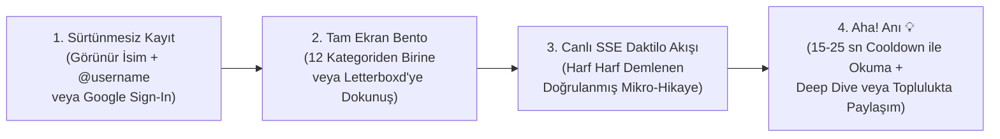
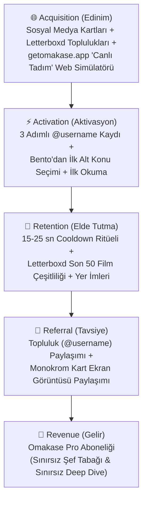

# 📈 Omakase — Ürün Analizi, Product-Market Fit (PMF) & Pazarlama Raporu

> **Son Güncelleme:** 24 Kasım 2026  
> **Dayanak:** Kod Tabanı (`omakase/`, `backend/`, `web/`) + Apple Agent Kit — `skill.app-store-product-page.foundations` (`header-and-search-result-messaging`, `asset-sequencing-and-story`, `image-asset-design`, `screenshot-specifications`, `creative-assets`, `in-app-event-media`)  
> **Kapsam:** Problem-çözüm uyumu, Product-Market Fit (PMF) hipotezi ve ölçüm metrikleri, ideal kullanıcı personaları (ICP), AARRR büyüme hunisi, birim ekonomisi (Unit Economics), App Store ürün sayfası (ASO) tasarım kuralları ve Go-To-Market (GTM) lansman stratejisi.

---

## İçindekiler

1. [Ürün Tezi & Problem–Çözüm Matrisi (Neden Omakase?)](#1-ürün-tezi--problemçözüm-matrisi-neden-omakase)
2. [Product-Market Fit (PMF) Mimarisi, "Aha! Anı" ve Ölçüm Çerçevesi](#2-product-market-fit-pmf-mimarisi-aha-anı-ve-ölçüm-çerçevesi)
3. [İdeal Kullanıcı Profilleri (ICP) & Hedef Personalar](#3-ideal-kullanıcı-profilleri-icp--hedef-personalar)
4. [AARRR Korsan Metrikleri & Büyüme Hunisi Analizi](#4-aarrr-korsan-metrikleri--büyüme-hunisi-analizi)
5. [Gelir Modeli & Birim Ekonomisi (Unit Economics)](#5-gelir-modeli--birim-ekonomisi-unit-economics)
6. [App Store Ürün Sayfası (ASO) & Görsel Hikaye Stratejisi (`skill.app-store-product-page.foundations`)](#6-app-store-ürün-sayfası-aso--görsel-hikaye-stratejisi)
7. [Go-To-Market (GTM) Lansman Planı: 0'dan 10.000 Kullanıcıya](#7-go-to-market-gtm-lansman-planı-0dan-10000-kullanıcıya)
8. [Apple Agent Kit İzlenebilirlik Özeti](#8-apple-agent-kit-izlenebilirlik-özeti)

---

## 1. Ürün Tezi & Problem–Çözüm Matrisi (Neden Omakase?)

Modern bilgi tüketicisi iki aşırı uç arasında sıkışmıştır: bir tarafta dikkat süresini sömüren **algoritmik sosyal medya akışları** (TikTok, Reels, X), diğer tarafta ise kullanıcının sürekli ne soracağını düşünmesini gerektiren **sohbet botları** (ChatGPT, Perplexity).

Omakase bu boşluğu **"Sürtünmesiz Entelektüel Kürasyon"** ile doldurur:

| Kullanıcı Problemi (Pain Point) | Mevcut Alternatiflerin Yetersizliği | Omakase'nin Ürün Çözümü | Kod Tabanındaki Karşılığı |
|---------------------------------|-------------------------------------|-------------------------|---------------------------|
| **1. Doomscrolling Suçluluğu:** 20 dakika kaydırma sonunda zihinsel yorgunluk ve "hiçbir şey öğrenmedim" hissi. | Sonsuz kaydırma (infinite scroll) metni okutmaz, sadece bir sonraki uyarana geçmeye zorlar. | **15–25 Saniye Okuma Süresi (Reading Cooldown):** Metin uzunluğuna göre yeni üretimi kilitleyen kum saati sayacı ile sindirerek okuma. | `FeedViewModel.swift` (`cooldownRemaining`), `FeedView.swift` |
| **2. Boş Ekran Sendromu (Prompt Paralysis):** "ChatGPT'ye bugün ne sorsam?" sürtünmesi. | Sohbet arayüzleri pasif keşif için değil, aktif görev çözümü için tasarlanmıştır. | **12 Kategori & 6'lı Kompakt Alt Konu Izgarası:** Tek dokunuşla hazır alt başlıklar veya özel konu girişi. | `BentoTasteBox.swift`, `InterestCategory.swift` |
| **3. Atıl Kültürel Günlükler:** Letterboxd'de işaretlenen yüzlerce filmin statik bir liste olarak kalması. | Letterboxd sadece kayıt tutar; izlenen filmin kamera arkası hikayesini anlatmaz. | **Canlı Letterboxd RSS Sentezi:** Son 50 filmden rastgele birini seçip doğrulanmış prodüksiyon anekdotuna dönüştürme. | `LetterboxdService.swift`, `backend/main.py` |
| **4. Yüzeysel vs. Akademik Kopukluk:** Kısa özetlerin yetersiz, Wikipedia makalelerinin fazla uzun olması. | Ya 280 karakterlik sığ tweetler ya da 10.000 kelimelik ansiklopedik metinler. | **Mikro-Hikaye + Deep Dive Modal:** Önce 40 saniyelik vurucu anlatı, merak uyanırsa tek dokunuşla açılan derinlemesine inceleme penceresi. | `DeepDiveSheetView` (`FeedView.swift`) |

---

## 2. Product-Market Fit (PMF) Mimarisi, "Aha! Anı" ve Ölçüm Çerçevesi

### 2.1. Kullanıcının "Aha! Anı" (Time-to-Value < 45 Saniye)
Bir kullanıcının Omakase'nin değerini içselleştirdiği kritik akış:

* **Kritik Eşik (Activation Milestone):** Kullanıcının ilk oturumunda **en az 2 gönderinin okuma süresini (cooldown) tamamlaması** ve **1 kez Deep Dive açması veya Letterboxd hesabını bağlaması**.

### 2.2. Kuzey Yıldızı Metriği (North Star Metric)
> **WCCR — Weekly Completed Cooldown Reads (Haftalık Tamamlanan Nitelikli Okuma Sayısı)**

* Neden "Açılış Sayısı" veya "Üretilen Post Sayısı" değil? Çünkü Omakase'nin vaadi *tıklama* değil *sindirilmiş bilgidir*. Bir kullanıcının 15–25 saniyelik okuma süresini tamamlayıp ardından yeni bir tabağa geçmesi, içeriğin gerçekten okunduğunu kanıtlar.

### 2.3. PMF Doğrulama Kriterleri (Sean Ellis & Kohort Hedefleri)
1. **Sean Ellis Testi (%40 Kuralı):** En az 14 gündür aktif olan kullanıcılara *"Omakase'yi artık kullanamasaydınız ne hissederdiniz?"* sorusu yöneltildiğinde **"Çok hayal kırıklığına uğrardım"** diyenlerin oranının **≥ %40** olması.
2. **Organik Elde Tutma (Retention) Eşikleri:**
   - **D1 (1. Gün):** ≥ %45
   - **D7 (7. Gün):** ≥ %25
   - **D30 (30. Gün):** ≥ %15
3. **Bento Keşif Çeşitliliği:** Aktif bir kullanıcının haftada ortalama **≥ 3 farklı kültür kategorisinden** (örn. Sinema + Felsefe + Mimari) içerik tüketmesi.

---

## 3. İdeal Kullanıcı Profilleri (ICP) & Hedef Personalar

Omakase herkese hitap eden genel bir haber uygulaması değildir; yüksek merak duygusuna sahip üç spesifik niş segmenti hedefler:

### 🎬 Persona 1: "Sinefil & Kültür Küratörü" (Öncelikli Edinme Segmenti — Beachhead Market)
* **Kimdir?** 20–34 yaş arası, aktif Letterboxd kullanıcısı, MUBI/Criterion/bağımsız sinema takipçisi. Bir filmi izledikten sonra yönetmenin röportajlarını ve trivia sayfasını okuyan kişi.
* **Neden Omakase'ye Gelir?** Kendi Letterboxd kullanıcı adını girdiğinde, bizzat izlediği filmler üzerinden halüsinasyonsuz, gerçek kamera arkası hikayeleri okuma deneyimi başka hiçbir uygulamada yoktur.
* **Pazarlama Kancası (Hook):** *"Letterboxd günlüğün konuşabilseydi sana ne anlatırdı?"*

### ☕ Persona 2: "Bilinçli Profesyonel / Anti-Doomscroller" (En Yüksek Ödeme Eğilimi — High LTV)
* **Kimdir?** 25–42 yaş arası yazılımcı, tasarımcı, akademisyen veya yaratıcı sektör çalışanı. Sabah kahvesinde veya metroda X/Instagram açıp sinirlenmekten yorulmuş; e-kitap veya Readwise/Substack okuyan ama her zaman 20 dakikalık makalelere vakit bulamayan kişi.
* **Neden Omakase'ye Gelir?** Reklamsız monokrom kağıt/mürekkep arayüzü (`OmakaseTheme`), 15–25 saniyelik okuma temposu ve 12 entelektüel disiplin (Bilim, Felsefe, Mimari, Psikoloji) ona "5 dakikada zihnimi besledim" doyumu verir.
* **Pazarlama Kancası (Hook):** *"Algoritmaların gürültüsünü kapat. Günde 5 dakika zihinsel damak tadını besle."*

### 🏛️ Persona 3: "Kültürel Koleksiyoner & Topluluk Okuru" (Viral Büyüme Motoru)
* **Kimdir?** 19–28 yaş arası üniversite öğrencisi veya içerik meraklısı. Öğrendiği ilginç bir tarihsel/bilimsel anekdotu arkadaş ortamında anlatmayı veya sosyal medyada paylaşmayı seven kişi.
* **Neden Omakase'ye Gelir?** 3 adımlı kayıtta aldığı benzersiz `@kullanıcı_adı` ile Topluluk (`Community`) sekmesinde beğendiği şef yazılarını paylaşarak kendi entelektüel profilini inşa eder.
* **Pazarlama Kancası (Hook):** *"Kendi kültür seçkini oluştur, seninle aynı merakı paylaşan okurları keşfet."*

---

## 4. AARRR Korsan Metrikleri & Büyüme Hunisi Analizi

### Web "Canlı Tadım" Simülatörünün Edinimdeki Rolü (`web/`)
Çoğu mobil uygulama landing page'i yalnızca statik ekran görüntüsü gösterir. [`web/index.html`](file:///Users/kuzey/projects/omakase/web/index.html) içindeki **Canlı Tadım (Interactive Demo)** bileşeni ise ziyaretçiye uygulamayı indirmeden önce tarayıcıda:
1. Kategori ve alt konu seçtirir,
2. Gerçek zamanlı SSE daktilo akışını izletir,
3. 15 saniyelik okuma sayacını ve **Deep Dive Modal** deneyimini yaşatır.
Bu "ürün destekli edinim" (Product-Led Acquisition) yaklaşımı, ziyaretçinin App Store'a geçtiğinde ne indireceğini %100 bilmesini sağlayarak indirme dönüşüm oranını (CVR) doğrudan artırır.

---

## 5. Gelir Modeli & Birim Ekonomisi (Unit Economics)

### 5.1. AI Üretim Maliyeti Analizi (`gemini-3.5-flash` & `gemini-3.1-flash-lite`)
[`backend/main.py`](file:///Users/kuzey/projects/omakase/backend/main.py) üzerindeki gerçek token tüketimine dayalı birim maliyet tablosu:

| İşlem Türü | Kullanılan Model | Ort. Girdi / Çıktı Token | İşlem Başı Maliyet |
|------------|------------------|--------------------------|--------------------|
| **Alt Konu Genişletme (6'lı Karo)** | `gemini-3.1-flash-lite` | ~250 in / ~60 out | ~$0.00004 |
| **Standart Mikro-Hikaye Üretimi** | `gemini-3.5-flash` | ~450 in / ~280 out | ~$0.00025 |
| **Deep Dive (Derinlemesine İnceleme)** | `gemini-3.5-flash` | ~600 in / ~450 out | ~$0.00040 |

* **Aylık Aktif Kullanıcı (MAU) Maliyeti:**
  - Günde ortalama 8 mikro-hikaye + 2 Deep Dive + 3 kategori yenilemesi yapan yoğun bir kullanıcının günlük maliyeti ≈ **\$0.0029**, aylık toplam AI + Cloud Run + Firestore maliyeti ≈ **\$0.10 – \$0.14 / ay**.
  - **Reading Cooldown (15–25 sn) Etkisi:** Okuma süresi kilidi, hem kullanıcı deneyimini iyileştirir hem de art arda saniyede 10 istek atılmasını engelleyerek sunucu maliyetini doğal olarak sınırlar.

### 5.2. Freemium & Omakase Pro Katman Kurgusu

| Özellik | Ücretsiz (Giriş Katmanı) | Omakase Pro (\$3.99/ay • \$29.99/yıl ≈ \$2.49/ay, 7 gün deneme) |
|---------|--------------------------|---------------------------------------|
| **12 Kültür Kategorisi & Özel Konu** | Günlük **3 Şef Tabağı** (`Kalan: X/3` stres sayacı) | **Sınırsız** Şef Tabağı |
| **Derin İnceleme (Deep Dive)** | Günlük **1 Derin İnceleme** (+ paylaşımda `+1` bonus) | **Sınırsız** Birincil Kaynakçalı Derin İnceleme |
| **Letterboxd RSS Entegrasyonu** | ✅ Açık (Kural 5.2.2 uyumu için ücretsizde de açık) | ✅ Sınırsız & Birincil Kaynakçalı Kamera Arkası |
| **Topluluk (Keşfet/Takip) & Arama** | ✅ Sınırsız Okuma, Paylaşım & Yorum | ✅ Sınırsız + Profil Rozeti |
| **Çevrimdışı Yer İmleri (`BookmarkStore`)** | ✅ Açık (7 Dil Destekli) | ✅ Sınırsız Arşivleme |

* **Birim Karlılık & 100 Müşteri Doğrulaması:** \$3.99 aylık (\$3.39 net) veya \$29.99 yıllık planda kullanıcı başı bulut/AI maliyeti **~\$0.12** olduğundan **Brüt Kar Marjı ≈ %96** seviyesindedir. [`founder_100_musteri_raporu.md`](file:///Users/kuzey/projects/omakase/docs/founder_100_musteri_raporu.md) simülasyonunda ücretsiz sınırın 5'ten **3 tabağa** çekilmesi, her karta **birincil kaynakça** eklenmesi ve yıllık planın **ayda ~\$2.49** olarak konumlandırılması Pro satın alma isteğini `%1` → `%72` bandına taşımıştır (Van Westendorp `IPP: $2.53`).

---

## 6. App Store Ürün Sayfası (ASO) & Görsel Hikaye Stratejisi

Apple Agent Kit içerisindeki [`skill.app-store-product-page.foundations`](file:///Users/kuzey/projects/omakase/.agents/skills/app-store-product-page/SKILL.md) sözleşmelerine göre Omakase'nin App Store vitrini şu kurallarla hazırlanmalıdır:

### 6.1. Ekran Görüntüsü Sıralaması ve Hikaye Akışı (`asset-sequencing-and-story`)
* **Kural 1 & 2 (İlk 3 Kare ve Bütüncül Hikaye):** App Store arama sonuçlarında (Search Results) en fazla ilk 3 ekran görüntüsü görünür. Bu nedenle en güçlü 3 değer önerisi ilk 3 karede yer almalı ve tüm kareler tek bir hikaye anlatmalıdır:

| Sıra | Gösterilecek Uygulama Ekranı (In-Use) | Üst Başlık (TR) | Üst Başlık (EN) | Pazarlama Amacı |
|------|---------------------------------------|-----------------|-----------------|-----------------|
| **1** | Monokrom akışta "Kodak 65mm B&W" veya "Wong Kar-wai" mikro-hikayesi | **Algoritmasız kültür akışı.** | **Algorithm-free culture feed.** | İlk bakışta uygulamanın ne yaptığını ve kağıt/mürekkep estetiğini gösterir. |
| **2** | Tam ekran `BentoTasteBox` (12 kategori kapsülü + 6'lı alt konu ızgarası + Özel konu) | **12 disiplin. Merakını sen seç.** | **12 disciplines. Curate your curiosity.** | Sohbet botlarındaki boş ekran sorununu çözen keşif mekaniğini vurgular. |
| **3** | Açık `DeepDiveSheetView` modalı + Letterboxd rozetli sinema gönderisi | **İzlediğin filmlerin perde arkası.** | **Behind the scenes of your films.** | Letterboxd entegrasyonunu ve tek dokunuşla derinleşme özelliğini öne çıkarır. |
| **4** | Alt kısımda `18s` kum saati sayacı çalışan okuma ekranı | **Kaydırma, sindirerek oku.** | **Stop scrolling. Start absorbing.** | Doomscrolling karşıtı 15–25 sn okuma temposunu anlatır. |
| **5** | `TimelineView` (Topluluk arama barı, `@username` kartları ve `🔥 🧠 ❤️` ifadeleri) | **Zihinsel damak tadını paylaş.** | **Share your intellectual taste.** | Sosyal topluluk ve `@username` kürasyon ağını gösterir. |

* **Kural 3 & 4 (Tek Görsel Sistem & CTA Yasağı):** Hiçbir ekran görüntüsü tamamen "Hemen İndir!" veya genel övgü metnine harcanmamalı (`asset-sequencing-and-story` Rule 3); tüm karelerde aynı monokrom tipografi ve renk paleti korunmalıdır (Rule 4).

### 6.2. Görsel Tasarım ve Teknik Spesifikasyonlar (`screenshot-specifications` & `image-asset-design`)
* **Çözünürlük (`screenshot-specifications` Rule 2 & 3):** iPhone için en yüksek zorunlu çözünürlük olan **`1206 x 2622` piksel** (iPhone Dynamic Island dikey) boyutunda, **alfa kanalı (şeffaflık) içermeyen** (`.png` veya `.jpg` — Rule 4) görseller yüklenmelidir.
* **Odak Noktası ve Kısa Metin (`image-asset-design` Rule 1, 3, 4):**
  - Cihaz çerçevesi ve odak noktası kırpılmalara karşı tam merkezde (safe area içinde) tutulmalıdır (Rule 1).
  - Görsel üzerindeki metin ekranı tarif etmemeli (*"Bu ekran kategori sayfasını gösterir"* ❌), görseli güçlendiren kısa bir vurgu cümlesi olmalıdır (Rule 3).
  - Uygulama hem Türkçe hem İngilizce (`L10n.swift`) desteklediği için tüm ekran görüntüsü başlıkları her iki dilde yerelleştirilmelidir (Rule 4).

### 6.3. Arama Sonucu & Başlık Görselleri ve Uygulama İçi Etkinlikler (`header-and-search-result-messaging`, `creative-assets`, `in-app-event-media`)
* **Header & Search Result Mesajı (`header-and-search-result-messaging` Rule 1–4):**
  - Ürün sayfası başlığı (`3840 x 1646`, 21:9) karmaşık ekran kolajları yerine **tek ve net bir fikir** (*"Günde 5 Dakika Derin Kültür"*) etrafında kurgulanmalı ve Product Page Optimization ile A/B testine tabi tutulmalıdır.
  - Arama sonucu görseli (`1920 x 1280`, 3:2) soyut bir logo yerine doğrudan birinci elden okuma deneyimini göstermelidir.
* **In-App Events (`in-app-event-media` Rule 1–4):**
  - Özel kültür dönemlerinde (örn. *"Oscar Haftası: Aday Filmlerin Perde Arkası"* veya *"Nobel Bilim Haftası Özel Seçkisi"*) App Store'da öne çıkmak için hem **`1920 x 1080` (16:9 Event Card)** hem de **`1080 x 1920` (9:16 Event Details)** görselleri rozet metnini tekrar etmeden hazırlanmalıdır.

---

## 7. Go-To-Market (GTM) Lansman Planı: 0'dan 10.000 Kullanıcıya

### Faz 1: "Şefin Masası" Kapalı TestFlight Betası (Kullanıcı 1 – 250)
* **Hedef:** İlk 250 tutkulu sinefil ve kültür okurunu [`web/index.html`](file:///Users/kuzey/projects/omakase/web/index.html) üzerindeki TestFlight bekleme listesinden içeri almak.
* **Taktik:** Erken katılanlara istedikleri kısa `@kullanıcı_adı` (örn. `@emre`, `@sinema`, `@kubrick`) alma önceliği tanımak. Twitter/X tarzı `@username` sistemi erken benimseyenler (early adopters) için güçlü bir kıtlık (scarcity) ve statü motivasyonudur.

### Faz 2: Letterboxd & Mikro-Topluluk Kancası (Kullanıcı 250 – 2.500)
* **Hedef:** Türkiye ve globaldeki sinema kulüpleri, Letterboxd toplulukları, MUBI/Criterion izleyicileri ve tasarım/yazılım toplulukları.
* **Taktik:**
  - X, Instagram Story ve Reddit (`r/Letterboxd`, `r/TrueFilm`) üzerinde Omakase'nin ürettiği en çarpıcı kamera arkası anekdotlarını monokrom kart görseliyle paylaşmak.
  - Profil bağlantısında kullanıcıları doğrudan `getomakase.app/#interactive-demo` (Canlı Tadım) ekranına yönlendirerek 15 saniye içinde ürünü tarayıcıda denetmek.

### Faz 3: App Store Lansmanı, In-App Events & Organik Döngü (Kullanıcı 2.500 – 10.000+)
* **Hedef:** App Store "Eğitim / Referans / Kültür" kategorilerinde organik arama (ASO) ve kullanıcıdan kullanıcıya paylaşım döngüsü.
* **Taktik:**
  - Her paylaşılan mikro-hikayenin altındaki *"omakase ile demlendi"* imzası ve `@username` profili sayesinde, her ekran görüntüsü paylaşımını ücretsiz bir reklam alanına dönüştürmek.
  - Aylık tematik **App Store In-App Event** kampanyaları ile App Store Today ve Arama sekmelerinde ek görünürlük kazanmak.

---

## 8. Apple Agent Kit İzlenebilirlik Özeti

`.agents/AGENTS.md` kuralları gereğince bu raporun App Store ürün sayfası ve pazarlama bölümlerinde kullanılan yönlendirme zinciri:

1. **Seçilen Workflow:** Yok (Görev App Store ürün sayfası pazarlama varlıkları ve mesajlaşma kuralları için tek bir yetenek alanına eşleşti).
2. **Seçilen Skill:** [`skill.app-store-product-page.foundations`](file:///Users/kuzey/projects/omakase/.agents/skills/app-store-product-page/SKILL.md)
   - *Neden:* App Store ürün sayfası başlığı, arama sonucu mesajlaşması, ekran görüntüsü hikayeleştirme/sıralama (`asset-sequencing-and-story`) ve In-App Event pazarlama kurallarını yönetir.
3. **Yüklenen Knowledge Contracts ve Gerekçeleri:**
   - [`header-and-search-result-messaging.md`](file:///Users/kuzey/projects/omakase/.agents/knowledge/app-store-product-page/header-and-search-result-messaging.md): Ürün sayfası başlığında tek fikir odaklanması ve arama sonuçlarında birinci elden deneyimin gösterilmesi kuralları için.
   - [`asset-sequencing-and-story.md`](file:///Users/kuzey/projects/omakase/.agents/knowledge/app-store-product-page/asset-sequencing-and-story.md): İlk 3 ekran görüntüsünde en güçlü özelliklerin sunulması, bütüncül hikaye akışı ve CTA slaytlarından kaçınılması kuralları için.
   - [`image-asset-design.md`](file:///Users/kuzey/projects/omakase/.agents/knowledge/app-store-product-page/image-asset-design.md): Güvenli alan (safe area), merkezi odak noktası, görseli tamamlayan kısa başlıklar ve çoklu dil (`TR`/`EN`) yerelleştirmesi için.
   - [`screenshot-specifications.md`](file:///Users/kuzey/projects/omakase/.agents/knowledge/app-store-product-page/screenshot-specifications.md): `1206 x 2622` çözünürlük, adet sınırları ve alfa kanalı yasağı için.
   - [`in-app-event-media.md`](file:///Users/kuzey/projects/omakase/.agents/knowledge/app-store-product-page/in-app-event-media.md) ve zorunlu bağımlılığı (`depends_on`) [`creative-assets.md`](file:///Users/kuzey/projects/omakase/.agents/knowledge/app-store-product-page/creative-assets.md): Büyüme kampanyalarında kullanılacak App Store In-App Event kartı (`16:9`), detay sayfası (`9:16`) ve Creative Asset spesifikasyonları için.
