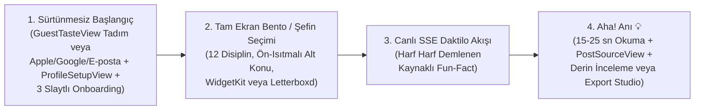
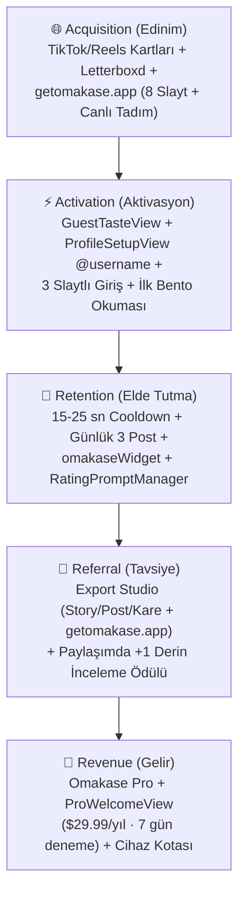

# 📈 Omakase — Ürün Analizi, Product-Market Fit (PMF) & Pazarlama Raporu

> **Son Güncelleme:** 26 Kasım 2026  
> **Dayanak:** Kod Tabanı (`omakase/`, `backend/`, `web/`, `admin-web/`, `app-store-screenshots/`) + Apple Agent Kit — `skill.app-store-product-page.foundations` (`header-and-search-result-messaging`, `asset-sequencing-and-story`, `image-asset-design`, `screenshot-specifications`, `creative-assets`, `in-app-event-media`)  
> **Kapsam:** Problem-çözüm uyumu, Product-Market Fit (PMF) hipotezi ve Mission Control ölçüm altyapısı, ideal kullanıcı personaları (ICP), AARRR büyüme hunisi, Export Studio viral paylaşım döngüsü, birim ekonomisi, 8 slaytlı × 7 dilli App Store vitrini (ASO) ve Go-To-Market (GTM) planı.

---

## İçindekiler

1. [Ürün Tezi & Problem–Çözüm Matrisi (Neden Omakase?)](#1-ürün-tezi--problemçözüm-matrisi-neden-omakase)
2. [Product-Market Fit (PMF) Mimarisi, "Aha! Anı" ve Ölçüm Çerçevesi](#2-product-market-fit-pmf-mimarisi-aha-anı-ve-ölçüm-çerçevesi)
3. [İdeal Kullanıcı Profilleri (ICP) & Hedef Personalar](#3-ideal-kullanıcı-profilleri-icp--hedef-personalar)
4. [AARRR Korsan Metrikleri, Export Studio & Büyüme Hunisi Analizi](#4-aarrr-korsan-metrikleri-export-studio--büyüme-hunisi-analizi)
5. [Gelir Modeli & Birim Ekonomisi (Unit Economics)](#5-gelir-modeli--birim-ekonomisi-unit-economics)
6. [App Store Ürün Sayfası (ASO) & 8 Slaytlı Görsel Hikaye Stratejisi (`skill.app-store-product-page.foundations`)](#6-app-store-ürün-sayfası-aso--8-slaytlı-görsel-hikaye-stratejisi)
7. [Go-To-Market (GTM) Lansman Planı: 0'dan 10.000 Kullanıcıya](#7-go-to-market-gtm-lansman-planı-0dan-10000-kullanıcıya)
8. [Apple Agent Kit İzlenebilirlik Özeti](#8-apple-agent-kit-izlenebilirlik-özeti)

---

## 1. Ürün Tezi & Problem–Çözüm Matrisi (Neden Omakase?)

Modern bilgi tüketicisi iki aşırı uç arasında sıkışmıştır: bir tarafta dikkat süresini sömüren **algoritmik sosyal medya akışları** (TikTok, Reels, X), diğer tarafta ise kullanıcının sürekli ne soracağını düşünmesini gerektiren **sohbet botları** (ChatGPT, Perplexity).

Omakase bu boşluğu **"Sürtünmesiz, Kaynaklı Entelektüel Kürasyon"** ile doldurur:

| Kullanıcı Problemi (Pain Point) | Mevcut Alternatiflerin Yetersizliği | Omakase'nin Ürün Çözümü | Kod Tabanındaki Karşılığı |
|---------------------------------|-------------------------------------|-------------------------|---------------------------|
| **1. Doomscrolling Suçluluğu:** 20 dakika kaydırma sonunda zihinsel yorgunluk ve "hiçbir şey öğrenmedim" hissi. | Sonsuz kaydırma metni okutmaz, sadece bir sonraki uyarana geçmeye zorlar. | **15–25 Saniye Okuma Molası (Reading Cooldown):** Metin uzunluğuna göre yeni üretimi kilitleyen ince sayaç ile sindirerek okuma. | [`FeedViewModel.swift`](file:///Users/kuzey/projects/omakase/omakase/omakase/Feed/FeedViewModel.swift), [`FeedView.swift`](file:///Users/kuzey/projects/omakase/omakase/omakase/Feed/FeedView.swift) |
| **2. Boş Ekran Sendromu (Prompt Paralysis):** "ChatGPT'ye bugün ne sorsam?" sürtünmesi. | Sohbet botları pasif keşif için değil, kullanıcının yazmasını bekleyen görev çözümü içindir. | **12 Kategori + 24 Merak Merceği Alt Konular + Şefin Seçimi:** Manuel metin kutusu yerine tek dokunuşla ön-ısıtmalı alt konular veya başparmak bölgesinden Şefin Seçimi. | [`BentoTasteBox.swift`](file:///Users/kuzey/projects/omakase/omakase/omakase/Interests/BentoTasteBox.swift), [`prompts.py`](file:///Users/kuzey/projects/omakase/backend/app/prompts.py) |
| **3. AI Halüsinasyon Şüphesi:** Yapay zeka özetlerine güvenememe. | Çoğu AI aracı kaynak göstermeden genel geçer cümleler kurar. | **Zorunlu Birincil Kaynakça:** "Wikipedia" yasaktır; her post ve Derin İnceleme sonunda kitap, makale, arşiv veya röportaj kapsülü ve popover bağlantısı yer alır. | [`PostSourceView.swift`](file:///Users/kuzey/projects/omakase/omakase/omakase/Theme/PostSourceView.swift), [`prompts.py`](file:///Users/kuzey/projects/omakase/backend/app/prompts.py) |
| **4. Atıl Kültürel Günlükler & Paylaşım Eksikliği:** Letterboxd listelerinin statik kalması, okunanların şık paylaşılamaması. | Letterboxd sadece kayıt tutar; ekran görüntüsü almak estetik değildir. | **Letterboxd Son 50 Film Sentezi + Export Studio:** İzlenen son 50 filmden doğrulanmış kamera arkası hikayeleri ve 3 oran × 4 temalı monokrom kart stüdyosu. | [`LetterboxdService.swift`](file:///Users/kuzey/projects/omakase/omakase/omakase/Networking/LetterboxdService.swift), [`letterboxd_service.py`](file:///Users/kuzey/projects/omakase/backend/app/services/letterboxd_service.py), [`ExportPostSheet.swift`](file:///Users/kuzey/projects/omakase/omakase/omakase/Feed/ExportPostSheet.swift) |

---

## 2. Product-Market Fit (PMF) Mimarisi, "Aha! Anı" ve Ölçüm Çerçevesi

### 2.1. Kullanıcının "Aha! Anı" (Time-to-Value < 45 Saniye)
24–26 Kasım güncellemeleriyle ilk oturumdaki sürtünme en aza indirilmiştir: hesap açmadan denemeye imkan tanıyan **Misafir Tadımı ([`GuestTasteView.swift`](file:///Users/kuzey/projects/omakase/omakase/omakase/Onboarding/GuestTasteView.swift))**, 3 slaytlı ASCII suşi tanıtımı ve kayıt sonrası `ProfileSetupView` eklendi:

* **Kritik Eşik (Activation Milestone):** Kullanıcının ilk oturumunda **en az 2 gönderinin okuma süresini (`cooldown_completed`) tamamlaması** ve **birincil kaynağı (`source_tapped`) veya ilk Derin İnceleme'yi açması**.

### 2.2. Kuzey Yıldızı Metriği & Canlı Ölçüm Altyapısı (`TelemetryService` + Mission Control)
> **North Star Metric:** **WCCR — Weekly Completed Cooldown Reads (Haftalık Tamamlanan Nitelikli Okuma Sayısı)**

Bu metrikler artık yalnızca teorik değildir; [`TelemetryService.swift`](file:///Users/kuzey/projects/omakase/omakase/omakase/Services/TelemetryService.swift) → `POST /telemetry/events` → `metrics_daily` boru hattı ve **Mission Control ([admin-web/](file:///Users/kuzey/projects/omakase/admin-web))** üzerinden canlı izlenmektedir:
* **Aktivasyon & Dönüşüm Hunisi (`admin_service.py`):** Kayıt → Tabak Üretimi → `cooldown_completed` → `paywall_viewed` (5 kaynak kırılımıyla) → Trial / Pro.
* **Okuma Kalitesi:** `source_tap_rate_pct` (okuyucuların `PostSourceView` kapsülünü açma oranı) ve `generation_success_rate_pct`.
* **PMF Hedef Eşikleri:** D1 Retention ≥ %45, D7 Retention ≥ %25, D30 Retention ≥ %15; Sean Ellis testinde *"Çok hayal kırıklığına uğrardım"* oranı ≥ %40.

---

## 3. İdeal Kullanıcı Profilleri (ICP) & Hedef Personalar

Omakase yüksek merak duygusuna sahip üç spesifik niş segmenti (7 dil desteğiyle ABD/UK/AB + Türkiye/Japonya/Kore) hedefler:

1. **🎬 Persona 1: "Sinefil & Kültür Küratörü" (Beachhead Market):** 20–34 yaş arası aktif Letterboxd, MUBI/Criterion izleyicisi. Son 50 filmden doğrulanmış kamera arkası hikayeleri okur (*"Letterboxd günlüğün konuşabilseydi sana ne anlatırdı?"*).
2. **☕ Persona 2: "Bilinçli Profesyonel / Anti-Doomscroller" (High LTV):** 25–42 yaş arası yazılımcı, tasarımcı, akademisyen. Sabah kahvesinde algoritmik gürültü yerine kağıt/mürekkep arayüzünde 15–25 sn tempolu ve kaynaklı bilgi tüketir.
3. **🏛️ Persona 3: "Kültürel Koleksiyoner & Sosyal Paylaşımcı" (Viral Motor):** 19–28 yaş arası meraklılar. Export Studio ile (`Story`, `Post`, `Square`) okuduklarını Instagram Stories, WhatsApp ve X'te paylaşır, Topluluk Keşfet akışında `@username` kürasyonu kurar.

---

## 4. AARRR Korsan Metrikleri, Export Studio & Büyüme Hunisi Analizi

### 4.1. Web "Canlı Tadım" & Yenilenen Vitrin (`web/`)
[`web/index.html`](file:///Users/kuzey/projects/omakase/web/index.html) 25 Kasım'da ASCII suşi arka planı, **8 slaytlı App Store vitrini (`#screenshots`)**, **4 ekranlı canlı iPhone maketi** (`Akışım`, `Bento Keşif`, `Topluluk`, `Profil`) ve **Canlı Tadım** demosu ile güncellenmiştir; 26 Kasım'da SEO/GEO (`web/en/index.html`, Schema.org) ve yasal sayfalar senkronize edilmiştir.

### 4.2. Ürün İçi Viral Motor: Export Studio (`ExportPostSheet.swift`)
[`ExportPostSheet.swift`](file:///Users/kuzey/projects/omakase/omakase/omakase/Feed/ExportPostSheet.swift) ve [`ShareCardView.swift`](file:///Users/kuzey/projects/omakase/omakase/omakase/Feed/ShareCardView.swift), her okuyucuyu organik dağıtım kanalına dönüştürür:
* **3 Format:** `Story` (`1080×1920`), `Post` (`1080×1350`), `Kare` (`1080×1080`).
* **4 Monokrom Tema:** `Paper`, `Ink`, `Editorial`, `Midnight` + açılıp kapatılabilir Kaynak, Etiket ve Motif çipleri.
* **Tek Dokunuşla Dağıtım & Ödül:** Instagram Stories, WhatsApp, X, Fotoğraflar'a Kaydet, Panoya Kopyala ve `getomakase.app` link kopyalama barı; paylaşım tamamlandığında ücretsiz kullanıcıya günde 1 kez **`+1` Derin İnceleme** bonusu (`POST /feed/reward-share`) tanımlanır.

---

## 5. Gelir Modeli & Birim Ekonomisi (Unit Economics)

### 5.1. AI Üretim Maliyeti Analizi (`gemini-3.5-flash` & `gemini-3.1-flash-lite`)
[`backend/app/config.py`](file:///Users/kuzey/projects/omakase/backend/app/config.py) ve [`backend/app/services/metrics_service.py`](file:///Users/kuzey/projects/omakase/backend/app/services/metrics_service.py) üzerinden gerçek zamanlı izlenen birim maliyetler:

| İşlem Türü | Kullanılan Model | Ort. Girdi / Çıktı Token | İşlem Başı Maliyet |
|------------|------------------|--------------------------|--------------------|
| **Alt Konu Genişletme (24 Mercek)** | `gemini-3.1-flash-lite` | ~250 in / ~60 out | ~\$0.00004 |
| **Standart Mikro-Hikaye (40–90 kelime)** | `gemini-3.5-flash` | ~450 in / ~280 out | ~\$0.00025 |
| **Deep Dive (150–250 kelime)** | `gemini-3.5-flash` | ~600 in / ~450 out | ~\$0.00040 |

* **Aylık Aktif Kullanıcı (MAU) Maliyeti:** Yoğun bir kullanıcının aylık toplam AI + Cloud Run + Firestore maliyeti **~\$0.10 – \$0.14 / ay** seviyesindedir.
* **Gelir & Brüt Kar Marjı:** **Omakase Pro** (\$3.99/ay veya 7 gün denemeli \$29.99/yıl ≈ \$2.49/ay) katmanında Apple %15 Small Business komisyonu sonrası **Brüt Kar Marjı ≈ %96**'dır ve Mission Control `Gelir & AI` sekmesinden RevenueCat v2 verisiyle canlı takip edilir.

### 5.2. Freemium, Letterboxd Sınırı & Cihaz-Bazlı Kota Koruması

| Özellik | Ücretsiz (Giriş Katmanı) | Omakase Pro (\$3.99/ay · \$29.99/yıl, 7 gün deneme) |
|---------|--------------------------|------------------------------------------------------|
| **Günlük AI Post (12 Disiplin & Alt Konu)** | **Günde 3 Post** (`Kalan: X/3` sayaç) | **Sınırsız UI** (sunucuda `100/gün`) |
| **Letterboxd Son 50 Film Sentezi** | **Günde 1 Post** (3 post kotası içinden) | **Sınırsız UI** (sunucuda `100/gün`) |
| **Derin İnceleme (Deep Dive)** | **Günde 1** (+ paylaşımda `+1` ödül) | **Sınırsız UI** (sunucuda `40/gün`) |
| **Topluluk (`FollowListSheet`), Export Studio & Yer İmleri** | ✅ Açık | ✅ Sınırsız + Profil Rozeti |

* **Cihaz-Bazlı Suistimal Önlemi:** `device_usage` katmanı hesap değiştirme/silme ile 3 post / 1 Letterboxd sınırının sıfırlanmasını engeller; ücretsiz kullanıcının paywall'a geçiş baskısını gerçekçi tutar ([`founder_100_musteri_raporu.md`](file:///Users/kuzey/projects/omakase/docs/founder_100_musteri_raporu.md) 2. Turda `%1` → `%72` dönüşüm artışı).

---

## 6. App Store Ürün Sayfası (ASO) & 8 Slaytlı Görsel Hikaye Stratejisi

[`skill.app-store-product-page.foundations`](file:///Users/kuzey/projects/omakase/.agents/skills/app-store-product-page/SKILL.md) ve [`app-store-screenshots.json`](file:///Users/kuzey/projects/omakase/app-store-screenshots/app-store-screenshots.json) doğrultusunda **8 slayt × 7 dil** (`en, tr, ja, de, fr, es, ko`) vitrini üretilmiştir; **9 App Store yerel ayarına (`72 × 1320×2868`)** yüklenerek `v1.0 (1)` (`APP_ID: 6838044134`) **App Review'a gönderilmiştir (`Waiting for Review`)**:

### 6.1. Ekran Görüntüsü Sıralaması ve Hikaye Akışı (`asset-sequencing-and-story`)
Arama sonuçlarında görünen **ilk 3 kare** uygulamanın temel değer önerisine ayrılmıştır; Letterboxd ve Export Studio 7–8. slaytlarda yer alır:

| Sıra | Gösterilecek Ekran (`01`–`08`) | Üst Başlık (TR) | Üst Başlık (EN) | Pazarlama Amacı |
|------|---------------------------------|-----------------|-----------------|-----------------|
| **1** | Hero + Monokrom Akış | *algoritmayı değil, zihnini besle.* | *feed your mind, not the algorithm.* | Kağıt/mürekkep estetiği ve marka kimliği |
| **2** | 12 Disiplin Bento Izgarası | *tek dokunuşta fun-fact. postu ai anlık üretir. kaynağını da verir.* | *fun-facts in one tap. written live by ai. always with its source.* | Sürtünmesiz üretim ve birincil kaynakça vurgusu |
| **3** | Alt Konular (`Subtopics`) | *evet chatbotlar öğretici. ama senin yazmanı bekliyorlar. omakase beklemez.* | *yes, ai chatbots teach well, but they wait for you to ask. omakase does not.* | Chatbot boş ekran sorununa karşı net ayrışma |
| **4** | Derin İnceleme (`Deep Dive`) | *post ilgini mi çekti? derine inebilirsin.* | *caught your interest? dive deeper.* | Kıvılcımdan 200 kelimelik analize tek dokunuş |
| **5** | Okuma Molası (`Reading Ritual`) | *okuma süresi kadar beklenir. okuyup sindirmen için.* | *a brief pause to read. so every bite sinks in.* | Büyüteçli callout ile anti-doomscrolling sayacı |
| **6** | Topluluk (`Community`) | *tattığın kültürel lokmayı arkadaşlarınla da paylaş. başkalarının denk geldiği lokmaları da tat.* | *share the cultural bites you loved with friends. taste what others discovered too.* | Keşfet/Takip `@username` sosyal kürasyonu |
| **7** | Letterboxd Entegrasyonu | *letterboxd'ı bağla. son 50 filmine dair fun-fact'ler oku.* | *connect your letterboxd. fun-facts from your last 50 watched films.* | Sinefil kitlesi için kişisel film günlüğü kancası |
| **8** | Export Studio (`Export`) | *beğendiğin postu kart olarak dışa aktar. instagram, whatsapp ve x'e hazır.* | *export any post as a monochrome card. ready for instagram, whatsapp & x.* | Paylaşılabilir estetik kart stüdyosu |

### 6.2. Teknik Spesifikasyonlar (`screenshot-specifications` & `image-asset-design`)
* **App Store Connect Yüklemesi (`APP_ID: 6838044134`):** 9 yerel ayara **72 × `1320×2868`** piksel ekran görüntüsü yüklendi (`Asset Library` 72/72 temizlendi); repo içinde `app-store-screenshots/exports/ios/` altında 4 iPhone boyutunda (`1125×2436`, `1206×2622`, `1284×2778`, `1320×2868`) arşivlendi.
* **Arama & Etkinlik Varlıkları:** Ürün sayfası başlığı (`3840×1646`, 21:9), arama sonucu görseli (`1920×1280`, 3:2) ve In-App Events (`1920×1080` & `1080×1920`) tek görsel sistemle hazırlanır.

---

## 7. Go-To-Market (GTM) Lansman Planı: 0'dan 10.000 Kullanıcıya

1. **Faz 1 — App Review & Kurucu Topluluk (Kullanıcı 1–250):** `v1.0 (1)` (`APP_ID: 6838044134`) **App Review'da (`Waiting for Review`, 174 ülke — `CHN` kapalı)**. `GuestTasteView` ile kayıtsız tadım, `getomakase.app` üzerinden erken kullanıcı alımı, `ProfileSetupView` ile `@username` önceliği ve `FeedbackSheetView` + Mission Control kalite döngüsü aktif.
2. **Faz 2 — Letterboxd, Anti-Doomscrolling & Export Döngüsü (Kullanıcı 250–2.500):** Export Studio + `omakaseWidget` + `RatingPromptManager` üçlüsüyle Instagram Stories, X ve `r/nosurf`, `r/digitalminimalism`, `r/Letterboxd`, `Show HN` üzerinde organik yayılım; tüm trafik `getomakase.app/#interactive-demo` Canlı Tadım'a yönlendirilir.
3. **Faz 3 — App Store ASO, In-App Events & Kaldıraçlı UA (Kullanıcı 2.500–10.000+):** 9 App Store yerel ayarında (`Education` / `Reference`) lansman, aylık tematik In-App Events, Apple Search Ads (\$100 kredi) ve organik kazanan içeriklere TikTok Spark Ads.

---

## 8. Apple Agent Kit İzlenebilirlik Özeti

`.agents/AGENTS.md` kuralları gereğince bu raporun App Store ürün sayfası ve pazarlama bölümlerinde kullanılan yönlendirme zinciri:

1. **Seçilen Workflow:** Yok (Görev App Store ürün sayfası pazarlama varlıkları ve mesajlaşma kuralları için tek bir yetenek alanına eşleşti).
2. **Seçilen Skill:** [`skill.app-store-product-page.foundations`](file:///Users/kuzey/projects/omakase/.agents/skills/app-store-product-page/SKILL.md)
3. **Yüklenen Knowledge Contracts:** [`header-and-search-result-messaging.md`](file:///Users/kuzey/projects/omakase/.agents/knowledge/app-store-product-page/header-and-search-result-messaging.md), [`asset-sequencing-and-story.md`](file:///Users/kuzey/projects/omakase/.agents/knowledge/app-store-product-page/asset-sequencing-and-story.md), [`image-asset-design.md`](file:///Users/kuzey/projects/omakase/.agents/knowledge/app-store-product-page/image-asset-design.md), [`screenshot-specifications.md`](file:///Users/kuzey/projects/omakase/.agents/knowledge/app-store-product-page/screenshot-specifications.md), [`in-app-event-media.md`](file:///Users/kuzey/projects/omakase/.agents/knowledge/app-store-product-page/in-app-event-media.md), [`creative-assets.md`](file:///Users/kuzey/projects/omakase/.agents/knowledge/app-store-product-page/creative-assets.md).
