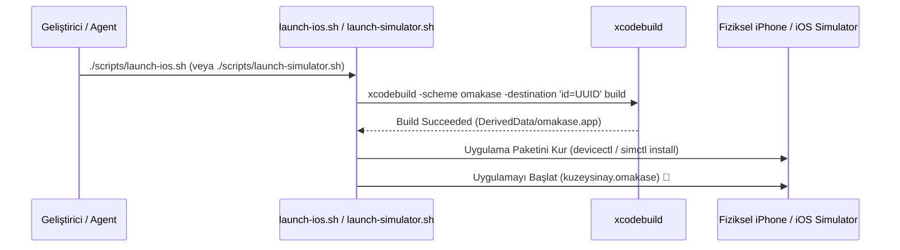

# 🔧 Omakase — Xcode, Derleme & Cihaz Konfigürasyon Raporu

> **Son Güncelleme:** 12 Kasım 2026  
> **Dayanak:** Apple Agent Kit — `skill.xcode.foundations` (`build-configurations`, `entitlements-capabilities`, `archive-process`, `export-options`)  
> **Kapsam:** Xcode proje yapılandırması, fiziksel iPhone ve iOS Simulator başlatma otomasyonu, `Info.plist` & ATS ayarları, Capabilities/Entitlements ve App Store Connect arşiv/dağıtım prosedürü.

---

## İçindekiler

1. [Geliştirici Otomasyonu: Fiziksel Cihaz & Simulator İş Akışı](#1-geliştirici-otomasyonu-fiziksel-cihaz--simulator-iş-akışı)
2. [`Info.plist` & ATS (App Transport Security) Yapılandırması](#2-infoplist--ats-app-transport-security-yapılandırması)
3. [Derleme Yapılandırmaları (`Debug` vs `Release`) ve Backend URL](#3-derleme-yapılandırmaları-debug-vs-release-ve-backend-url)
4. [Yetenekler (Capabilities), İkonlar ve Paket Bütünlüğü](#4-yetenekler-capabilities-ikonlar-ve-paket-bütünlüğü)
5. [App Store Arşivleme (`Archive`) ve Dağıtım (`Export`) Prosedürü](#5-app-store-arşivleme-archive-ve-dağıtım-export-prosedürü)

---

## 1. Geliştirici Otomasyonu: Fiziksel Cihaz & Simulator İş Akışı

Omakase'de kod değişikliklerini hem fiziksel iPhone üzerinde hem de iOS Simulator üzerinde tek komutla derleyip başlatan çift modlu otomasyon altyapısı kurulmuştur:

### Otomasyon Betikleri ve Kurallar
1. **[`scripts/launch-ios.sh`](file:///Users/kuzey/projects/omakase/scripts/launch-ios.sh) (Fiziksel iPhone — Sweetpad Eşdeğeri):**
   - Bağlı fiziksel iPhone'u (`ADFC2ADA-EA3F-51A7-9C82-E2554869B97D`) hedefler.
   - `xcodebuild` ile derler, `xcrun devicectl device install app` ile kurar ve `xcrun devicectl device process launch` ile `kuzeysinay.omakase` uygulamasını cihazda başlatır.
2. **[`scripts/launch-simulator.sh`](file:///Users/kuzey/projects/omakase/scripts/launch-simulator.sh) (iOS Simulator):**
   - `iPhone 17` simülatörünü (`45BCCBC2-5804-4E7A-BF2C-8E3FE4C47134`) otomatik başlatır (`xcrun simctl boot`), projeyi simülatör mimarisi için derler, kurar ve ekranda açar.
3. **[`GEMINI.md`](file:///Users/kuzey/projects/omakase/GEMINI.md) & [`.vscode/tasks.json`](file:///Users/kuzey/projects/omakase/.vscode/tasks.json):**
   - iOS kodunda yapılan her değişiklik sonrasında derleme doğrulamasını zorunlu kılar ve IDE içinden `Cmd + Shift + B` kısayoluyla tetiklenir.

---

## 2. `Info.plist` & ATS (App Transport Security) Yapılandırması

### Mevcut [`omakase/omakase/Info.plist`](file:///Users/kuzey/projects/omakase/omakase/omakase/Info.plist) İçeriği
1. **Google Sign-In URL Scheme:**
   - `CFBundleURLSchemes`: `com.googleusercontent.apps.20235796246-4c6te2tevmhe1nk6lfbjhbpqvr33shh9` (✅ Tanımlı).
2. **Canlı API Adresi (`OMAKASE_API_URL`):**
   - `https://omakase-backend-20235796246.us-central1.run.app` (✅ HTTPS Cloud Run servisine bağlı).
3. **ATS (`NSAppTransportSecurity`) İstisnaları (⚠️ Release Öncesi Temizlenmeli):**
   - Şu an `Info.plist` içinde `NSAllowsLocalNetworking = true` ile birlikte `172.20.10.14`, `127.0.0.1` ve `localhost` için `NSExceptionAllowsInsecureHTTPLoads = true` bulunmaktadır.
   - **Kural (`knowledge.app-store-review-guidelines.data-security` Rule 2):** Canlı sunucu HTTPS kullandığından, App Store arşivinden önce özellikle yerel geliştirme IP'si olan `172.20.10.14` istisnası `Info.plist` dosyasından kaldırılmalıdır.

---

## 3. Derleme Yapılandırmaları (`Debug` vs `Release`) ve Backend URL

* **Dayanak:** [`knowledge.xcode.build-configurations`](file:///Users/kuzey/projects/omakase/.agents/knowledge/xcode/build-configurations.md) (Rule 1–3)
* `Debug` ve `Release` arasında farklı olması gereken değerler Xcode Target Build Settings altında **"Any Configuration"** satırına değil, doğrudan ilgili konfigürasyon sütununa (`Debug` veya `Release`) tanımlanmalıdır (Rule 1).
* `#if DEBUG` koşullu derleme blokları yalnızca `SWIFT_ACTIVE_COMPILATION_CONDITIONS` içinde `DEBUG` tanımlı olduğunda çalışır (Rule 2).

| Ortam | `OMAKASE_API_URL` Değeri | Kullanım Amacı |
|-------|--------------------------|----------------|
| **Canlı (Cloud Run — Varsayılan)** | `https://omakase-backend-20235796246.us-central1.run.app` | Fiziksel cihaz, Simulator, TestFlight ve App Store Release |
| **Lokal (Localhost — Geliştirme)** | `http://127.0.0.1:8000` | Yalnızca lokal FastAPI (`uvicorn`) testi yapılırken |

---

## 4. Yetenekler (Capabilities), İkonlar ve Paket Bütünlüğü

* **Dayanak:** [`knowledge.xcode.entitlements-capabilities`](file:///Users/kuzey/projects/omakase/.agents/knowledge/xcode/entitlements-capabilities.md)
* **AppIcon (`Assets.xcassets/AppIcon.appiconset`):**
  - [`Contents.json`](file:///Users/kuzey/projects/omakase/omakase/omakase/Assets.xcassets/AppIcon.appiconset/Contents.json) içinde 1024×1024 boyutundaki `omakase.png` hem standart, hem `dark`, hem de `tinted` görünümler için tanımlanmıştır (✅ Hazır).
* **Sign in with Apple Capability:**
  - Kural 4.8 uyumluluğu için `Sign in with Apple` eklendiğinde, yetenek mutlaka Xcode'un **Signing & Capabilities → + Capability** menüsünden eklenmelidir (`entitlements-capabilities` Rule 1). Elle `.entitlements` dosyası düzenlemek Apple Developer Portal üzerindeki App ID ve Provisioning Profile kaydını güncellemez.
* **iOS 17.0 Hedef Uyumluluğu:**
  - `DEPLOYMENT_TARGET` = **iOS 17.0** olarak yapılandırılmıştır. SF Symbols animasyonlarında iOS 17+ tam uyumlu `.symbolEffect(.pulse, isActive: true)` kullanılmaktadır.

---

## 5. App Store Arşivleme (`Archive`) ve Dağıtım (`Export`) Prosedürü

* **Dayanak:** [`knowledge.xcode.archive-process`](file:///Users/kuzey/projects/omakase/.agents/knowledge/xcode/archive-process.md) & [`knowledge.xcode.export-options`](file:///Users/kuzey/projects/omakase/.agents/knowledge/xcode/export-options.md)

App Store Connect veya TestFlight'a paket gönderirken uyulması gereken zorunlu sıra:

1. **Hedef Cihaz Seçimi (`archive-process` Rule 1):**
   - Xcode üst çubuğunda hedef olarak bir Simulator değil, **"Any iOS Device (arm64)"** veya bağlı fiziksel iPhone seçilmelidir (Simulator seçiliyken `Product → Archive` menüsü devre dışıdır).
2. **Release Konfigürasyonu Kontrolü (`archive-process` Rule 4):**
   - `Edit Scheme → Archive` altında Build Configuration değerinin **Release** olduğu doğrulanmalıdır.
3. **Gizlilik Raporu Kontrolü (`manifest-file-structure-and-scope` Rule 5):**
   - `Product → Archive` tamamlandıktan sonra açılan Organizer penceresinde arşive sağ tıklayıp **Generate Privacy Report** seçilerek uygulama ve Firebase/GoogleSignIn SDK gizlilik bildirimlerinin birleştiği teyit edilmelidir.
4. **Yerel Doğrulama (`archive-process` Rule 2):**
   - **"Distribute App"** butonuna basmadan önce mutlaka **"Validate App"** çalıştırılmalı ve ikon, `Info.plist`, `PrivacyInfo.xcprivacy` ve imzalama kontrollerinin hatasız geçtiği görülmelidir.
5. **Dağıtım ve Otomatik İmzalama (`export-options` Rule 1 & Rule 2):**
   - **Distribute App → App Store Connect** seçilmeli ve proje Automatic Signing kullandığı için dışa aktarım sırasında da **Automatic Signing** tercih edilmelidir.
6. **Arşivin ve `dSYMs` Sembollerinin Saklanması (`archive-process` Rule 3):**
   - Yükleme başarılı olduktan sonra Organizer içindeki `.xcarchive` **kesinlikle silinmemelidir**; üretim ortamındaki çökme raporlarını (crash logs) sembolize etmek için gereken `dSYMs` dosyaları yalnızca bu arşiv içinde yer alır.
